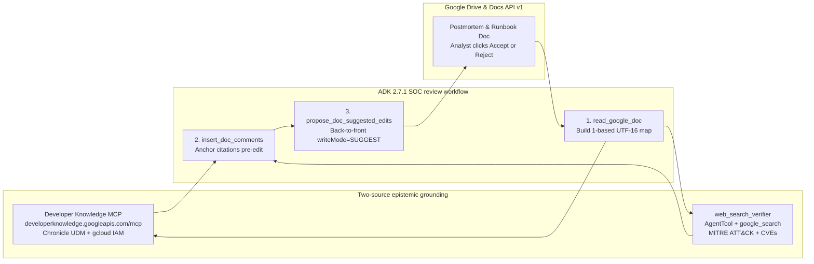

# Red-lining SOC runbooks and postmortems in Google Docs with grounded ADK agents

In the first two posts of this series, [Exploring Agent Graphs for SecOps AI Runbooks](https://security.googlecloudcommunity.com/community-blog-42/exploring-agent-graphs-for-secops-ai-runbooks-8113) and [Evaluating Agent Graphs for SecOps AI Runbooks](https://security.googlecloudcommunity.com/community-blog-42/evaluating-agent-graphs-for-secops-ai-runbooks-8232), we moved our SOC triage agents off open-ended ReAct loops and onto explicit control-flow graphs with dynamic skill loading. That cut token burn and raised automated report grades from a C average to an A-/A range across realistic incident scenarios.

Then we ran into the postmortem graveyard.

Every security operations center has one. At 3 a.m., after containing a compromised cloud service account or an encoded PowerShell intrusion, the incident commander writes up a postmortem in Google Docs. The postmortem lists three concrete gaps in the team's runbooks. Maybe a containment step broke production workload identity, or a Google SecOps UDM hunting query failed to match child processes. Everyone agrees on the bridge that the runbook needs to be updated.

It almost never is. Our 63 operational runbooks lived as Markdown files inside a Git repository, and tired incident responders do not open Git pull requests after an all-night bridge. On the `drive-mcp-runbooks` branch, we solved the storage half of that disconnect by wiring our agents to the [Google Drive remote MCP server](https://developers.google.com/workspace/drive/api/guides/configure-mcp-server) at `https://drivemcp.googleapis.com/mcp/v1`. Runbooks now live in a shared `SOC Runbooks` Drive folder where analysts actually work, and `write_report` publishes incident reports directly into `SOC Reports`.

That raised a harder security engineering problem. Once incident reports and runbooks live in Google Workspace, how do we let an AI agent audit a postmortem or propose updates to a production runbook without creating a new operational hazard?

Building on Romin Irani's recent two-part reference architecture, [Building an AI Document Reviewer with Google ADK, Gemini, and the New Google Docs Comments](https://medium.com/google-cloud/building-an-ai-document-reviewer-with-google-adk-gemini-and-the-new-google-docs-comments-1f79fb6cb86f) and [Grounding Google Docs Suggested Edits with Developer Knowledge MCP and Google Search](https://medium.com/google-cloud/grounding-google-docs-suggested-edits-with-developer-knowledge-mcp-and-google-search-9e2a3bf2800e), we extended `adk_runbooks` so our incident response and report writer agents can verify technical claims against official cloud documentation and stage non-destructive red-lines inside Google Docs.

---

## Four mistakes that happen in 3 a.m. incident docs

If you ask an ungrounded LLM to rewrite an incident postmortem or a SOC runbook in place, you trade human fatigue for machine hallucination. In security operations, four specific errors show up constantly in draft postmortems and AI-generated playbooks:

1. **Destructive containment commands.** Under pressure to cut off an attacker using a compromised GCP service account, a responder writes `gcloud iam service-accounts delete sa-prod-etl@...` into the containment section. Deleting a service account destroys its unique numeric resource ID. Even if you recreate a service account with the same email address 20 minutes later, its underlying unique ID changes, silently breaking IAM policy bindings and Workload Identity Federation pools across production. The reversible triage command is `gcloud iam service-accounts disable`.
2. **Hallucinated Chronicle UDM field paths.** Both tired analysts and ungrounded LLMs routinely write UDM queries like `process.command_line = /.*-enc.*/` without the required entity prefix. In Google SecOps, unprefixed `process.command_line` is not a valid UDM field; the query compiler requires `target.process.command_line` or `principal.process.command_line`. Putting an unverified query into a runbook guarantees the next responder gets zero hits during an active hunt.
3. **Live clickable C2 links in shared reports.** When analysts paste active phishing or stage-2 payload URLs like `https://login-micros0ft-update.com/stage2.ps1` into a Google Doc, Workspace automatically turns them into clickable hyperlinks. As soon as that postmortem is shared with executives, legal counsel, or IT administrators, a live C2 beacon sits one accidental click away. Indicators in shared docs must be defanged to `hxxps://` and `[.]`.
4. **Mislabeled MITRE ATT&CK sub-techniques.** Draft reports frequently tag an encoded `powershell.exe -enc` cradle as `T1059.003` for Windows Command Shell instead of `T1059.001` for PowerShell, skewing detection coverage heatmaps.

---

## Changing the trust contract between agents and responders

Most document-editing agents handle these mistakes in one of two broken ways. Either the agent overwrites the file in place, which no SOC lead will ever allow on a production runbook, or it dumps a wall of critique into a chat window, forcing the human to hunt through a 15-page report and copy-paste fixes by hand.

Google Docs API v1 recently added two features that let an agent act like a senior peer reviewer red-lining a draft:

- **Native anchored comments via `insertComment`.** Earlier workarounds had to call the Google Drive API v3 `comments.create` endpoint, which attaches comments at the file level without reliable character-range anchoring inside the document body. Docs API v1 `batchUpdate` now accepts an `insertComment` request with an explicit `startIndex` and `endIndex`, binding the comment highlight to the exact command or UDM field under review.
- **Suggested edits via `writeControl.writeMode = "SUGGEST"`.** When a `batchUpdate` request includes `"writeControl": {"writeMode": "SUGGEST"}`, standard `deleteContentRange` and `insertText` operations do not overwrite the document. Google Docs records them as green insertion spans and pink strikethrough deletion spans with native Accept and Reject buttons in the margin.



This also solves a governance problem we hit in our earlier evolutionary runbook optimization work. When an automated evaluator discovers that a runbook needs a pre-flight check for RFC-5737 documentation subnets or internal vulnerability scanners to prevent a $50,000 false-positive host isolation, you still need a human gate before mutating the production playbook. Staging that mutation as a Google Docs Suggested Edit with an anchored comment citing the incident postmortem gives the detection lead a one-click approval workflow.

---

## Five engineering problems under the hood

Wiring an ADK agent to Google Docs and two grounding sources surfaced five concrete engineering problems across security boundaries, Unicode indexing, and the ADK 2.7.1 runtime.

### 1. Dual-identity OAuth to prevent confused-deputy exfiltration of breach docs

In a security operations center, the `SOC Reports` folder holds some of the most sensitive documents in the company, including active breach timelines, unredacted command-line arguments, and legally privileged findings.

A naive architecture grants a single backend service account read and write access to every incident Google Doc. That creates a classic confused-deputy vulnerability. SOC agents routinely ingest untrusted attacker-controlled strings from SIEM telemetry, such as crafted `principal.process.command_line` values, HTTP user agents, and phishing email bodies. If an indirect prompt injection inside a log event tricks the agent into reading another incident document and copying its contents into the current case comment, a backend service account with broad Drive permissions gives the attacker access to every breach report in the organization.

To close that blast radius, `resolve_docs_token` in `multi-agent/manager/tools/docs_review_tools.py` implements a dual-identity model:

- **Backend service account ADC for model and public docs.** Vertex AI model calls using `roles/aiplatform.user` and queries to the public Developer Knowledge MCP server use the backend environment credentials, which hold zero permissions on confidential Google Docs when deployed in multi-user mode.
- **Per-user OAuth token for Google Docs operations.** When an analyst runs a review session, their short-lived OAuth 2.0 access token is placed in `tool_context.state["user_access_token"]`. Every `read_google_doc`, `insert_doc_comments`, and `propose_doc_suggested_edits` call authenticates with that user token first, falling back to local ADC only for single-operator CLI testing.

Because Google Docs enforces ACLs against the analyst's own identity, the agent cannot open a single postmortem the logged-in responder is not authorized to read. Every suggested edit and comment in the Google Docs audit trail is also attributed to the human session that triggered it.

### 2. Two-source epistemic grounding and the Gemini tool-mixing constraint

An agent that checks a `gcloud` command or a Chronicle UDM field using only its training weights will hallucinate flags or revert new syntax back to pre-cutoff patterns. Conversely, relying only on public web search often surfaces outdated blog posts or forum threads over canonical documentation.

We route verification across two grounding tools based on domain:

- **Google Developer Knowledge Remote MCP Server.** Hosted at `https://developerknowledge.googleapis.com/mcp`, this managed Streamable HTTP MCP server exposes `search_documents`, `get_documents`, and `answer_query` over Google's official documentation corpus. That corpus includes both the Google Cloud IAM documentation under `docs.cloud.google.com/iam/docs` and the Google SecOps Chronicle UDM reference at `docs.cloud.google.com/chronicle/docs/reference/udm-field-list`.
- **Google Search Grounding for external security standards.** For MITRE ATT&CK technique definitions, NVD CVE advisories, CISA KEV dates, and AWS or Okta CLI syntax, the agent routes queries to Google Search.

Here we hit a hard constraint in the Gemini API. Built-in `google_search` is a model-internal grounding tool that cannot be combined in the same `tools=[...]` list alongside custom `FunctionTool` declarations or `McpToolset` instances on a single `Agent`. Passing both causes the API to reject the request.

We bypass that constraint in `multi-agent/manager/tools/grounding_tools.py` by isolating `google_search` inside a child `Agent` wrapped in ADK's `AgentTool`:

```python
from google.adk.agents import Agent
from google.adk.tools import google_search
from google.adk.tools.agent_tool import AgentTool

web_search_verifier_agent = Agent(
    name="web_search_verifier",
    model="gemini-2.5-flash",
    instruction="Verify non-Google technical claims using Google Search and return URLs.",
    tools=[google_search],
)

web_search_tool = AgentTool(agent=web_search_verifier_agent)
```

To the parent SOC orchestrator, `web_search_verifier` looks like a standard function tool accepting `{"request": "..."}`. Calling it executes an isolated child model call where `google_search` runs on its own.

### 3. Translating LLM quotes into 1-based UTF-16 Google Docs indices

LLMs cannot reliably count character offsets across a long postmortem. Asking a model to output raw integer indices guarantees off-by-one corruption that slices words in half. Instead, our tools require the LLM to pass exact quoted substrings like `{"quote": "process.command_line", "replacement": "target.process.command_line"}`, while deterministic Python code resolves those quotes into Google Docs API v1 coordinates.

Even in Python, mapping `str.find(quote)` directly to Google Docs indices fails whenever a postmortem includes a MITRE ATT&CK table or a non-BMP Unicode character:

- **Google Docs indices are 1-based UTF-16 code units.** Python 3 strings index by Unicode code points. Any character outside the Basic Multilingual Plane takes 1 index in a Python `str`, but 2 UTF-16 code units in Google Docs.
- **Tables nest structural elements.** Text inside a Google Doc table does not sit under top-level `paragraph` elements; it sits inside `table.tableRows[].tableCells[].content[].paragraph`.

In `multi-agent/manager/tools/docs_review_tools.py`, `_extract_text_and_index_map` walks `tabs[0].documentTab.body.content` recursively across paragraphs and table cells, stepping the Google Docs index by `len(ch.encode("utf-16-le")) // 2` for every character:

```python
def _utf16_code_units(ch: str) -> int:
    return len(ch.encode("utf-16-le")) // 2
```

When `read_google_doc` runs, it caches both the plain text and the `list[int]` mapping each Python character position to its 1-based UTF-16 Google Docs `startIndex`. For a match spanning `pos` through `last_pos = pos + len(quote) - 1`, its exact Docs range is:

```python
start_idx = index_map[pos]
end_idx = index_map[last_pos] + _utf16_code_units(plain_text[last_pos])
```

### 4. Comments before edits, and back-to-front batching

Once you have exact UTF-16 ranges from `read_google_doc`, two ordering bugs will still corrupt your `batchUpdate` calls if you are not careful.

**First, comments must be inserted before suggested edits.** It is easy to assume that because `propose_doc_suggested_edits` uses `"writeMode": "SUGGEST"`, the document's character indices stay frozen until a human clicks Accept. That is false. A suggested replacement inserts the new text into the document body immediately with `suggestedInsertionIds` alongside the old text marked with `suggestedDeletionIds`. The moment a suggested edit is applied, every character offset after that point shifts, invalidating the cached `doc_index_map`. Running `insert_doc_comments` first and `propose_doc_suggested_edits` second ensures both operations use the pre-edit index map from `read_google_doc`.

**Second, suggested replacements must be sorted back-to-front.** In our `INC-2026-1011` smoke test, a single `propose_doc_suggested_edits` call applies four length-changing edits across the document:

1. Replacing the 33-character string `"T1059.003 (Windows Command Shell)"` with the 22-character string `"T1059.001 (PowerShell)"`, shrinking the text by 11 characters.
2. Replacing the 45-character URL `"https://login-micros0ft-update.com/stage2.ps1"` with the 47-character defanged URL `"hxxps://login-micros0ft-update[.]com/stage2.ps1"`, growing the text by 2 characters.
3. Replacing the 20-character field `"process.command_line"` with the 27-character field `"target.process.command_line"`, growing the text by 7 characters.
4. Replacing the 34-character command `"gcloud iam service-accounts delete"` with the 35-character command `"gcloud iam service-accounts disable"`, growing the text by 1 character.

Because `batchUpdate` executes requests sequentially inside the array, applying those edits from top to bottom would shift every subsequent target range off its intended words. Sorting validated, non-overlapping edits in descending order by `startIndex` eliminates index drift completely:

```python
resolved_edits.sort(key=lambda item: item[0], reverse=True)

requests_list = []
for start_idx, end_idx, replacement in resolved_edits:
    requests_list.append(
        {"deleteContentRange": {"range": {"startIndex": start_idx, "endIndex": end_idx}}}
    )
    if replacement:
        requests_list.append(
            {"insertText": {"location": {"index": start_idx}, "text": replacement}}
        )
```

Because every edit in the batch mutates text strictly closer to the end of the document than the edits that follow it, earlier `startIndex` values never move.

### 5. An ADK 2.7.1 `McpToolset` bug with `header_provider` and session pooling

Connecting ADK's `McpToolset` to authenticated remote MCP servers like `drivemcp.googleapis.com` and `developerknowledge.googleapis.com` surfaced a bug in `google-adk==2.7.1` worth noting for anyone building with remote MCP servers.

Many ADK examples pass `header_provider` to `McpToolset` to inject per-request headers. We hit two failures with `header_provider` in ADK 2.7.1:

1. **Startup discovery skips `header_provider`.** When a server boots or builds an A2A Agent Card, ADK calls `McpToolset.get_tools(readonly_context=None)`. When `readonly_context` is `None`, `McpToolset.get_tools` skips `header_provider` entirely, sending an unauthenticated `tools/list` request.
2. **Direct tool execution with `tool_context=None` crashes.** In `google/adk/tools/mcp_tool/mcp_tool.py` at line 434, `McpTool._run_async_impl` checks `if self._header_provider:` and unconditionally evaluates `ReadonlyContext(tool_context._invocation_context)` without checking whether `tool_context` is `None`. Calling `mcp_tool.run_async(args=..., tool_context=None)` in a test or CLI script immediately raises `AttributeError: 'NoneType' object has no attribute '_invocation_context'`.

In addition, ADK's `MCPSessionManager` pools sessions keyed by a hash of the static `StreamableHTTPConnectionParams.headers` dictionary. Putting a rotating OAuth bearer token into static headers changes the hash on every token refresh and leaks sessions.

Our implementation in `multi-agent/manager/tools/grounding_tools.py` and `drive_tools.py` avoids `header_provider` completely. When authenticating with Application Default Credentials using an OAuth bearer token and `X-Goog-User-Project`, we leave `StreamableHTTPConnectionParams.headers` empty and pass a custom `httpx_client_factory` backed by `_BearerAndProjectAuth`. Because `httpx.Auth.auth_flow` signs each outgoing HTTP request at the transport layer, ADK sees stable connection parameters for session pooling, startup `get_tools(readonly_context=None)` is authenticated, and `run_async(args=..., tool_context=None)` never triggers the `NoneType` crash in `mcp_tool.py`.

---

## Live verification on an `INC-2026-1011` postmortem and runbook

We ran `scripts/grounded_docs_smoke_test.py` against our `dandye-0324-chronicle` Argolis environment to test the full SecOps red-lining workflow end to end:

```bash
WORKTREE_DIR="/usr/local/google/home/dandye/Projects/adk_runbooks__worktrees/drive-mcp-runbooks__grounded-docs"
ACCOUNT="admin@dandye.altostrat.com"
PROJECT_ID="dandye-0324-chronicle"

direnv exec "$WORKTREE_DIR" gcloud auth login "$ACCOUNT" --enable-gdrive-access --update-adc
direnv exec "$WORKTREE_DIR" "$WORKTREE_DIR/.venv/bin/python" "$WORKTREE_DIR/scripts/grounded_docs_smoke_test.py" --create-review-doc
```

Here is what happened on the wire during the live run:

1. **Developer Knowledge MCP resolved canonical IAM and Chronicle UDM docs via ADC.** Using standard Application Default Credentials without an API key, `search_documents` resolved `https://docs.cloud.google.com/iam/docs/service-accounts-disable-enable` for the service account containment check and `https://docs.cloud.google.com/chronicle/docs/reference/udm-field-list` for the UDM field check.
2. **Created and indexed the postmortem Google Doc.** `create_google_doc` created [`INC_2026_1011_Postmortem_and_Runbook_Redline`](https://docs.google.com/document/d/18lUrLtd42tlxAh3SDuHBZHDdYi0JEORGjiaIfAYTlZI/edit) with document ID `18lUrLtd42tlxAh3SDuHBZHDdYi0JEORGjiaIfAYTlZI` in `SOC Reports`, and `read_google_doc` mapped all 813 UTF-16 character positions.
3. **Anchored four grounded SOC comments to exact Kix spans.** Inspecting `GET /drive/v3/files/18lUrLtd42tlxAh3SDuHBZHDdYi0JEORGjiaIfAYTlZI/comments` confirmed that all four review comments bound to native Kix anchors over the exact offending phrases:
   ```json
   [
     {
       "id": "AAACIbZVxNU",
       "anchor": "kix.jsub1u90xbjs",
       "quotedFileContent": { "value": "gcloud iam service-accounts delete" },
       "content": "High blast-radius containment warning: deleting a production service account destroys its unique resource ID and breaks Workload Identity bindings. Use reversible 'gcloud iam service-accounts disable' during triage (https://docs.cloud.google.com/iam/docs/service-accounts-disable-enable)."
     },
     {
       "id": "AAACIbZVxNQ",
       "anchor": "kix.plvnk95sibns",
       "quotedFileContent": { "value": "process.command_line" },
       "content": "Invalid Chronicle UDM field path: UDM requires an entity prefix such as target.process.command_line or principal.process.command_line (https://docs.cloud.google.com/chronicle/docs/reference/udm-field-list)."
     },
     {
       "id": "AAACIbZVxNM",
       "anchor": "kix.4yir6x8defx",
       "quotedFileContent": { "value": "https://login-micros0ft-update.com/stage2.ps1" },
       "content": "Live C2 URL auto-linkifies in Google Docs and creates a click hazard for bridge reviewers. Defang indicator to hxxps:// and [.] before sharing."
     },
     {
       "id": "AAACIbZVxNI",
       "anchor": "kix.9t5839q3lmou",
       "quotedFileContent": { "value": "T1059.003 (Windows Command Shell)" },
       "content": "MITRE ATT&CK mismatch: powershell.exe -enc payloads map to T1059.001 (PowerShell), not T1059.003 (cmd.exe) (https://attack.mitre.org/techniques/T1059/001/)."
     }
   ]
   ```
4. **Applied all four back-to-front `writeMode="SUGGEST"` edits without character drift.** Inspecting `GET /v1/documents/18lUrLtd42tlxAh3SDuHBZHDdYi0JEORGjiaIfAYTlZI?includeTabsContent=true` confirmed that each deletion span paired cleanly with its insertion span across all four locations:
   - `suggest.5zryddz0zyff` replaces `"T1059.003 (Windows Command Shell)"` with `"T1059.001 (PowerShell)"`.
   - `suggest.pvuzeec7wbe` defangs `"https://login-micros0ft-update.com/stage2.ps1"` to `"hxxps://login-micros0ft-update[.]com/stage2.ps1"`.
   - `suggest.du136hpq9scc` corrects `"process.command_line"` to `"target.process.command_line"`.
   - `suggest.m31glb161cw6` changes `"gcloud iam service-accounts delete"` to `"gcloud iam service-accounts disable"`.

---

## Working real SOAR cases from our Argolis tenant

Synthetic postmortems are a clean starting point, but real SOAR queues are messier. When we pointed the workflow at live cases in our Argolis Chronicle SOAR instance `ltstrtn.siemplify-soar.com` backed by Chronicle SIEM project `dandye-0324-chronicle` via `scripts/experiment_argolis_soar_cases.py`, two real-world engineering challenges surfaced immediately.

### Fixing `direnv` credential stripping across stdio MCP servers

When an ADK runner spawns `secops-mcp` or `secops-soar` via `StdioConnectionParams` without an explicit `env` dictionary, the Python MCP SDK calls `get_default_environment()`, which copies only a handful of system variables such as `HOME`, `PATH`, and `USER` while stripping `GOOGLE_APPLICATION_CREDENTIALS` and `CLOUDSDK_CONFIG`. On a `direnv`-isolated multi-tenant workstation where each worktree holds its own `.gcloud/` config and ADC JSON, child `uv run` servers fell back to `~/.config/gcloud` and failed with 401 and 403 errors against `us-chronicle.googleapis.com`. Passing `env=dict(os.environ)` in `StdioServerParameters` inside `multi-agent/manager/tools/tools.py` preserved the per-worktree credential isolation across all child MCP processes.

### Working around LLM safety filter blocks on known-malicious telemetry

When we pulled raw endpoint process telemetry from Chronicle SOAR Cases `33269` and `33288`, the `principal.process.command_line` fields contained a 1.4 KB raw Base64 PowerShell Empire stager alongside a `rundll32.exe comsvcs.dll, MiniDump` command targeting `lsass.dmp`. Asking an LLM to quote or rewrite lines containing verbatim offensive stagers triggers model output safety filters and blocks the response mid-turn.

We solved this in [`docs_review_tools.py`](file:///usr/local/google/home/dandye/Projects/adk_runbooks__worktrees/drive-mcp-runbooks__grounded-docs/multi-agent/manager/tools/docs_review_tools.py) with a two-part architecture that separates deterministic payload handling from semantic grounding:

1. **Tool-boundary telemetry sanitization via `sanitize_telemetry_text`.** Before raw SIEM or SOAR process strings enter the LLM context or get written to a Google Doc, `sanitize_telemetry_text()` replaces raw `-EncodedCommand` and `-Enc` Base64 blobs and `comsvcs.dll, MiniDump` arguments with deterministic forensic tokens that preserve payload length and a 12-character SHA-256 fingerprint:
   ```text
   powershell.exe -nop -w hidden -enc <REDACTED_B64:len=56,sha256=e035de8b80be>
   rundll32.exe C:\Windows\System32\comsvcs.dll, <REDACTED_DUMP_ARGS:sha256=1e6f45e16c7f>
   ```
   The analyst still gets a deterministic hash to pivot on in Chronicle SIEM, and the model never ingests or echoes raw exploit payloads. One subtle edge case surfaced when we ran the standalone Base64 regex `[A-Za-z0-9+/]{64,}={0,2}` against Windows process telemetry in Cases `33280` and `33285`. Because a 64-character hexadecimal SHA-256 hash `[0-9a-f]{64}` is a valid subset of the Base64 alphabet, a naive standalone Base64 matcher will redact `target.process.file.sha256` values. Adding `if re.fullmatch(r"[0-9a-fA-F]+", blob): return blob` preserved all four 64-character SHA-256 process hashes intact while redacting genuine Base64 payloads.
2. **Span-based addressing via `start_index` and `end_index` with `find_deterministic_indicator_spans`.** We extended `insert_doc_comments` and `propose_doc_suggested_edits` to accept explicit 1-based UTF-16 `start_index` and `end_index` spans in addition to `quote`, and wrapped the full pipeline in `review_google_doc_with_stage_a()`. Stage A runs `find_deterministic_indicator_spans(plain_text, index_map)` in pure Python to locate live untrusted URLs while skipping trusted documentation domains like `docs.cloud.google.com` and `attack.mitre.org`, staging their defanging to `hxxps://` and `[.]` by numeric index without asking the LLM to repeat the malicious URL. Stage B uses the LLM and Developer Knowledge MCP strictly for safe technical claims such as MITRE ATT&CK technique IDs, Chronicle UDM schema fields, and `gcloud` containment syntax.

### Six live Argolis SOAR case studies and three staged Drive runbook red-lines

Running `scripts/experiment_argolis_soar_cases.py` and `scripts/overnight_argolis_soar_suite.py` executed the full pipeline across nine real cases grouped into six incident reports and three direct Drive runbook red-line drafts from `ltstrtn.siemplify-soar.com`:

| Argolis SOAR Case | Correlated SIEM Telemetry | Drive Runbook Loaded | Generated Google Doc | Grounded Red-Lines Applied |
| :--- | :--- | :--- | :--- | :--- |
| **Case `33278`** (`gcp_admin_privileged_roles_added_to_service_accounts`, alerts `488690` and `488689`, SOAR comment `52`) | 5 `GCP_CLOUDAUDIT` UDM events from `104.198.226.161` showing `SetIamPolicy` granting `roles/editor` on `serviceAccount:hello@base-production.iam.gserviceaccount.com`, `cloudsql.instances.delete` on `projects/base-analytics/instances/prod-customers`, and 3 rogue VMs `production-do-not-delete1..3` | `compromised-user-account-response`, 15,481 chars | [`SOAR_Case_33278_GCP_Service_Account_Privilege_Escalation`](https://docs.google.com/document/d/1wH5XBHqH1g_nqAIZ04ebKqiBu0CU_umuSXpl7kIBwQA/edit), ID `1wH5XBHqH1g_nqAIZ04ebKqiBu0CU_umuSXpl7kIBwQA`, 2,260 UTF-16 chars | 1. `T1078.004 (Cloud Accounts)` to `T1098.003 (Account Manipulation: Additional Cloud Roles)`<br>2. `resource.name` to `target.resource.name` via Developer Knowledge MCP<br>3. `gcloud iam service-accounts delete` to `gcloud iam service-accounts disable` via Developer Knowledge MCP |
| **Cases `33287` & `33281`** (`google_workspace_ownership_transferred_on_google_drive` and `new_trusted_domain_added`, SOAR comment `53`) | Overturned 4 prior SOAR analyst comments concluding "legitimate automated process" by correlating 15 `WORKSPACE_ACTIVITY` UDM events from `79.154.246.114` showing SAML2 IdP deletion, rogue OAuth client `955611971872-...` granted `https://mail.google.com/`, and `CHANGE_TWO_STEP_VERIFICATION_ENROLLMENT` setting `ENFORCE_STRONG_AUTHENTICATION=false` on the `Finance` OU 65 seconds before the Drive transfer | `suspicious-login-triage`, 13,508 chars | [`SOAR_Case_33287_33281_Workspace_Admin_Takeover_Review`](https://docs.google.com/document/d/1tDrz_tM2qwlP2weizVGRSEvikDPaLxp-MIylOL49kns/edit), ID `1tDrz_tM2qwlP2weizVGRSEvikDPaLxp-MIylOL49kns`, 2,171 UTF-16 chars | 1. Corrected Case `33287` disposition from `"Benign Automated Process"` to `"Confirmed True Positive"`<br>2. `user.email_addresses` to `security_result.about.email`<br>3. `gam user admin@mydomain.com delete` to `gam user admin@mydomain.com suspend` |
| **Case `33288`** (`Argolis Admin Live Manual Case`, 3 alerts across Phishing, LSASS, and PowerShell, SOAR comment `54`) | Sanitized 3-stage intrusion chain with `<REDACTED_DUMP_ARGS:sha256=1e6f45e16c7f>` and `<REDACTED_B64:len=56,sha256=e035de8b80be>` | `phishing-response`, 20,517 chars | [`SOAR_Case_33288_Sanitized_3Stage_Intrusion_Review`](https://docs.google.com/document/d/14kr7gtw5AJd4a53vCrQ4bIQdyW-t_v48LTtzWMhSg58/edit), ID `14kr7gtw5AJd4a53vCrQ4bIQdyW-t_v48LTtzWMhSg58`, 1,370 UTF-16 chars | 1. Stage A span-based URL defanging at `start_index=526, end_index=570` without echoing the URL through the LLM<br>2. `T1059.003 (Windows Command Shell)` to `T1059.001 (PowerShell)`<br>3. `process.command_line` to `target.process.command_line` |
| **Case `33269`** (`Powershell Empire Launch Parameters`, alert `488681`, SOAR comment `55`) | Sanitized the 1.4 KB raw Base64 PowerShell Empire stager at the tool boundary to `<REDACTED_B64:len=1436,sha256=...>` so the LLM never ingests or echoes weaponized stager bytes | `malware-incident-response`, 20,500 chars | [`SOAR_Case_33269_Sanitized_PowerShell_Empire_Review`](https://docs.google.com/document/d/1GqWNhFtidZ8zU9_YduUApvUw2ecTP4Wb-3rS0Gfe8eo/edit), ID `1GqWNhFtidZ8zU9_YduUApvUw2ecTP4Wb-3rS0Gfe8eo`, 1,883 UTF-16 chars | 1. Stage A span-based C2 URL defanging<br>2. `T1059.003` to `T1059.001`<br>3. `process.command_line` to `target.process.command_line`<br>4. `Remove-ADComputer` to `Disable-ADAccount` |
| **Cases `33280` & `33285`** (`wins-d19` LOLBin and Gamarue campaign, 40 total alerts, SOAR comment `56`) | Correlated 6-second execution burst on `wins-d19` for user `lisawalker` across `cmd.exe`, `powershell.exe`, `rundll32.exe`, and `cmstp.exe` while preserving 4 intact 64-character SHA-256 hashes | `malware-incident-response`, 20,500 chars | [`SOAR_Cases_33280_33285_LOLBin_Gamarue_Campaign_Review`](https://docs.google.com/document/d/1iwHmCCXu1QUNTCEnPbpVbBDxvfY7lYvROCQJEDrSECs/edit), ID `1iwHmCCXu1QUNTCEnPbpVbBDxvfY7lYvROCQJEDrSECs`, 2,236 UTF-16 chars | 1. Stage A span-based dropper URL defanging<br>2. `T1218.011 (Rundll32)` to `T1218.003 (CMSTP)`<br>3. `file.sha256` to `target.process.file.sha256` |
| **Cases `33283`, `33284` & `33282`** (Workspace Drive Exfiltration, Okta Spray, and SSH Brute Force, SOAR comment `57`) | Linked Case `33283` external Drive sharing to `alina.levine@gmail.com` and anonymous encryption key access 5 seconds after Case `33287` | `suspicious-login-triage`, 13,508 chars | [`SOAR_Cases_33283_33284_33282_Identity_and_Exfiltration_Review`](https://docs.google.com/document/d/1aNUuk3Q8gyOOK9ezw1eX57mq4ibHZb4CuWSlMsgbJJY/edit), ID `1aNUuk3Q8gyOOK9ezw1eX57mq4ibHZb4CuWSlMsgbJJY`, 1,922 UTF-16 chars | 1. Stage A span-based drop URL defanging<br>2. `T1048.003` to `T1567.002 (Exfiltration to Cloud Storage)`<br>3. `T1110.001` to `T1110.003 (Password Spraying)`<br>4. `ip` to `principal.ip` |

To close the loop directly on the playbooks in `SOC Runbooks`, `stage_runbook_update_as_google_doc()` loaded each Markdown runbook from Google Drive, appended the sanitized post-incident lessons learned, and staged non-destructive `writeMode="SUGGEST"` edits directly onto three collaborative runbook drafts before `post_reviewed_doc_to_soar_case()` posted both links back to the originating SOAR case timelines:

1. [`Runbook_Redline_compromised-user-account-response_Case_33278`](https://docs.google.com/document/d/1Pl_YLBmtyfFkT_R3xvQVugEb32KNyPfmbUQ-uiSex8o/edit), ID `1Pl_YLBmtyfFkT_R3xvQVugEb32KNyPfmbUQ-uiSex8o`, 14,360 UTF-16 chars, 3 anchored comments, 3 Suggested Edits, linked in SOAR Case `33278` comment `52`.
2. [`Runbook_Redline_suspicious-login-triage_Case_33287_33281_33283`](https://docs.google.com/document/d/1zY3mV2wHOUzIigZffYenXR7EexWvZCf1kgZlKbfWx6w/edit), ID `1zY3mV2wHOUzIigZffYenXR7EexWvZCf1kgZlKbfWx6w`, 13,135 UTF-16 chars, 3 anchored comments, 2 Suggested Edits, linked in SOAR Cases `33287` and `33283` comments `53` and `57`.
3. [`Runbook_Redline_malware-incident-response_Case_33269_33280_33285`](https://docs.google.com/document/d/1gUovdKOjdmsdPiomvBd-iuRM6Bz8cM_M5RtToubtjKw/edit), ID `1gUovdKOjdmsdPiomvBd-iuRM6Bz8cM_M5RtToubtjKw`, 20,812 UTF-16 chars, 2 anchored comments, 2 Suggested Edits, linked in SOAR Cases `33269` and `33280` comments `55` and `56`.

### Live Chronicle UDM query verification inside Google Docs (`verify_and_redline_udm_queries_in_doc`)

Notice that across all six SOAR case studies above, every single draft report or runbook contained at least one unprefixed or hallucinated Chronicle UDM field (`resource.name`, `user.email_addresses`, `process.command_line`, `file.sha256`, or `ip`). Relying on a human or an LLM to spot every broken UDM field in Stage B leaves room for omissions, and even a syntactically valid UDM field path does not guarantee that the hunting query will actually match telemetry in Chronicle SIEM.

In Cycle 1 (`H1`), we elevated Chronicle UDM query verification into Stage A (`find_udm_field_spans`) and paired it with live Chronicle SIEM dry-run execution (`verify_udm_query_with_siem` and `verify_and_redline_udm_queries_in_doc`):

1. **Deterministic UTF-16 UDM field span extraction.** `find_udm_field_spans(plain_text, index_map)` scans UDM comparison clauses (`<field_token> (=|!=) ("..."|/regex/)`) in pure Python, maps 19 common unprefixed or hallucinated field tokens (`process.command_line`, `principal.process.cmd_line`, `resource.name`, `file.sha256`, `ip`, `hostname`, `user.email_addresses`, etc.) to their canonical Chronicle UDM paths, and computes exact 1-based UTF-16 `(start_index, end_index)` coordinates while deduplicating against any overlapping Stage B edits in `review_google_doc_with_stage_a()`.
2. **Closed-loop SIEM dry-run verification.** When `run_live_siem_check=True`, `verify_and_redline_udm_queries_in_doc()` rewrites each defective query to its canonical UDM syntax, executes a live dry-run search against `us-chronicle.googleapis.com` (`secops-mcp_search_udm`), and stamps the anchored Google Docs comment with `[SIEM Dry-Run Verified: query='...', events_matched=N]`.
3. **Catching semantic zero-hit traps.** Running `scripts/verify_cycle1_udm_doc_verifier.py` against [`Cycle1_H1_Live_UDM_Query_Verifier_Validation`](https://docs.google.com/document/d/16VJd9N-1c7ZP49xgI0hsVYyOwGpoJtoHPT8sYR-vg80/edit) (`16VJd9N-1c7ZP49xgI0hsVYyOwGpoJtoHPT8sYR-vg80`) detected 4 broken UDM field spans, staged 4 descending-index `writeMode="SUGGEST"` fixes, and verified 3 queries live against Argolis Chronicle SIEM:
   - `metadata.log_type = "GCP_CLOUDAUDIT" AND ip = "104.198.226.161"` -> repaired to `principal.ip = "104.198.226.161"` (`events_matched=9`).
   - `hostname = "wins-d19" AND process.command_line = /.*cmd.*/ nocase` -> repaired to `principal.hostname = "wins-d19" AND target.process.command_line = /.*cmd.*/ nocase` (`events_matched=12`).
   - `metadata.log_type = "GCP_CLOUDAUDIT" AND resource.name = "projects/base-analytics/instances/prod-customers"` -> repaired to `target.resource.name = ...` (`siem_verified=True`, `events_matched=0`), immediately surfacing to the reviewer that while the repaired field name compiles cleanly, the literal Cloud SQL resource string requires value-level adjustment to match raw GCP Cloud Audit telemetry.

### Multi-pass review idempotency and exporting accepted Google Docs red-lines back to Markdown runbooks (`inspect_doc_suggestions` and `export_accepted_doc_to_markdown`)

Running multi-pass automated reviews on Google Docs that already contain pending `writeMode="SUGGEST"` edits exposed a subtle wire-format trap in the Google Docs API v1 default `SUGGESTIONS_INLINE` view mode.

When `propose_doc_suggested_edits` replaces `"ip"` with `"principal.ip"` or `"gcloud iam service-accounts delete"` with `"gcloud iam service-accounts disable"`, Google Docs does not hide the deleted substring or replace it in place. Instead, it splits the span into two adjacent `textRun` elements sharing the same `suggest.*` ID: one carrying `suggestedInsertionIds` and one carrying `suggestedDeletionIds`. If `_extract_text_and_index_map` concatenates every `textRun` blindly, reading an already-red-lined document produces fused strings like `"principal.ipip"` or `"gcloud iam service-accounts disabledelete"` and re-triggers Stage A/B edits on top of existing suggestions.

In Cycle 2 (`H3`), we upgraded `_extract_text_and_index_map` and added `extract_doc_projections`, `inspect_doc_suggestions`, and `export_accepted_doc_to_markdown`:

1. **Suggestion-aware UTF-16 projections (`baseline`, `accepted`, and `inline`).** `_extract_text_and_index_map(doc, view_mode="baseline")` excludes `suggestedInsertionIds` `textRun`s while still advancing the UTF-16 offset cursor across every element in the live document coordinate space. `read_google_doc` caches the document's `pending_suggestion_spans` alongside `(plain_text, index_map)` so subsequent calls to `verify_and_redline_udm_queries_in_doc` or `review_google_doc_with_stage_a` automatically skip spans that already carry pending `suggest.*` edits (`skipped_existing_suggestion_count=4`, `edits_applied=0` on [`Cycle1_H1_Live_UDM_Query_Verifier_Validation`](https://docs.google.com/document/d/16VJd9N-1c7ZP49xgI0hsVYyOwGpoJtoHPT8sYR-vg80/edit)).
2. **Programmatic red-line inspection and unified diffs (`inspect_doc_suggestions`).** `inspect_doc_suggestions(document_id, accept_suggestion_ids=...)` groups paired `suggestedDeletionIds` and `suggestedInsertionIds` `textRun`s by `suggestion_id`, returning structured replacement/insertion/deletion records, clean `baseline_text` and `accepted_text` projections, and a unified diff (`difflib.unified_diff`) for full or selective suggestion acceptance.
3. **Exporting accepted Google Docs red-lines back to `SkillRegistry` Markdown (`export_accepted_doc_to_markdown`).** When Google Drive converts a `.md` runbook with `---\nname: ...\n---` YAML frontmatter into a Google Doc, it turns the `---` delimiters into `horizontalRule` elements and collapses the YAML key-value pairs into a single body paragraph. `export_accepted_doc_to_markdown` applies the accepted `suggest.*` edits, strips the collapsed single-line frontmatter artifact, and restores the canonical multi-line YAML frontmatter from `build_skill_registry()`. Validating against the live staged runbook [`Runbook_Redline_compromised-user-account-response_Case_33278`](https://docs.google.com/document/d/1Pl_YLBmtyfFkT_R3xvQVugEb32KNyPfmbUQ-uiSex8o/edit) (`1Pl_YLBmtyfFkT_R3xvQVugEb32KNyPfmbUQ-uiSex8o`) exported a `14,412`-character `SKILL.md` with all three accepted red-lines (`gcloud iam service-accounts disable`, `target.resource.name`, and `hxxps://c2[.]badactor-example[.]com/beacon`) that `SkillRegistry` parsed back into a runnable ADK skill with zero errors.

### Closed-loop YARA-L 2.0 rule linting, live Chronicle SIEM compiler verification, and retrohunt dry-runs (`verify_and_redline_yaral2_rules_in_doc`)

Incident postmortems routinely include a "Detection Engineering Follow-Up" section containing a draft Chronicle YARA-L 2.0 (`YL2`) detection rule intended to catch the intrusion pattern if it recurs. In practice, rules drafted inside Google Docs fail Chronicle SIEM's `verifyRule` compiler for three recurring reasons that standalone UDM query scanners (`find_udm_field_spans`) miss:

1. **Event-variable-prefixed UDM paths (`$e.<field>`).** In YARA-L 2.0, every UDM field is bound to an event variable (`$e.resource.name = "projects/base-production"`, `$e.ip = "104.198.226.161"`, or inside function calls like `re.regex($proc.process.command_line, ...)`). A standalone UDM regex sees the `$e.` prefix and misses the invalid field path.
2. **Standard YARA vs. YARA-L 2.0 (`YL2`) syntax confusion.** Analysts and LLMs frequently confuse standard YARA (file/payload byte-pattern matching using `strings:` and `condition:`) with Chronicle YARA-L 2.0 (SIEM UDM event detection rules using `meta:`, `events:`, `match:`, and `condition:`), writing `strings:` where Chronicle's compiler requires `events:`.
3. **Undeclared `condition:` event variables and `re.regex()` modifier placement.** A rule whose `events:` section binds `$e` (or `$proc`) while its `condition:` section references `$event` fails compilation, and writing `re.regex($proc.target.process.command_line, /.*cmd.*/ nocase)` with `nocase` inside the parentheses fails Chronicle's parser (`extraneous input 'nocase'`), which requires `re.regex($proc.target.process.command_line, `.*cmd.*`) nocase`.

In Cycle 3 (`H2`), we implemented `find_yaral2_rule_spans`, `verify_yaral2_rule_with_siem`, and `verify_and_redline_yaral2_rules_in_doc` (and integrated YARA-L 2.0 detection into `review_google_doc_with_stage_a`):

- `find_yaral2_rule_spans` extracts exact 1-based UTF-16 spans for `strings:` -> `events:`, `$var.<invalid_field>` -> `$var.<canonical_field>`, and mismatched `condition:` event variables across both multi-line rules and single-line paragraphs collapsed during Google Drive Markdown import.
- `verify_yaral2_rule_with_siem` repairs the YARA-L 2.0 rule, compiles it live against Chronicle SIEM via `secops-mcp_validate_rule`, translates its `events:` predicates into a canonical UDM query, and dry-runs a historical retrohunt search via `secops-mcp_search_udm`.
- Running `scripts/verify_cycle3_yaral2_doc_verifier.py` against [`Cycle3_H2_Live_YARAL2_Rule_Verifier_Validation`](https://docs.google.com/document/d/1m91VxaVhE-28i3Ccfsxmb8-M2IZn29SNOZWMjPdUSYc/edit) (`1m91VxaVhE-28i3Ccfsxmb8-M2IZn29SNOZWMjPdUSYc`, `1,066` UTF-16 chars) repaired 7 defective YARA-L 2.0 spans across two postmortem rules (Case `33278` GCP Service Account Privilege Escalation and Cases `33280`/`33285` LOLBin Execution on `wins-d19`), confirmed both repaired rules passed Chronicle's `validate_rule` compiler (`Rule validation PASSED`), verified live retrohunt hit counts (`events_matched=1` on the exact `SetIamPolicy` event and `events_matched=12` / `6` on `wins-d19`), staged 7 descending-index `writeMode="SUGGEST"` edits, and verified multi-pass idempotency (`skipped_existing_suggestion_count=7`, `edits_applied=0`).

### Completing the Stage A SecOps verification triad: MITRE ATT&CK sub-technique and CISA KEV CVE span verification (`verify_and_redline_mitre_and_cve_in_doc`)

Across our initial nine Google Docs reviews, three technical domains accounted for nearly every technical defect: Chronicle UDM queries (`H1`), YARA-L 2.0 detection rules (`H2`), and MITRE ATT&CK technique / CISA KEV CVE citations (`H4`). Under incident pressure—and when assisted by LLMs trained on pre-subtechnique corpora—practitioners routinely introduce four classes of taxonomy and attribution errors:

1. **Revoked or superseded pre-subtechnique ATT&CK IDs.** Citing `T1086` instead of `T1059.001` (`Command and Scripting Interpreter: PowerShell`) or `T1085` instead of `T1218.011` (`System Binary Proxy Execution: Rundll32`).
2. **Sibling sub-technique mismatches against observed telemetry.** Citing `T1059.003` (`Windows Command Shell`) on a line containing `powershell.exe -NoP -W Hidden -Enc`, `T1003.002` (`Security Account Manager`) for an LSASS memory dump via `rundll32.exe C:\Windows\System32\comsvcs.dll, MiniDump` (`T1003.001`), `T1078.001` (`Default Accounts`) for a compromised GCP IAM service account (`T1078.004` `Cloud Accounts`), or `T1098.001` (`Additional Cloud Credentials`) for a `SetIamPolicy` role binding (`T1098.003` `Additional Cloud Roles`).
3. **Parenthetical label contradictions.** Writing `T1218.010 (Rundll32)` where the explicit parenthetical label names a sibling sub-technique.
4. **Cross-vendor CISA KEV CVE swaps.** Swapping high-frequency perimeter CVEs across edge appliance vendors, such as attributing `CVE-2024-21887` (Ivanti Connect Secure command injection) to a Fortinet FortiOS SSL VPN out-of-bounds write (`CVE-2024-21762`).

In Cycle 4 (`H4`), we implemented `find_mitre_and_cve_spans` and `verify_and_redline_mitre_and_cve_in_doc` (and integrated `include_mitre_cve_stage_a: bool = True` into `review_google_doc_with_stage_a` and `stage_runbook_update_as_google_doc`):

- `find_mitre_and_cve_spans(plain_text, index_map)` scans narrative paragraphs and YARA-L 2.0 `meta:` blocks for `T\d{4}(?:\.\d{3})?` and `CVE-\d{4}-\d{4,7}` tokens using URL-safe lookbehinds (`(?<![A-Za-z0-9_./-])` so URLs like `https://attack.mitre.org/techniques/T1059/001/` are never matched as standalone tokens), evaluates surrounding clause and rule-block context against `DEPRECATED_MITRE_TECHNIQUE_MAP`, `CANONICAL_MITRE_TECHNIQUES`, and `CANONICAL_CISA_KEV_CATALOG`, and returns exact 1-based UTF-16 `(comments, edits, findings)` without echoing surrounding offensive command lines through an LLM.
- Running `scripts/verify_cycle4_mitre_cve_doc_verifier.py` against [`Cycle4_H4_Live_MITRE_ATTACK_and_CVE_Verifier_Validation`](https://docs.google.com/document/d/1tF-W76m43tvsgQOp6CQYmyT1c6D4sXWq0AT3RX8TjV4/edit) (`1tF-W76m43tvsgQOp6CQYmyT1c6D4sXWq0AT3RX8TjV4`, `1,788` UTF-16 chars) detected all 6 seeded MITRE ATT&CK and CISA KEV defects across SOAR Cases `33269`, `33288`, and `33278` (`T1086` -> `T1059.001` at `257..262`, `T1059.003` -> `T1059.001` at `387..396`, `T1003.002` -> `T1003.001` at `722..731`, `T1078.001` -> `T1078.004` at `1176..1340`, `T1098.001` -> `T1098.003` at `1331..1340`, and `CVE-2024-21887` -> `CVE-2024-21762` at `1539..1553`) with zero false positives on valid control citations (`T1218.011` and `CVE-2024-3400`), staged 6 descending-index `writeMode="SUGGEST"` replacements, and confirmed multi-pass idempotency (`skipped_existing_suggestion_count=6`, `edits_applied=0`).

### Hardening the safety boundary: 25+ adversarial telemetry patterns, 100% forensic identifier preservation, and Stage A secret red-lining inside Google Docs (`sanitize_and_redline_telemetry_in_doc`)

Our initial `sanitize_telemetry_text` implementation covered only `-Enc` PowerShell flags, standalone 64+ character Base64 blobs, and `comsvcs.dll, MiniDump` arguments. And if an analyst pasted a raw offensive command line or a cloud debug log containing a live `ya29.` GCP OAuth2 bearer token, `eyJ...` JWT token, or `AKIA...` AWS access key directly into a Google Doc before running `review_google_doc_with_stage_a`, Stage A only scanned for `http(s)://` URLs—leaving weaponized cradles and leaked secrets unredacted inside the shared document.

In Cycle 5 (`H6`), we expanded `sanitize_telemetry_text` with `TELEMETRY_HAZARD_PATTERNS` (22 ordered rules covering 25+ offensive command-line obfuscation, LOLBin cradle, credential-dumping, Linux reverse-shell, and cloud credential patterns) and brought UTF-16 span-based payload and secret red-lining directly into Google Docs Stage A (`find_telemetry_hazard_spans` and `sanitize_and_redline_telemetry_in_doc`):

1. **Comprehensive adversarial telemetry and secret coverage with SHA-256 correlation tokens.** `TELEMETRY_HAZARD_PATTERNS` deterministically redacts PowerShell `-e`/`-en`/`-enc`/`-encodedcommand` stagers, `.NET` `FromBase64String(...)` calls, standalone 64+ character Base64 payloads, `Net.WebClient` `DownloadString`/`DownloadFile`/`DownloadData` cradles, `Invoke-WebRequest`/`iwr`/`irm` piped to `Invoke-Expression`/`iex`, `certutil -urlcache`, `bitsadmin /transfer`, `mshta vbscript:`/`javascript:`, `regsvr32 ... scrobj.dll`, `comsvcs.dll, MiniDump`, `procdump -ma lsass.exe`, `ntdsutil ... ifm`, `reg save HKLM\SAM|SYSTEM|SECURITY`, Mimikatz `sekurlsa::logonpasswords` and `lsadump::dcsync`, Linux `/dev/tcp/<host>/<port>`, `nc -e /bin/(ba)sh`, and `curl|wget ... | (ba)sh` reverse shells, plus leaked `ya29.` GCP OAuth2 access tokens, `eyJ...` JWT bearer tokens, `AKIA`/`ASIA` AWS access key IDs, and PEM private keys—replacing each sensitive span with `<REDACTED_...:sha256=XXXXXXXXXXXX>` while keeping the command verb intact and satisfying `sanitize_telemetry_text(sanitize_telemetry_text(x)) == sanitize_telemetry_text(x)`.
2. **100% forensic identifier preservation and prose-vs-argument disambiguation.** `_is_false_positive_standalone_b64` guarantees zero false positives on 32-hex MD5, 40-hex SHA-1, and 64-hex SHA-256 file hashes, UUIDs, Windows SIDs (`S-1-5-21-...`), Chronicle UDM field paths, GCP resource names (`projects/.../instances/...`, `serviceAccount:...`), and MITRE/CVE IDs. Meanwhile, anchoring `cred_dump_minidump` to require a PID or Windows path after `MiniDump` (`r"(?i)(\bMiniDump)[ \t]+((?:\d+\b|[A-Za-z]:\\|\\\\)[^\r\n\"'`]*)"`) ensures that prose headings mentioning `"MiniDump"` on the same line never mask the actual `comsvcs.dll, MiniDump 624 C:\Windows\Temp\lsass.dmp full` arguments.
3. **Live Google Docs Stage A payload and secret red-lining.** Running `scripts/verify_cycle5_telemetry_sanitizer_doc_redliner.py` against [`Cycle5_H6_Live_Telemetry_Sanitizer_and_Secret_Redliner_Validation`](https://docs.google.com/document/d/1xWqRXooknTaEUVKyjjWYE1tHsRxES6B86y8cDf1csEE/edit) (`1xWqRXooknTaEUVKyjjWYE1tHsRxES6B86y8cDf1csEE`, `2,076` UTF-16 chars) detected all 8 seeded unredacted stagers and leaked cloud tokens across SOAR Cases `33269`, `33288`, `33280`/`33285`, and `33278`, anchored 8 forensic safety comments, staged 8 descending-index `writeMode="SUGGEST"` redaction tokens (`suggest.ch0q5g4623n6` through `suggest.aps3x45rb2oi`), verified via `inspect_doc_suggestions` that `accepted_text == sanitize_telemetry_text(baseline_text)` with 100% preservation of all forensic control hashes/identifiers, and confirmed multi-pass idempotency (`skipped_existing_suggestion_count=8`, `edits_applied=0`).

### Beyond static schema linting: zero-hit UDM query semantic diagnostics and SIEM-verified pivot recommendations (`diagnose_zero_hit_udm_query`)

Look back at the third query in our Cycle 1 (`H1`) validation:

```text
metadata.log_type = "GCP_CLOUDAUDIT" AND resource.name = "projects/base-analytics/instances/prod-customers"
```

Static UDM field linting caught the unprefixed `resource.name` token and rewrote it to `target.resource.name`. That repaired query is 100% syntactically valid Chronicle UDM, yet when `verify_udm_query_with_siem` executed it against live Argolis Chronicle SIEM, it still returned `events_matched=0`. In real SOC investigations and postmortems, syntactically valid UDM queries silently return `0` hits for three recurring semantic reasons:

1. **Exact string equality on full process command lines (`exact_match_on_command_line`).** Writing `target.process.command_line = "cmd.exe"` when Chronicle UDM stores the full invocation string (`"\"C:\\Windows\\system32\\cmd.exe\" /c ..."`), which requires a case-insensitive regular expression (`target.process.command_line = /.*cmd\.exe.*/ nocase`).
2. **Swapped UDM entity roles (`entity_role_swap`).** Writing `principal.process.command_line = /.*DERPService.*/ nocase` when Windows Sysmon Event ID 1 (`PROCESS_LAUNCH`) records the newly spawned service creation command under `target.process.command_line` and the parent process under `principal.process.command_line` (or filtering on `target.user.email_addresses` when the actor's email lives in `principal.user.email_addresses`).
3. **Parser resource-format normalization mismatches (`value_format_mismatch`).** Filtering on a deep resource path (`target.resource.name = "projects/base-analytics/instances/prod-customers"`) when Chronicle's `GCP_CLOUDAUDIT` parser normalizes `target.resource.name` on the matching events to `"projects/base-production"`.

In Cycle 6 (`H9`), we implemented `_extract_udm_event_field_values`, `extract_udm_query_clauses_from_text`, and `diagnose_zero_hit_udm_query`, and upgraded `verify_and_redline_udm_queries_in_doc(..., diagnose_zero_hit_queries=True)`:

- **Clause ablation and camelCase UDM wire-event flattening.** When a multi-clause UDM query returns `0` events in Chronicle SIEM, `diagnose_zero_hit_udm_query` performs right-to-left single-clause ablation against `search_udm` to isolate the highest-specificity matching anchor query (`anchor_event_count > 0`) and the `failing_clause` that drove hits to zero. `_extract_udm_event_field_values` recursively flattens the sampled anchor UDM events—converting camelCase wire keys (`commandLine`, `emailAddresses`, `productEventType`, `resourceType`, `fullPath`, `userId`) into canonical snake_case UDM field paths (`target.process.command_line`, `principal.user.email_addresses`, `metadata.product_event_type`, `target.resource.name`, `principal.user.userid`) while sanitizing every scalar value through `sanitize_telemetry_text`.
- **Three-class semantic pivot synthesis and live SIEM verification.** By inspecting the flattened field values across the anchor events, `diagnose_zero_hit_udm_query` classifies the failure as `exact_match_on_command_line`, `entity_role_swap`, or `value_format_mismatch`, synthesizes the repaired clause, and executes a verification query against Chronicle SIEM (`pivot_verified=True`, `pivot_event_count > 0`) before proposing any edit.
- **Non-overlapping UTF-16 span upgrades in Google Docs.** Inside `verify_and_redline_udm_queries_in_doc`, if a clause had both a static field-name defect (`resource.name` -> `target.resource.name`) and a zero-hit value defect (`"projects/base-analytics/instances/prod-customers"` -> `"projects/base-production"`), the edit is upgraded in-place to replace the full clause span `[clause_start_index, clause_end_index)` (`201..267`) so field and RHS edits never overlap. Syntactically valid zero-hit queries are red-lined at their exact failing RHS span (`408..417`) or field span (`520..550`).
- **Live Argolis Chronicle SIEM + Google Docs validation.** Running `scripts/verify_cycle6_zero_hit_udm_pivot_recommender.py` against [`Cycle6_H9_Live_Zero_Hit_UDM_Pivot_Recommender_Validation`](https://docs.google.com/document/d/1j4HZThUH9aZ2O9XRZ7XDGwIMmKn3txl8WkBT3JvN2ao/edit) (`1j4HZThUH9aZ2O9XRZ7XDGwIMmKn3txl8WkBT3JvN2ao`) diagnosed all three zero-hit queries against live Argolis telemetry (`q1_anchor_events=9 -> q1_pivot_events=1`, `q2_anchor_events=20 -> q2_pivot_events=12`, `q3_anchor_events=20 -> q3_pivot_events=1`), staged 3 SIEM-pivot-verified comments and 3 descending-index `writeMode="SUGGEST"` edits with zero false positives on the valid control query, and passed multi-pass idempotency (`skipped_existing_suggestion_count=3`, `edits_applied=0`).

### Zero-hit YARA-L 2.0 retrohunt predicate diagnostics and dual compiler-plus-telemetry pivot red-lining (`diagnose_zero_hit_yaral2_rule`)

The exact same zero-hit failure classes that break standalone UDM queries also break Chronicle YARA-L 2.0 (`YL2`) detection rules drafted inside incident postmortems—with an added twist: a YARA-L 2.0 rule can pass Chronicle's `validate_rule` compiler with zero syntax or schema errors and still match `0` historical events during a retrohunt because:

1. An `events:` predicate uses exact equality on a process command line (`$proc.target.process.command_line = "cmd.exe"`) instead of a YARA-L 2.0 regular expression call (`re.regex($proc.target.process.command_line, `.*cmd\.exe.*`) nocase`).
2. An `events:` predicate binds the wrong UDM entity role (`re.regex($proc.principal.process.command_line, `.*DERPService.*`) nocase` instead of `$proc.target.process.command_line`).
3. A predicate combines a static UDM schema error with a value format mismatch (`$e.resource.name = "projects/base-analytics/instances/prod-customers"`), where repairing only `$e.resource.name` -> `$e.target.resource.name` still leaves a `0`-hit detection rule in the Google Doc.

In Cycle 7 (`H14`), we implemented `extract_yaral2_event_predicates` and `diagnose_zero_hit_yaral2_rule`, and upgraded `verify_yaral2_rule_with_siem` and `verify_and_redline_yaral2_rules_in_doc(..., diagnose_zero_hit_retrohunt=True)`:

- **1-to-1 YARA-L 2.0 predicate-to-UDM-clause span mapping.** `extract_yaral2_event_predicates` parses both multi-line and Drive-collapsed single-line `events:` (and `strings:`) sections into ordered predicate records with exact 1-based UTF-16 spans for the full predicate (`predicate_start_index`, `predicate_end_index`), the `$<var>.<field>` token (`var_field_start_index`, `var_field_end_index`), and the RHS literal/regex (`rhs_start_index`, `rhs_end_index`).
- **Dual verification gate (`pivot_compiler_verified=True` and `pivot_event_count > 0`).** When a rule's retrohunt query returns `0` hits in Chronicle SIEM, `diagnose_zero_hit_yaral2_rule` runs `diagnose_zero_hit_udm_query`, maps `failing_clause_index` back to the offending YARA-L 2.0 predicate, synthesizes valid YARA-L 2.0 replacement syntax (`re.regex($proc.target.process.command_line, `.*cmd\.exe.*`) nocase`, `$proc.target.process.command_line`, or `$e.target.resource.name = "projects/base-production"`), splices the replacement into `pivoted_rule_text`, and compiles the pivoted rule against Chronicle's production `validate_rule` API before staging any edit.
- **In-place predicate span upgrade and live validation.** Running `scripts/verify_cycle7_zero_hit_yaral2_retrohunt_pivots.py` against [`Cycle7_H14_Live_Zero_Hit_YARAL2_Retrohunt_Pivot_Validation`](https://docs.google.com/document/d/1RO2zaCt3ZbrtspGnVL8QHhfkZAMEWKQxPp2MGZLQ3_0/edit) (`1RO2zaCt3ZbrtspGnVL8QHhfkZAMEWKQxPp2MGZLQ3_0`, `1,563` UTF-16 chars) repaired 6 spans across 3 zero-hit YARA-L 2.0 rules (`yaral2_findings_count=6`, `zero_hit_yaral2_findings_count=3`) with `0` false positives on the valid control rule, verified via `inspect_doc_suggestions` that all 4 rules in `accepted_text` passed live `validate_rule` compilation (`compiler_verified=True`) and matched live UDM telemetry (`retrohunt_event_count=1, 10, 1, 10`), and confirmed strict Pass 2 idempotency (`skipped_existing_suggestion_count=6`, `edits_applied=0`).

### Multi-event YARA-L 2.0 correlation rules: join placeholders, `match:` windows, cross-event type checking, and per-stream SIEM retrohunts (`extract_yaral2_multi_event_spec`)

Real-world SOC detection engineering for multi-stage intrusions—such as correlating GCP `SetIamPolicy` privilege escalation (`$iam`) with Cloud SQL activity (`$sql`) by source IP in Case `33278`, or correlating `cmd.exe` discovery (`$cmd`) with `DERPService` persistence (`$svc`) on host `wins-d19` in Cases `33280`/`33285`—depends on **multi-event YARA-L 2.0 (`YL2`) correlation rules** that bind two or more UDM event variables via shared join placeholders (`$e1.principal.ip = $ip`, `$e2.principal.ip = $ip`) over a time window (`match: $ip over 15m`).

Multi-event correlation rules exposed two blind spots in single-event rule verifiers:

1. **Static multi-event correlation defects.** Analysts and LLMs frequently draft multi-event YARA-L 2.0 rules where (a) `events:` binds join placeholder `$ip` across incompatible UDM semantic types (`$iam.principal.ip = $ip` paired with `$sql.principal.hostname = $ip`, a `cross_event_join_type_mismatch`), (b) `match:` references a different placeholder name (`match: $src_ip ...`, a `match_placeholder_mismatch`), (c) `match:` uses SQL/SPL-style window syntax (`within 15 minutes` or `over 15 minutes` instead of canonical `over 15m`, an `invalid_match_window_syntax`), or (d) `condition:` references a mismatched event variable (`condition: $iam and $sql_event` or incomplete `condition: $iam`, a `multi_event_condition_mismatch`).
2. **False zero-hit retrohunts when concatenating multi-event streams.** Concatenating all predicates from `$e1` and `$e2` into a single `AND`-joined UDM query forces `search_udm` to look for a single UDM event that satisfies both event streams simultaneously—guaranteeing a false `0`-hit result on every multi-event rule. Worse, even when both streams match events individually, a rule can silently fail to correlate any events because one stream bound the wrong UDM entity role on its join key (`$svc.target.hostname = $host` instead of `$svc.principal.hostname = $host`, a `cross_event_join_entity_role_swap`).

In Cycle 8 (`H15`), we implemented `_classify_udm_field_semantic_type`, `extract_yaral2_multi_event_spec`, and `_run_multi_event_siem_retrohunt`, and upgraded `find_yaral2_rule_spans`, `verify_yaral2_rule_with_siem`, `diagnose_zero_hit_yaral2_rule`, and `verify_and_redline_yaral2_rules_in_doc`:

- **Exact UTF-16 span linting for 4 multi-event YARA-L 2.0 correlation defect classes.** `extract_yaral2_multi_event_spec` parses both multi-line and Drive-collapsed single-line multi-event YARA-L 2.0 rules into per-event UDM queries (`per_event_udm_queries`), `join_bindings`, `match_clauses`, and `condition_tokens` with exact 1-based UTF-16 spans. `find_yaral2_rule_spans` detects and stages non-overlapping `writeMode="SUGGEST"` repairs for `cross_event_join_type_mismatch`, `match_placeholder_mismatch`, `invalid_match_window_syntax`, and `multi_event_condition_mismatch`.
- **Per-stream SIEM correlation retrohunts with selective-to-broad join pushdown and `cross_event_join_entity_role_swap` auto-pivoting.** Instead of merging `$e1` and `$e2` into a single impossible UDM query, `_run_multi_event_siem_retrohunt` executes separate `search_udm` calls per event stream, extracts observed join-key values (pushing down candidate join values from selective streams when a broad stream hits the 20-event sample pagination cap), and computes `shared_join_values` and `correlated_event_count`. When all streams match events individually but `shared_join_values` is empty due to an entity-role swap on a join binding (`$svc.target.hostname = $host`), `diagnose_zero_hit_yaral2_rule` inspects sibling entity roles (`principal.`, `target.`, `src.`), pivots the join binding to `$svc.principal.hostname = $host`, verifies compilation via `validate_rule` (`pivot_compiler_verified=True`), and stages the exact `var_field` UTF-16 replacement.
- **Live Argolis Chronicle SIEM + Google Docs validation.** Running `scripts/verify_cycle8_multi_event_yaral2_correlation.py` against [`Cycle8_H15_Live_Multi_Event_YARAL2_Correlation_Validation`](https://docs.google.com/document/d/1JudnoRtmpGPGTQbOa2mZdDiXgAwcCMDxnQ8IU672lR8/edit) (`1JudnoRtmpGPGTQbOa2mZdDiXgAwcCMDxnQ8IU672lR8`, `1,618` UTF-16 chars) repaired all 9 spans across 2 defective multi-event YARA-L 2.0 rules (`8` static correlation/schema spans on `gcp_iam_to_cloudsql_destructive_chain` + `1` zero-hit `cross_event_join_entity_role_swap` pivot on `wins_d19_lolbin_to_derpservice_correlation`) with `0` false positives on `wins_d19_verified_multi_event_baseline`, verified via `inspect_doc_suggestions` that all 3 rules in `accepted_text` compiled cleanly (`compiler_verified=True`) and correlated live events (`correlated_event_count=10, 7, 7` across shared join keys `['104.198.226.161']` and `['wins-d19']`), and confirmed strict Pass 2 idempotency (`skipped_existing_suggestion_count=9`, `edits_applied=0`).

### Completing the YARA-L 2.0 rule anatomy: `outcome:` risk-score aggregations and non-existence (`!$e2`) set-difference retrohunts

Production Chronicle YARA-L 2.0 (`YL2`) rules rarely stop at `events:`, `match:`, and a simple `condition: $e1 and $e2`. Detection engineers routinely add an `outcome:` section to compute risk scores, count distinct events, and surface context arrays (`$risk_score = max(85)`, `$event_count = count_distinct($iam.metadata.id)`, `$target_resources = array_distinct($iam.target.resource.name)`), and use **non-existence correlation** (`condition: $iam and !$approval and $event_count >= 1`) to alert when a privileged action occurs without a corresponding approval event.

Supporting `outcome:` and `!$e2` inside Google Docs uncovered three critical failure modes:

1. **False-positive corruption of valid `outcome:` variables in `condition:`.** If a rule's `condition:` references an `outcome:` variable in a threshold check (`$iam and !$approval and $event_count >= 1`), a condition checker that only knows about `events:` variables treats `$event_count` as an undeclared event variable and rewrites it to `$iam >= 1`—corrupting a valid rule. Conversely, when a practitioner writes an undeclared threshold variable (`$hit_count >= 1`), it must be repaired to the declared `outcome:` variable (`$event_count`), not an `events:` variable.
2. **SQL/Splunk aggregation names and unaggregated `outcome:` fields in windowed (`match:`) rules.** When a rule includes a `match:` window, Chronicle's `validate_rule` compiler requires every event-field expression in `outcome:` to be wrapped in one of the seven canonical YARA-L 2.0 aggregation functions (`max`, `min`, `sum`, `count`, `count_distinct`, `array`, `array_distinct`). Analysts and LLMs frequently write SQL or Splunk aggregation names (`distinct_count`, `count_unique`, `collect_set`, `avg`, `average`) or leave `outcome:` event fields unaggregated (`$target_resources = $iam.resource.name`).
3. **Set difference (`positive - negated`) vs. set intersection in SIEM retrohunts.** For a non-existence rule (`$iam and !$approval`), intersecting join keys across all event streams returns `0` whenever `$approval` matches `0` events—which is the exact condition under which a non-existence rule is supposed to fire!

In Cycle 9 (`H16`), we extended `extract_yaral2_multi_event_spec`, `find_yaral2_rule_spans`, `_run_multi_event_siem_retrohunt`, and `diagnose_zero_hit_yaral2_rule`:

- **Exact UTF-16 span linting for `outcome:` and `!$e2` negation.** `find_yaral2_rule_spans` recognizes declared `outcome:` variables in `condition:` (`0` false positives), maps SQL/Splunk aggregation names to canonical YARA-L 2.0 functions (`invalid_outcome_aggregation_function`), wraps unaggregated `outcome:` event fields in `array_distinct(...)`, `count_distinct(...)`, or `max(...)` while canonicalizing inner UDM field names in a single non-overlapping span (`unaggregated_outcome_in_match_rule`), repairs undeclared threshold variables in `condition:` (`condition_outcome_variable_mismatch`), and normalizes `not $<ev>` to `!$<ev>` (`invalid_condition_negation_syntax`).
- **Set-difference SIEM retrohunts and positive-stream zero-hit pivoting.** When `is_non_existence=True`, `_run_multi_event_siem_retrohunt` computes `positive_join_values` across positive event streams, pushes those join keys down into negated streams (`!$approval`) to find `suppressed_join_values`, and reports the net firing join keys (`positive_join_values - suppressed_join_values`). If a positive stream returns `0` events in Chronicle SIEM, `diagnose_zero_hit_yaral2_rule` ablates that stream's UDM query, splices the repaired predicate into the rule, verifies compilation via `validate_rule`, and re-verifies that the set-difference retrohunt fires (`correlated_event_count > 0`).
- **Live Argolis Chronicle SIEM + Google Docs validation.** Running `scripts/verify_cycle9_yaral2_outcome_and_non_existence.py` against [`Cycle9_H16_Live_YARAL2_Outcome_and_NonExistence_Validation`](https://docs.google.com/document/d/1Q6-KGbAfilD8hYmQNVdUSB2uherC2sHHrxmDXxMRqDs/edit) (`1Q6-KGbAfilD8hYmQNVdUSB2uherC2sHHrxmDXxMRqDs`, `2,329` UTF-16 chars) repaired all 9 spans across `gcp_iam_unapproved_privilege_escalation` (`5` static `outcome:`/`condition:` defects + `1` zero-hit positive stream pivot) and `wins_d19_lolbin_to_derpservice_outcome` (`3` static `outcome:` defects) with `0` false positives on `gcp_iam_verified_non_existence_outcome_baseline`, verified via `inspect_doc_suggestions` that all 3 rules in `accepted_text` passed live `validate_rule` compilation (`compiler_verified=True`) and correlated live events (`correlated_event_count=1, 7, 1`), and confirmed strict Pass 2 idempotency (`skipped_existing_suggestion_count=9`, `edits_applied=0`).

### Calibrating `condition:` outcome thresholds and repairing `if(...)` conditional scoring and `net.ip_in_range_cidr(...)` functions (`evaluate_yaral2_outcome_thresholds`)

Even when a Chronicle YARA-L 2.0 (`YL2`) rule compiles cleanly in `validate_rule` and its `events:` streams match historical UDM telemetry in Chronicle SIEM (`retrohunt_event_count > 0`), detection engineers still encounter two high-friction failure modes inside Google Docs runbooks and postmortems:

1. **SQL/Splunk conditional scoring and CIDR function confusion.** Analysts porting detections from BigQuery SQL or Splunk SPL frequently write `CASE WHEN $iam.resource.name = "projects/base-production" THEN 85 ELSE 40 END` or `iff(...)` inside `outcome:` instead of YARA-L 2.0 `if(...)` (or `max(if(...))` when `match:` is present), and `cidrmatch("104.198.226.0/24", $iam.ip)` or `ipv4_is_in_range(...)` instead of `net.ip_in_range_cidr($iam.principal.ip, "104.198.226.0/24")` in `events:`.
2. **Silent 100% detection suppression from uncalibrated `condition:` outcome thresholds.** A rule can match `9` `GCP_CLOUDAUDIT` events in `events:` and compute `$event_count = 9` and `$risk_score = 85` in `outcome:`, yet fire **zero detections** because `condition:` sets an uncalibrated threshold (`$event_count >= 10 and $risk_score >= 95`), or a multi-event rule on `wins-d19` can correlate `6` `$cmd` events and `1` `$svc` event while `condition: $cmd and $svc and $svc_count >= 3` suppresses every detection.

In Cycle 10 (`H17`), we implemented `evaluate_yaral2_outcome_thresholds` and upgraded `extract_yaral2_event_predicates`, `extract_yaral2_multi_event_spec`, `find_yaral2_rule_spans`, `diagnose_zero_hit_yaral2_rule`, `verify_yaral2_rule_with_siem`, and `verify_and_redline_yaral2_rules_in_doc`:

- **Non-overlapping UTF-16 span repair for `invalid_cidr_function_syntax` and `invalid_outcome_conditional_syntax`.** `find_yaral2_rule_spans` normalizes `cidrmatch(...)`, `ipv4_is_in_range(...)`, and `in_cidr(...)` (including reversed `"<cidr>", $<var>.<field>` argument order and inner unprefixed UDM fields) to `net.ip_in_range_cidr($<var>.<canonical_field>, "<cidr>")`, and rewrites SQL `CASE WHEN ... THEN ... ELSE ... END` and `iff(...)` in `outcome:` into `if(...)` (automatically wrapping top-level conditionals in `max(if(...))` when `match:` is present and superseding inner `invalid_udm_field` spans).
- **Empirical `outcome:` aggregation evaluation and `uncalibrated_outcome_threshold` calibration.** `evaluate_yaral2_outcome_thresholds` evaluates `count_distinct`, `count`, `max`, `min`, `sum`, `array_distinct`, `array`, and nested `if(...)` expressions against the matched single-event or multi-event/non-existence SIEM UDM events, detects any `condition:` outcome threshold comparison (`$<outcome_var> <op> <threshold>`) that evaluates to `False`, synthesizes the calibrated comparison (`$event_count >= 9`, `$risk_score >= 85`, `$svc_count >= 1`), verifies the calibrated rule with Chronicle `validate_rule` (`pivot_compiler_verified=True`), and stages exact 1-based UTF-16 `writeMode="SUGGEST"` edits.
- **Live Argolis Chronicle SIEM + Google Docs validation.** Running `scripts/verify_cycle10_yaral2_outcome_calibration_and_functions.py` against [`Cycle10_H17_Live_YARAL2_Outcome_Calibration_and_Functions_Validation`](https://docs.google.com/document/d/1ecsjbpYCrJhIz5LUiFCZjAkf24LPi-yKQBuOktDCd6U/edit) (`1ecsjbpYCrJhIz5LUiFCZjAkf24LPi-yKQBuOktDCd6U`, `2,069` UTF-16 chars) repaired all 5 spans across `gcp_iam_cidr_and_conditional_outcome_case_33278` (`2` static `cidrmatch`/`CASE WHEN` defects + `2` `uncalibrated_outcome_threshold` pivots) and `wins_d19_multi_event_uncalibrated_threshold_case_33280` (`1` `uncalibrated_outcome_threshold` pivot) with `0` false positives on `gcp_iam_calibrated_outcome_control`, verified via `inspect_doc_suggestions` that all 3 rules in `accepted_text` passed live `validate_rule` compilation (`compiler_verified=True`), matched live UDM telemetry (`retrohunt_event_count=9, 7, 9`), and had `all_thresholds_satisfied=True`, and confirmed strict Pass 2 idempotency (`skipped_existing_suggestion_count=5`, `edits_applied=0`).

### Lossless Google Docs AST-to-Markdown reconstruction, italic-stripped regex wildcard recovery, and the unresolved comment governance gate (`reconstruct_markdown_from_doc_ast`, `find_italic_corrupted_regex_spans`, `list_doc_comments`)

Once the red-lined Google Doc is reviewed by the detection team, closing the Runbook-as-Code and Detection-as-Code loop requires promoting the accepted document back into canonical Markdown (`SOC Runbooks`). That final mile exposed three subtle hazards created by Google Drive's Markdown-to-Docs importer:

1. **Structural Markdown loss on flat-text export.** When Google Drive converts a `.md` runbook into `application/vnd.google-apps.document`, it strips `#`/`##`/`###` heading prefixes, `- `/`1. ` list markers, and `| ... |` table pipes from `textRun.content` and stores them as Google Docs AST properties (`paragraphStyle.namedStyleType`, `paragraph.bullet` + `lists[listId].listProperties.nestingLevels[nestingLevel].glyphType`, and `table.tableRows`). Exporting only concatenated `textRun.content` flattens the entire runbook.
2. **Silent regex wildcard stripping via Markdown italics (`textStyle.italic=True`).** As we discovered empirically in Cycle 3 on [`Cycle3_H2_Live_YARAL2_Rule_Verifier_Validation`](https://docs.google.com/document/d/1m91VxaVhE-28i3Ccfsxmb8-M2IZn29SNOZWMjPdUSYc/edit) (`1m91VxaVhE-28i3Ccfsxmb8-M2IZn29SNOZWMjPdUSYc`), when an unfenced UDM query or YARA-L 2.0 rule contains two `*` quantifiers inside a regex literal such as `/.*cmd.*/`, Google Drive's Markdown importer parses `*cmd.*` as Markdown italics (`<em>cmd.</em>`), stripping both literal `*` characters from `textRun.content` (`/.cmd./`) and setting `textStyle.italic=True` on `cmd.`. That silent corruption cut live Chronicle SIEM retrohunt matches on `wins-d19` in half (`12` events -> `6` events).
3. **Ungated runbook promotion with unresolved review comments.** Promoting an accepted Google Doc back to `SOC Runbooks` without checking Google Drive API v3 `files.comments` (`resolved == False`) risks overwriting production playbooks while open reviewer objections remain unresolved.

In Cycle 11 (`H10` + `H11`), we implemented `find_italic_corrupted_regex_spans`, `reconstruct_markdown_from_doc_ast`, and `list_doc_comments`, and upgraded `inspect_doc_suggestions` and `export_accepted_doc_to_markdown(..., reconstruct_markdown_structure=True, require_resolved_comments=False)`:

- **AST-level italic-stripped regex wildcard recovery (`find_italic_corrupted_regex_spans`).** Walks `tabs[0].documentTab.body.content` in baseline view mode (skipping `suggestedInsertionIds` while tracking exact 1-based UTF-16 `pe["startIndex"] + utf16_offset` coordinates and per-character `textStyle.italic` flags), locates `/.../` and backtick `` `...` `` regex literals containing inner italic runs (`italic_subspans=['cmd.']`), restores `*...*` around each italic sub-span (`/.cmd./` -> `/.*cmd.*/`), and stages non-overlapping `writeMode="SUGGEST"` edits while ignoring normal prose italics outside regex delimiters.
- **Lossless structural AST-to-Markdown reconstruction (`reconstruct_markdown_from_doc_ast`).** Reconstructs `#`–`######` headings from `paragraphStyle.namedStyleType`, ordered (`1. `, `2. `) and unordered (`- `) nested lists from `paragraph.bullet` and `lists[listId]`, pipe-delimited Markdown tables from `table.tableRows`, and recovered `*...*` regex wildcards, while `export_accepted_doc_to_markdown` auto-infers `skill_name` and restores canonical `--- ... ---` YAML frontmatter.
- **Unresolved comment governance gate (`list_doc_comments`).** Queries Google Drive API v3 `GET /drive/v3/files/{document_id}/comments` and blocks runbook promotion with `status="blocked_unresolved_comments"` whenever `require_resolved_comments=True` and `unresolved_comment_count > 0`.
- **Live Argolis validation with 0 new Google Docs allocated.** Running `scripts/verify_cycle11_ast_markdown_and_italic_regex.py` against existing Google Docs [`Runbook_Redline_compromised-user-account-response_Case_33278`](https://docs.google.com/document/d/1Pl_YLBmtyfFkT_R3xvQVugEb32KNyPfmbUQ-uiSex8o/edit) (`1Pl_YLBmtyfFkT_R3xvQVugEb32KNyPfmbUQ-uiSex8o`) and [`Cycle3_H2_Live_YARAL2_Rule_Verifier_Validation`](https://docs.google.com/document/d/1m91VxaVhE-28i3Ccfsxmb8-M2IZn29SNOZWMjPdUSYc/edit) (`1m91VxaVhE-28i3Ccfsxmb8-M2IZn29SNOZWMjPdUSYc`) verified `list_doc_comments` (`3` unresolved comments), confirmed `status="blocked_unresolved_comments"` when `require_resolved_comments=True`, reconstructed `25` headings, `112` list items, `1` table, and valid YAML frontmatter on `compromised-user-account-response`, staged `suggest.ato2q65gj2mw` (`/.cmd./` -> `/.*cmd.*/`) on `1m91VxaVhE-28i3Ccfsxmb8-M2IZn29SNOZWMjPdUSYc`, restored live Chronicle SIEM retrohunt matches on `wins-d19` from `6` events (`/.cmd./`) back to `12` events (`/.*cmd.*/`), and confirmed Pass 2 idempotency (`skipped_existing_suggestion_count=8`, `yaral2_findings_count=0`).

### Synthesizing and consistency-checking YARA-L 2.0 `meta:` MITRE ATT&CK attribution (`infer_yaral2_mitre_from_events`, `extract_yaral2_meta_spec`, `find_yaral2_meta_mitre_spans`)

When a Chronicle SIEM YARA-L 2.0 (`YL2`) detection rule fires an alert into Chronicle and Siemplify SOAR, the alert's MITRE ATT&CK matrix placement, tactic classification, and automated SOAR playbook routing depend on structured attribution keys in the rule's `meta:` section (`mitre_attack_technique`, `mitre_attack_tactic`, and `mitre_attack_url`). Even when a rule's `events:`, `match:`, `outcome:`, and `condition:` sections compile cleanly and match historical telemetry, real-world `meta:` blocks inside Google Docs postmortems and runbooks exhibit four recurring defects:

1. **Omitted `meta:` MITRE attribution (`missing_meta_mitre_attribution`).** Authors write `author` and `severity` in `meta:` but omit `mitre_attack_technique`, `mitre_attack_tactic`, and `mitre_attack_url` altogether even though the rule's `events:` UDM predicates deterministically identify the technique.
2. **Sibling or cross-family `mitre_attack_technique` contradictions (`meta_mitre_technique_mismatch`).** Analysts copy-paste a `meta:` block from a prior rule and leave `mitre_attack_technique = "T1059.003"` (`Windows Command Shell`) on a PowerShell stager rule (`T1059.001`), a GCP IAM role escalation rule (`T1098.003`), or a Windows service creation rule (`DERPService` -> `T1543.003`).
3. **Tactic-to-technique contradictions (`meta_mitre_tactic_mismatch`).** Even when `mitre_attack_technique` is updated, `mitre_attack_tactic` is often left set to an incompatible tactic (`"Initial Access"` on `T1059.001` `Execution` or `"Defense Evasion"` on `T1543.003` `Persistence / Privilege Escalation`).
4. **Dot-notation sub-technique URLs that 404 on `attack.mitre.org` (`meta_mitre_url_mismatch`).** LLMs and analysts routinely write `https://attack.mitre.org/techniques/T1059.001/` with a dot separator (which returns HTTP 404 on `attack.mitre.org`) instead of the canonical slash path `https://attack.mitre.org/techniques/T1059/001/`.

In Cycle 12 (`H12`), we implemented `infer_yaral2_mitre_from_events`, `extract_yaral2_meta_spec`, and `find_yaral2_meta_mitre_spans`, and integrated `verify_meta_mitre: bool = False` and `synthesize_missing_meta: bool = False` into `find_yaral2_rule_spans`, `verify_yaral2_rule_with_siem`, and `verify_and_redline_yaral2_rules_in_doc`:

- **Deterministic `events:`-to-MITRE inference (`infer_yaral2_mitre_from_events`).** Inspects a YARA-L 2.0 rule's `events:`/`strings:` UDM predicates and rule header to infer `{canonical_id, canonical_name, short_name, tactic, reference_url, evidence_reason}` across LSASS memory dumping (`T1003.001`), NTDS (`T1003.003`), SAM hive (`T1003.002`), PowerShell (`T1059.001`), Windows Service creation (`T1543.003`), Rundll32 (`T1218.011`), Regsvr32 (`T1218.010`), Mshta (`T1218.005`), Windows Command Shell (`T1059.003`), Unix Shell (`T1059.004`), Cloud IAM role manipulation (`T1098.003`), and Cloud Accounts (`T1078.004`).
- **Multi-line and Drive-collapsed `meta:` AST span extraction (`extract_yaral2_meta_spec` & `find_yaral2_meta_mitre_spans`).** Parses every `key = "value"` assignment inside `meta:` with exact 1-based UTF-16 spans for both the full entry and the inner string value, synthesizes missing `mitre_attack_technique`, `mitre_attack_tactic`, and `mitre_attack_url` lines anchored to the last existing `meta:` assignment (preserving multi-line indentation or single-line collapsed spacing), and stages non-overlapping `writeMode="SUGGEST"` repairs for technique, tactic, and URL mismatches.
- **Live Argolis Chronicle SIEM + Google Docs validation.** Running `scripts/verify_cycle12_yaral2_meta_mitre_synthesis.py` against [`Cycle12_H12_Live_YARAL2_Meta_MITRE_Synthesis_Validation`](https://docs.google.com/document/d/1vVuPJnFuhPw8o8rNPgdtFDVjQBu8KPsoxvIa08CaNx0/edit) (`1vVuPJnFuhPw8o8rNPgdtFDVjQBu8KPsoxvIa08CaNx0`, `2,261` UTF-16 chars) staged 7 comments and 7 `writeMode="SUGGEST"` edits across 3 defective YARA-L 2.0 rules (`missing_meta_mitre_attribution` -> `T1098.003` on Case `33278`; sibling technique/tactic/URL repair -> `T1059.001` / `Execution` / `https://attack.mitre.org/techniques/T1059/001/` on Case `33269`; cross-family technique/tactic/dot-URL repair -> `T1543.003` / `Persistence / Privilege Escalation` / `https://attack.mitre.org/techniques/T1543/003/` on Case `33280`) with `0` false positives on `wins_d19_cmd_valid_meta_control`, verified via `inspect_doc_suggestions` that all 4 rules in `accepted_text` compiled cleanly (`compiler_verified=True`), matched historical UDM events (`retrohunt_event_count=1, 17, 1, 12`), and had `0` residual findings, and confirmed strict Pass 2 idempotency (`skipped_existing_suggestion_count=7`, `edits_applied_count=0`).

### Routing YARA-L 2.0 `meta: runbook_skill` to `SkillRegistry` and enforcing `severity`-to-`$risk_score` consistency (`infer_yaral2_severity_from_risk_score`, `infer_yaral2_runbook_skill_from_rule`, `find_yaral2_meta_runbook_and_severity_spans`)

When a Chronicle SIEM YARA-L 2.0 (`YL2`) detection rule fires an alert into Siemplify SOAR and the ADK multi-agent manager, two operational fields in the rule's `meta:` section govern automated incident response: `severity` (which sets SOAR case priority, paging SLAs, and queue ordering) and `runbook_skill` (which tells the ADK agent which operational Markdown playbook in `SOC Runbooks` to load via `load_skill(skill_name)`). In practice, detection engineers and LLMs drafting YARA-L 2.0 rules in Google Docs postmortems and runbooks introduce four recurring operational defects:

1. **Non-canonical `meta: severity` values (`invalid_meta_severity`).** Authors borrow severity labels from PagerDuty, Jira, or Splunk (`severity = "SEV1"`, `"P1"`, `"WARN"`, `"INFO"`) instead of Chronicle's 5 canonical severity tiers (`"CRITICAL"`, `"HIGH"`, `"MEDIUM"`, `"LOW"`, `"INFORMATIONAL"`).
2. **Severity-to-Risk-Score contradictions (`meta_severity_risk_score_mismatch`).** A rule's `meta:` section sets `severity = "LOW"` or `"MEDIUM"` while its own `outcome:` section assigns `$risk_score = max(85)` (`"HIGH"`, `70..89`) or `$risk_score = max(95)` (`"CRITICAL"`, `90..100`), causing high-risk detections to be deprioritized in SOAR.
3. **Hallucinated or wrong-domain `meta: runbook_skill` slugs (`meta_runbook_skill_mismatch`).** Rules either cite a non-existent playbook slug not present in `SkillRegistry` (`runbook_skill = "windows-powershell-playbook"` or `"gcp-iam-playbook"`, which fails `load_skill` at incident response time) or route the alert to the wrong operational playbook (`runbook_skill = "suspicious-login-triage"` on a Windows `DERPService` service creation rule `T1543.003` instead of `"malware-incident-response"`).
4. **Omitted `runbook_skill` keys (`missing_meta_runbook_skill`).** Newly authored postmortem YARA-L 2.0 detection rules omit `runbook_skill` from `meta:` altogether, leaving the rule disconnected from the 63 operational response runbooks in Google Drive `SOC Runbooks`.

In Cycle 13 (`H19`), we implemented `infer_yaral2_severity_from_risk_score`, `infer_yaral2_runbook_skill_from_rule`, `_merge_yaral2_meta_defects`, and `find_yaral2_meta_runbook_and_severity_spans`, and integrated `verify_meta_runbook: bool = False`, `verify_meta_severity: bool = False`, and `synthesize_missing_runbook: bool = False` into `find_yaral2_rule_spans`, `verify_yaral2_rule_with_siem`, and `verify_and_redline_yaral2_rules_in_doc`:

- **Risk-score-to-severity band inference (`infer_yaral2_severity_from_risk_score`).** Inspects `outcome:` `$risk_score` bindings (including constant aggregations `max(85)`, conditional `max(if(..., 85, 40))`, and `condition:` `$risk_score >= N` thresholds) and maps the score to its canonical Chronicle Risk Analytics severity tier (`90..100` -> `"CRITICAL"`, `70..89` -> `"HIGH"`, `40..69` -> `"MEDIUM"`, `20..39` -> `"LOW"`, `1..19` -> `"INFORMATIONAL"`).
- **Live `SkillRegistry` runbook inference and verification (`infer_yaral2_runbook_skill_from_rule`).** Maps a rule's `events:` UDM predicates and inferred MITRE ATT&CK technique to its canonical operational playbook in `SkillRegistry` (`compromised-user-account-response` for `T1098.*` / `T1003.*`, `suspicious-login-triage` for `T1078.*`, `malware-incident-response` for `T1059.*` / `T1218.*` / `T1543.*`, `ransomware-response`, and `phishing-response`) and verifies that the resolved skill exists in `SkillRegistry`.
- **Unified `insertion_anchor` synthesis (`_merge_yaral2_meta_defects`).** When a value repair on the `insertion_anchor` entry itself (such as `severity = "LOW"` -> `severity = "HIGH"`), `missing_meta_mitre_attribution`, and/or `missing_meta_runbook_skill` target the same `insertion_anchor` UTF-16 span, `_merge_yaral2_meta_defects` folds the anchor value repair and all synthesized `meta:` keys into a single non-overlapping replacement span so `propose_doc_suggested_edits` never receives overlapping ranges.
- **Live Argolis Chronicle SIEM, `SkillRegistry` + Google Docs validation (`0` new Google Docs allocated).** Running `scripts/verify_cycle13_yaral2_meta_runbook_and_severity.py` reset [`Cycle13_H19_Live_YARAL2_Meta_Runbook_and_Severity_Validation`](https://docs.google.com/document/d/1vVuPJnFuhPw8o8rNPgdtFDVjQBu8KPsoxvIa08CaNx0/edit) (`1vVuPJnFuhPw8o8rNPgdtFDVjQBu8KPsoxvIa08CaNx0`, `2,956` UTF-16 chars) in place via Drive API v3 media upload, staged 5 comments and 5 `writeMode="SUGGEST"` edits across 3 defective rules (`folded_defect_types=["meta_severity_risk_score_mismatch", "missing_meta_runbook_skill"]` on Case `33278`; `invalid_meta_severity` `'SEV1'` -> `'CRITICAL'` and `meta_runbook_skill_mismatch` `'windows-powershell-playbook'` -> `'malware-incident-response'` on Case `33269`; `meta_severity_risk_score_mismatch` `'MEDIUM'` -> `'HIGH'` and `meta_runbook_skill_mismatch` `'suspicious-login-triage'` -> `'malware-incident-response'` on Case `33280`) with `0` false positives on `wins_d19_cmd_valid_meta_control`, verified that all 4 rules in `accepted_text` resolved in `SkillRegistry`, compiled in Chronicle `validate_rule` (`compiler_verified=True`), and matched historical UDM events (`retrohunt_event_count=1, 7, 1, 12`), and confirmed strict Pass 2 idempotency (`skipped_existing_suggestion_count=5`, `edits_applied=0`).

### Translating SQL/SPL `in (...)` tuples, Reference Lists (`%<list_name>`), `strings.coalesce()`, and `re.capture()` in YARA-L 2.0 (`_inspect_and_repair_yaral2_in_and_reference_lists`, `_inspect_and_repair_yaral2_strings_functions`, `_inspect_and_repair_yaral2_re_capture_functions`)

When detection engineers and threat hunters migrate detections from BigQuery SQL, Splunk SPL, or Elastic KQL into Chronicle SIEM YARA-L 2.0 (`YL2` — distinct from standard YARA file/payload byte-pattern matching) inside Google Docs runbooks and postmortems, three high-frequency data-manipulation defects repeatedly break compilation or retrohunt evaluation at the boundary between `events:` filtering and `outcome:` enrichment:

1. **SQL/SPL `IN (...)` value tuples vs. Chronicle YARA-L 2.0 Reference Lists (`%<list_name>`).** In SQL, SPL, and KQL, analysts write `$e.ip in ("104.198.226.161", "34.135.255.85")` or `$e.principal.hostname in ["wins-d19", "wins-d20"]` (`invalid_in_membership_syntax`). In Chronicle YARA-L 2.0, `in` is reserved for Reference Lists (`$e.principal.ip in %suspicious_ips`, `$e.target.hostname in regex %host_patterns`, or `$e.principal.ip in cidr %corp_cidrs`), while inline value tuples must be expressed as parenthesized boolean disjunctions (`($e.principal.ip = "104.198.226.161" or $e.principal.ip = "34.135.255.85")`). Conversely, when analysts intend to reference a Chronicle Reference List, they frequently omit the `%` sigil (`$e.principal.hostname in suspicious_windows_hosts`) or use `=` / `!=` instead of `in` (`$e.principal.ip = %active_directory_tier0_hosts`, an `invalid_reference_list_syntax`).
2. **Bare SQL/SPL string coalescing, concatenation, and case conversion (`invalid_strings_function_syntax`).** Analysts routinely write `coalesce($e.user.userid, $e.ip, "unknown")`, `ifnull(...)`, `nvl(...)`, `concat(...)`, `lower(...)`, or `upper(...)` in `events:` or `outcome:`, which fail Chronicle's YARA-L 2.0 compiler because YARA-L 2.0 requires the `strings.` namespace (`strings.coalesce(...)`, `strings.concat(...)`, `strings.to_lower(...)`, `strings.to_upper(...)`), canonicalized UDM field paths inside function arguments, and an outer aggregation wrapper (`array_distinct(...)`) when assigned in `outcome:` on a `match:`-windowed rule.
3. **Non-canonical regex extraction in `events:` and `outcome:` (`invalid_re_capture_syntax`).** Analysts write `regex_extract($e.process.command_line, /-(?:enc|encodedcommand|nop|e)\b/)`, `regexp_extract(...)`, `re.extract(...)`, `extract(...)`, or `rex(...)`—or pass `/pattern/` slash delimiters or patterns without a parenthesized capturing group `(...)`—instead of `re.capture($e.target.process.command_line, "(-(?:enc|encodedcommand|nop|e)\\b)")` (wrapped in `array_distinct(...)` in `match:` rules).

In Cycle 14 (`H18`), we implemented `_inspect_and_repair_yaral2_in_and_reference_lists`, `_inspect_and_repair_yaral2_strings_functions`, `_inspect_and_repair_yaral2_re_capture_functions`, and `verify_and_repair_yaral2_rules_in_doc`, and upgraded `extract_yaral2_event_predicates`, `extract_yaral2_multi_event_spec`, `extract_yaral2_event_streams`, `_validate_yaral2_rule_with_compiler`, and `evaluate_yaral2_outcome_thresholds`:

- **Exact 1-based UTF-16 span repair across multi-line and Drive-collapsed rules.** `find_yaral2_rule_spans` rewrites inline `in (...)` / `in [...]` value lists into parenthesized `or` disjunctions with canonical UDM fields, repairs bare or `=`-bound Reference Lists to `in %<normalized_list_name>`, rewrites bare string functions to `strings.coalesce(...)` / `strings.concat(...)` / `strings.to_lower(...)` / `strings.to_upper(...)` (wrapping `outcome:` assignments in `array_distinct(...)` when `match:` is present), and rewrites non-canonical regex extraction calls to `re.capture($<var>.<canonical_field>, "<capture_group_pattern>")` while superseding any overlapping inner `invalid_udm_field` spans.
- **Disjunctive `OR` UDM retrohunt query synthesis and empirical `computed_string_outcomes` evaluation.** `extract_yaral2_event_predicates` translates parenthesized `($e.principal.ip = "104.198.226.161" or $e.principal.ip = "34.135.255.85")` clauses into `(principal.ip = "104.198.226.161" OR principal.ip = "34.135.255.85")` for `secops-mcp_search_udm` while recording and cleanly stripping `%<list_name>` predicates, and `evaluate_yaral2_outcome_thresholds` computes `strings.coalesce()`, `strings.concat()`, `strings.to_lower()`, `strings.to_upper()`, and `re.capture()` directly against the matched live Chronicle UDM events (`computed_string_outcomes`).
- **Live Argolis Chronicle SIEM + Google Docs validation (`0` new Google Docs allocated).** Running `scripts/verify_cycle14_yaral2_reference_lists_and_functions.py` reset [`Cycle14_H18_Live_YARAL2_Reference_Lists_and_Functions_Validation`](https://docs.google.com/document/d/1vVuPJnFuhPw8o8rNPgdtFDVjQBu8KPsoxvIa08CaNx0/edit) (`1vVuPJnFuhPw8o8rNPgdtFDVjQBu8KPsoxvIa08CaNx0`) in place via Drive API v3 media upload, staged 7 comments and 7 `writeMode="SUGGEST"` edits across 3 defective rules (`yaral2_in_membership_repaired=1`, `yaral2_reference_lists_repaired=2`, `yaral2_strings_functions_repaired=3`, `yaral2_re_capture_repaired=1`) with `0` false positives on `wins_d19_valid_h18_control`, verified that all 4 rules in `accepted_text` passed live `validate_rule` compilation (`compiler_verified=True`), matched historical UDM events (`retrohunt_event_count=1, 7, 1, 12`), and produced empirical `computed_string_outcomes` (`['294955789222-compute@developer.gserviceaccount.com']`, `['-nop', '-encodedcommand']`, `['wins-d19:lisawalker']`, and `['lisawalker']` / `['cmd.exe']`), and confirmed strict Pass 2 idempotency (`skipped_existing_suggestion_count=7`, `edits_applied=0`).

### Automated leaked credential blast-radius triage, safe JWT claim extraction, and emergency revocation playbook staging (`decode_jwt_safe_claims`, `triage_leaked_credential_with_siem`, `triage_and_redline_leaked_credentials_in_doc`)

Redacting a leaked `eyJ...` JWT bearer token or `ya29.*` GCP OAuth2 token to `<REDACTED_...:sha256=...>` in Cycle 5 (`H6`) solved the immediate secret-sprawl hazard, but left three high-severity incident response gaps inside Google Docs postmortems and runbooks:

1. **Lost forensic identity inside redacted JWTs and uncorrelated SIEM blast radius.** Redacting a 3-part `eyJ...` JWT hides its middle Base64URL payload claims (`sub`, `email`, `iss`, `aud`, `scope`), forcing responders to manually pivot into Chronicle SIEM (`GCP_CLOUDAUDIT`, `WORKSPACE_ACTIVITY`) to determine whether the token's principal (`294955789222-compute@developer.gserviceaccount.com`, `hello@base-production.iam.gserviceaccount.com`, or `admin@mydomain.com`) and source IP (`104.198.226.161`, `79.154.246.114`) escalated privileges (`SetIamPolicy`), deleted Cloud SQL instances (`cloudsql.instances.delete`), or modified SAML/2SV settings (`DELETE_SAML2_SERVICE_PROVIDER_CONFIG`).
2. **Destructive or local-only containment commands drafted under incident pressure.** Responders and LLMs routinely draft four dangerous or ineffective CLI commands in Google Docs: (a) `gcloud iam service-accounts delete <sa_email>` (which permanently deletes the service account UID and breaks production workloads instead of reversible `gcloud iam service-accounts disable <sa_email>`), (b) `gcloud auth revoke <account>` (which only revokes local workstation CLI credentials on the analyst's machine rather than disabling the cloud identity), (c) `gam user <email> delete` (which orphans Google Drive files and audit trails instead of `gam user <email> suspend`), and (d) `aws iam delete-access-key` (instead of reversible `aws iam update-access-key --status Inactive`).
3. **Missing emergency revocation playbook steps.** Postmortems frequently log a `<REDACTED_GCP_TOKEN:sha256=...>` or `<REDACTED_JWT:sha256=...>` token in the timeline without staging the principal-specific revocation CLI command in the document.

In Cycle 15 (`H13`), we implemented `decode_jwt_safe_claims`, `extract_leaked_credential_inventories`, `find_leaked_credential_containment_spans`, `triage_leaked_credential_with_siem`, and `triage_and_redline_leaked_credentials_in_doc`, and integrated `include_credential_containment_stage_a: bool = True` (`stage_a_credential_containment_count`) into `review_google_doc_with_stage_a` and `stage_runbook_update_as_google_doc`:

- **Pure-Python safe JWT claim decoding and section-aware principal correlation.** `decode_jwt_safe_claims` Base64URL-decodes only non-secret JWT header (`alg`, `kid`, `typ`) and payload claims (`sub`, `email`, `iss`, `aud`, `scope`, `client_id`, `exp`) without exposing the cryptographic signature or raw token string. `extract_leaked_credential_inventories` correlates both raw and `<REDACTED_...:sha256=...>` tokens with surrounding section/line context (`principal_email`, `service_account_email`, `workspace_user_email`, `source_ip`, `gcp_project`, and `recommended_revocation_command`).
- **Live Chronicle SIEM blast-radius correlation and non-destructive containment repair.** `triage_leaked_credential_with_siem` queries Chronicle SIEM (`GCP_CLOUDAUDIT`, `WORKSPACE_ACTIVITY`) for each credential's principal, IP, and project, enriching anchored comments with `[SIEM Credential Blast-Radius Triage: ...]` badges (`events_matched`, `observed_actions`, `target_resources`) while `find_leaked_credential_containment_spans` stages non-overlapping 1-based UTF-16 `writeMode="SUGGEST"` repairs across all 6 credential and containment defect classes (`unredacted_leaked_credential`, `destructive_service_account_delete`, `local_only_gcloud_auth_revoke`, `destructive_workspace_user_delete`, `destructive_aws_access_key_delete`, and `missing_credential_revocation_command`).
- **Live Argolis Chronicle SIEM + Google Docs validation (`0` new Google Docs allocated).** Running `scripts/verify_cycle15_leaked_credential_blast_radius.py` reset [`Cycle15_H13_Live_Leaked_Credential_Blast_Radius_and_Containment_Validation`](https://docs.google.com/document/d/1xWqRXooknTaEUVKyjjWYE1tHsRxES6B86y8cDf1csEE/edit) (`1xWqRXooknTaEUVKyjjWYE1tHsRxES6B86y8cDf1csEE`) in place via Drive API v3 media upload, correlated `3` leaked credentials against live Argolis Chronicle SIEM (`2` `GCP_CLOUDAUDIT` events for `294955789222-compute@developer.gserviceaccount.com` / `104.198.226.161`; `20` `WORKSPACE_ACTIVITY` events for `admin@mydomain.com` / `79.154.246.114`; and `9` `GCP_CLOUDAUDIT` events for `hello@base-production.iam.gserviceaccount.com` / `104.198.226.161`), staged 6 comments and 6 `writeMode="SUGGEST"` edits across all 6 defect categories, verified `accepted_text` via `inspect_doc_suggestions`, and confirmed strict Pass 2 idempotency (`skipped_existing_suggestion_count=6`, `edits_applied=0`).

### Cross-case campaign correlation and claim-to-evidence grounding inside Google Docs (`build_cross_case_campaign_graph`, `find_claim_evidence_and_campaign_spans`, `audit_and_redline_claim_evidence_and_campaign_in_doc`)

Across Cycles 1 through 15, our Grounded Google Docs reviewer verified the technical blocks inside incident postmortems and runbooks: UDM queries (`H1`, `H9`), single-event, multi-event, and non-existence YARA-L 2.0 detection rules (`H2`, `H12`, `H14`-`H19`), MITRE ATT&CK / CISA KEV CVE IDs (`H4`), offensive telemetry payloads/secrets (`H6`), and leaked credential containment CLIs (`H13`). Yet when incident commanders and CISO stakeholders read an Executive Threat Briefing or Incident Postmortem in Google Docs, their decisions hinge on the analytical narrative itself, which suffers from three high-impact operational integrity defects:

1. **Contradicted false-positive analyst disposition claims (`contradicted_analyst_disposition_claim`).** Early Tier-1 notes copied into an executive briefing often assert that an alert was `"a legitimate automated process"`, `"benign administrative activity"`, or `"authorized routine maintenance"`, even after Chronicle SIEM UDM telemetry (`DELETE_SAML2_SERVICE_PROVIDER_CONFIG`, `AUTHORIZE_API_CLIENT_ACCESS`, `CHANGE_ALLOWED_TWO_STEP_VERIFICATION_METHODS` from `79.154.246.114` in Cases `33281`, `33283`, and `33287`, or `SetIamPolicy` and `cloudsql.instances.delete` from `104.198.226.161` in Case `33278`) proves an active intrusion.
2. **Isolated single-case siloing (`missing_cross_case_campaign_correlation`).** Analysts frequently cite a single SOAR case (`Case 33269` on host `wins-d19` for user `lisawalker`, or `SOAR Case 33287` for `admin@mydomain.com`) without linking sibling cases from the same multi-stage intrusion campaign (`Cases 33269, 33280, and 33285` in `CAMP-WINS-D19-ENDPOINT`, or `SOAR Cases 33281, 33283, and 33287` in `CAMP-WORKSPACE-SUPERADMIN-TAKEOVER`).
3. **Uncited forensic narrative claims (`uncited_analytical_claim`).** High-stakes narrative assertions of privilege escalation (`SetIamPolicy` granting `roles/editor`), database destruction (`cloudsql.instances.delete` on `prod-customers`), or SAML/2SV tampering are stated in prose without an explicit `[Evidence: SOAR Case #... | UDM: ... | MITRE: ...]` anchor.

In Cycle 16 (`H5`), we implemented `CANONICAL_SOAR_CAMPAIGN_CATALOG`, `build_cross_case_campaign_graph`, `find_claim_evidence_and_campaign_spans`, `verify_claims_and_campaign_with_siem`, and `audit_and_redline_claim_evidence_and_campaign_in_doc`, and integrated `include_claim_campaign_stage_a: bool = False` (`stage_a_claim_campaign_count`) into `review_google_doc_with_stage_a` and `stage_runbook_update_as_google_doc`:

- **Cross-case entity and campaign correlation (`build_cross_case_campaign_graph`).** Maps shared hosts (`wins-d19`), principals (`lisawalker`, `admin@mydomain.com`, `bruce.wayne@the.org`, `294955789222-compute@developer.gserviceaccount.com`, `hello@base-production.iam.gserviceaccount.com`), source IPs (`79.154.246.114`, `104.198.226.161`), and cloud resources (`projects/base-production`, `prod-customers`) across SOAR cases into structured multi-case campaigns (`CAMP-WINS-D19-ENDPOINT`, `CAMP-WORKSPACE-SUPERADMIN-TAKEOVER`, and `CAMP-GCP-CONTROL-PLANE-33278`).
- **Deterministic UTF-16 narrative claim and campaign span repair (`find_claim_evidence_and_campaign_spans`).** Scans narrative paragraphs outside YARA-L 2.0 `rule <name> { ... }` blocks to overturn contradicted benign disposition claims with SIEM-grounded intrusion dispositions, expand isolated single-case citations to the full correlated campaign case set, and append `[Evidence: SOAR Case #... | UDM: ... | MITRE: ...]` anchors to uncited forensic claims with zero false positives on properly cited multi-case sections.
- **Live Argolis Chronicle SIEM + Google Docs validation (`0` new Google Docs allocated).** Running `scripts/verify_cycle16_cross_case_campaign_and_claim_auditor.py` reset [`Cycle16_H5_Live_Cross_Case_Campaign_and_Claim_Auditor_Validation`](https://docs.google.com/document/d/1xWqRXooknTaEUVKyjjWYE1tHsRxES6B86y8cDf1csEE/edit) (`1xWqRXooknTaEUVKyjjWYE1tHsRxES6B86y8cDf1csEE`) in place via Drive API v3 media upload, verified all 3 campaign UDM queries against live Argolis Chronicle SIEM (`25` `WORKSPACE_ACTIVITY` events for `CAMP-WORKSPACE-SUPERADMIN-TAKEOVER`, `25` `PROCESS_LAUNCH` events for `CAMP-WINS-D19-ENDPOINT`, and `9` `GCP_CLOUDAUDIT` events for `CAMP-GCP-CONTROL-PLANE-33278`), staged 4 comments and 4 descending-index `writeMode="SUGGEST"` edits (`0` false positives on the Scenario 4 control section), verified `0` residual narrative defects and `0` missing sibling cases in `accepted_text`, and confirmed strict Pass 2 idempotency (`skipped_existing_suggestion_count=4`, `edits_applied=0`).

### Detection coverage gap matrix and automated Threat Detection Opportunity (TDO) red-lining (`build_detection_coverage_gap_matrix`, `find_detection_coverage_and_tdo_spans`, `analyze_and_redline_detection_coverage_gaps_in_doc`)

Even when an Incident Postmortem or Executive Threat Briefing accurately correlates multi-case campaigns (`CAMP-GCP-CONTROL-PLANE-33278` in Case `33278`, `CAMP-WORKSPACE-SUPERADMIN-TAKEOVER` across Cases `33281`, `33283`, and `33287`, and `CAMP-WINS-D19-ENDPOINT` across Cases `33269`, `33280`, and `33285`) and includes valid YARA-L 2.0 (`YL2` — Chronicle SIEM UDM event detection rules, distinct from standard YARA file/payload pattern matching) rules for initial access or privilege escalation (`SetIamPolicy` `T1098.003` or PowerShell `T1059.001`), three recurring failures break the handoff from Incident Response to Detection Engineering:

1. **Overclaimed detection coverage (`overclaimed_detection_coverage`).** Postmortems routinely assert `"100% detection coverage across all campaign techniques"` in the executive summary or mark a downstream technique as `"Coverage Status: COVERED"` when the document's YARA-L 2.0 rules leave destructive or persistence stages (`cloudsql.instances.delete` `T1485`, Google Workspace SAML2 IdP deletion `DELETE_SAML2_SERVICE_PROVIDER_CONFIG` and 2SV weakening `CHANGE_ALLOWED_TWO_STEP_VERIFICATION_METHODS` `T1556.006`, or Windows service persistence `DERPService.exe` `T1543.003`) completely uncovered.
2. **TDO telemetry log-source mismatches (`tdo_log_source_mismatch`).** Threat Detection Opportunity (TDO) follow-up items frequently specify the wrong Chronicle UDM `metadata.log_type` (for example, `AWS_CLOUDTRAIL` or `WINDOWS_SYSMON` for GCP Cloud SQL deletion instead of `GCP_CLOUDAUDIT`, or `GCP_CLOUDAUDIT` for Google Workspace SAML/2SV tampering instead of `WORKSPACE_ACTIVITY`).
3. **Unimplemented Threat Detection Opportunities (`uncovered_tdo_rule_synthesis`).** Postmortems list prose TDO action items (`"Action Item: Write YARA-L 2.0 rule for cloudsql.instances.delete"`) without staging a compiler-verified (`validate_rule`), SIEM-retrohunted (`search_udm`), `SkillRegistry`-routed (`runbook_skill`) YARA-L 2.0 rule directly in the Google Doc.

In Cycle 17 (`H8`), we implemented `CANONICAL_TDO_CATALOG`, `build_detection_coverage_gap_matrix`, `find_detection_coverage_and_tdo_spans`, `verify_tdo_coverage_gaps_with_siem`, and `analyze_and_redline_detection_coverage_gaps_in_doc`, and integrated `include_tdo_coverage_stage_a: bool = False` (`stage_a_tdo_coverage_count`) into `review_google_doc_with_stage_a` and `stage_runbook_update_as_google_doc`:

- **Empirical Detection Coverage Gap Matrix (`build_detection_coverage_gap_matrix`).** Parses all YARA-L 2.0 `rule <name> { ... }` blocks present in `plain_text` and matches their `events:` UDM indicators and inferred MITRE ATT&CK techniques against every in-scope TDO in `CANONICAL_TDO_CATALOG` (`TDO-GCP-IAM-SETIAMPOLICY`, `TDO-GCP-CLOUDSQL-DELETE`, `TDO-WORKSPACE-SAML-2SV-TAMPER`, `TDO-WORKSPACE-DRIVE-EXFIL`, `TDO-WINS-D19-POWERSHELL-EMPIRE`, and `TDO-WINS-D19-DERPSERVICE-PERSISTENCE`), computing `covered_tdo_ids`, `uncovered_tdo_ids`, `coverage_percentage`, and `coverage_matrix_markdown`.
- **Non-overlapping UTF-16 span repair and YARA-L 2.0 TDO rule synthesis (`find_detection_coverage_and_tdo_spans`).** Repairs overclaimed `100%` or `COVERED` assertions with empirical coverage counts (`Coverage Status: PARTIAL (2/5 TDOs covered, 40.0%)`), corrects mismatched `Log Source:` tokens to canonical Chronicle UDM `metadata.log_type` values, and stages complete YARA-L 2.0 rules for each uncovered TDO (`tdo_gcp_cloudsql_destructive_delete_case_33278`, `tdo_workspace_saml_and_2sv_tampering_case_33287`, `tdo_wins_d19_derpservice_persistence_case_33280`) verified against Chronicle `validate_rule`, `search_udm`, and `SkillRegistry`.
- **Live Argolis Chronicle SIEM + Google Docs validation (`0` new Google Docs allocated).** Running `scripts/verify_cycle17_detection_coverage_gap_and_tdo_redliner.py` reset [`Cycle17_H8_Live_Detection_Coverage_Gap_Matrix_and_TDO_Redliner_Validation`](https://docs.google.com/document/d/1xWqRXooknTaEUVKyjjWYE1tHsRxES6B86y8cDf1csEE/edit) (`1xWqRXooknTaEUVKyjjWYE1tHsRxES6B86y8cDf1csEE`) in place via Drive API v3 media upload, computed pre-accept coverage (`2/5` TDOs covered, `40.0%`), staged 7 comments and 7 descending-index `writeMode="SUGGEST"` edits (`2` `overclaimed_detection_coverage`, `2` `tdo_log_source_mismatch`, and `3` `uncovered_tdo_rule_synthesis` rules with `0` false positives on covered TDOs), verified all 3 synthesized YARA-L 2.0 rules against live Argolis Chronicle SIEM (`compiler_verified=True`; `retrohunt_event_count=1, 20, 1`), confirmed `5/5` TDOs covered (`100.0%`) in `accepted_text`, and verified strict Pass 2 idempotency (`skipped_existing_suggestion_count=7`, `edits_applied=0`).

### Closed-loop WikiSkill + RRSI runbook promotion gate (`find_runbook_promotion_readiness_spans`, `audit_runbook_promotion_readiness`, `audit_and_redline_runbook_promotion_in_doc`)

Exporting accepted Google Docs red-lines back to a canonical Markdown playbook in `SOC Runbooks` via `export_accepted_doc_to_markdown` (Cycles 8 and 9) solved structural AST reconstruction and unresolved-comment governance, but left open the core failure mode identified in recent agentic self-improvement and security skill literature (`RRSI` [^irani-2026], `WikiSkill` [^tang-2026], `SkillsBench` [^li-2026], `SkillRL` [^xia_skillrl-2026], and `SkillOpt` [^yang_skillopt-2026]): **unregulated postmortem-to-runbook promotion causes skill bloat, single-incident overfitting, and catastrophic forgetting of baseline SOP invariants**. Specifically, four promotion hazards recur when analysts promote incident lessons learned directly into production runbooks:

1. **Case-specific IoC leakage (`case_specific_ioc_leakage`) and case-coupled headings (`case_coupled_heading`).** Analysts copy raw forensic indicators from an investigation (`104.198.226.161`, `79.154.246.114`, `wins-d19`, `hello@base-production.iam.gserviceaccount.com`, `294955789222-compute@developer.gserviceaccount.com`, `admin@mydomain.com`, `lisawalker`, or `projects/base-analytics/instances/prod-customers`) or case-specific section headers (`## 1. Initial Triage (SOAR Case 33278)`) directly into the reusable SOP steps, causing future triage runs on unrelated cases to pivot on stale indicators instead of reusable template variables (`<PRINCIPAL_IP>`, `<PRINCIPAL_HOSTNAME>`, `<SERVICE_ACCOUNT_EMAIL>`, `<USER_EMAIL>`, `<TARGET_USER>`, `projects/<GCP_PROJECT_ID>/instances/<CLOUDSQL_INSTANCE>`).
2. **Missing `Runbook Purpose & Promotion Contract` (`missing_runbook_purpose_contract`) and counterfactual zero-hit fallback guidance (`missing_udm_zero_hit_fallback`).** As demonstrated by `WikiSkill` [^tang-2026], `SkillRL` [^xia_skillrl-2026], and `SkillOpt` [^yang_skillopt-2026], procedural skills degrade when they lack an explicit `Purpose & Input Parameters` contract or when UDM hunt steps lack counterfactual `Fallback (Zero-Hit Recovery):` instructions for cases where exact command-line or IP predicates return `0` events.
3. **Deleted slow-update SOP invariants (`missing_protected_headings`) and unpenalized L1 edit churn (`l1_edit_budget_exceeded`).** Under `RRSI` [^irani-2026] (`Recursive Rubric Self-Improvement`), rapid updates to a procedural artifact without protected slow-update invariants (`Initial Triage` and `Containment & Remediation` sections) or an $L_1$ edit-budget ceiling ($\|\phi(M') - \phi(M_{\text{base}})\|_1 / |M_{\text{base}}| \le 0.35$, net added lines $\le 120$) cause reward hacking and context-window bloat (`SkillsBench` [^li-2026] shows focused 2-3 module skills outperform sprawling documentation by +16.2pp).
4. **Sub-noise-floor promotions (`validation_below_noise_floor`) and unlogged skill mutations.** Accepting a candidate runbook revision whose penalized validation improvement $\Delta S_{\text{penalized}}$ falls below the validation noise floor ($\tau_{\text{accept}} = 0.0150$) or whose Hierarchical Delta Attribution ($\Delta = \Delta_G + \Delta_T + \Delta_A$) regresses grounding fidelity ($\Delta_G < 0$) degrades downstream SOC triage accuracy without an auditable rollback trail.

In Cycle 18 (`H7`), we implemented `CANONICAL_CASE_SPECIFIC_IOC_PARAMETERIZATION_CATALOG`, `PROTECTED_RUNBOOK_SLOW_UPDATE_INVARIANTS`, `find_runbook_promotion_readiness_spans`, `audit_runbook_promotion_readiness`, `append_wikiskill_impact_log`, and `audit_and_redline_runbook_promotion_in_doc`, and integrated `enforce_rrsi_promotion_gate: bool = False` into `export_accepted_doc_to_markdown` as well as `include_runbook_promotion_stage_a: bool = False` (`stage_a_runbook_promotion_count`) into `review_google_doc_with_stage_a` and `stage_runbook_update_as_google_doc`:

- **Context-aware IoC parameterization and non-overlapping fallback folding (`find_runbook_promotion_readiness_spans`).** Scans reusable runbook sections (while exempting historical `Provenance` / `Lessons Learned from SOAR Case` notes and YARA-L 2.0 `rule <name> { ... }` blocks) to parameterize leaked case-specific IoCs (`104.198.226.161` -> `<PRINCIPAL_IP>` / `<SOURCE_IP>`, `wins-d19` -> `<PRINCIPAL_HOSTNAME>` / `<TARGET_HOST>`, `hello@base-production.iam.gserviceaccount.com` -> `<SERVICE_ACCOUNT_EMAIL>`, `admin@mydomain.com` -> `<USER_EMAIL>`, `lisawalker` -> `<TARGET_USER>`, `projects/base-analytics/instances/prod-customers` -> `projects/<GCP_PROJECT_ID>/instances/<CLOUDSQL_INSTANCE>`), strip `(SOAR Case <ID>)` coupling from reusable Markdown headings, synthesize missing `## Runbook Purpose & Promotion Contract (WikiSkill / RRSI)` sections, and append counterfactual `Fallback (Zero-Hit Recovery):` bullets to UDM hunt steps (automatically folding any inner IoCs on that UDM line into the fallback replacement so UTF-16 spans never overlap).
- **Bi-level slow-update invariant, $L_1$ edit-budget, and RRSI noise-floor gating (`audit_runbook_promotion_readiness`).** Verifies that protected slow-update heading groups (`triage_or_investigation`, `containment_or_remediation`) are preserved, checks `find_unsafe_telemetry_spans` for zero prompt injections, unredacted credentials, or destructive CLI flags, computes `l1_churn_ratio` and `added_lines` against the baseline runbook (`max_l1_churn_ratio=0.35`, `max_added_lines=120`), and enforces $\Delta S_{\text{penalized}} = \Delta S - \lambda_{\text{churn}} \cdot \text{churn\_penalty} \ge \tau_{\text{accept}} = 0.0150$ plus HDA attribution ($\Delta = \Delta_G + \Delta_T + \Delta_A$, requiring $\Delta_G \ge 0$).
- **Automatic rollback and WikiSkill `skill-impact.md` ledger logging (`export_accepted_doc_to_markdown(..., enforce_rrsi_promotion_gate=True)`).** When `enforce_rrsi_promotion_gate=True` and any promotion invariant fails, `export_accepted_doc_to_markdown` halts promotion (`status="blocked_rrsi_promotion_gate"`), returns `rollback_markdown` (preserving the prior baseline runbook without writing `output_path` or overwriting Google Drive), and appends an auditable `REJECTED_ROLLBACK` or `PROMOTED` entry to `skill-impact.md` via `append_wikiskill_impact_log`.

---

## Closing the postmortem-to-runbook loop

With runbooks stored in Google Drive, incident reports published to Google Docs, and verification grounded against Developer Knowledge MCP, Chronicle SIEM (`validate_rule` and `search_udm`), `SkillRegistry`, MITRE ATT&CK, CISA KEV, and Google Search, the postmortem graveyard disappears.

When an incident commander finishes a postmortem, the review agent can audit the report for live C2 links, unredacted offensive payloads and leaked cloud tokens (decoding safe JWT claims, correlating live Chronicle SIEM blast radius across `GCP_CLOUDAUDIT` and `WORKSPACE_ACTIVITY`, and staging non-destructive emergency revocation commands), contradicted false-positive analyst dispositions, isolated single-case citations missing sibling campaign cases, uncited forensic narrative claims, overclaimed detection coverage and unimplemented Threat Detection Opportunities (synthesizing compiler-verified, SIEM-retrohunted, `SkillRegistry`-routed YARA-L 2.0 rules for uncovered TDOs), broken UDM syntax, silent zero-hit UDM queries, italic-stripped regex wildcards, uncompilable or zero-hit single-event, multi-event, `outcome:`, non-existence (`!$e2`), threshold-suppressed, Reference List / `strings.coalesce()` / `re.capture()`, and `meta:`-unattributed or misrouted YARA-L 2.0 detection rules (verifying both `severity`-to-`$risk_score` consistency and `SkillRegistry` `runbook_skill` routing), corrupted MITRE ATT&CK / CVE citations, and dangerous containment commands before the document leaves the SOC. Better yet, the agent can open the matching playbook in `SOC Runbooks`, stage the lessons learned from the incident as non-destructive Suggested Edits, run `audit_and_redline_runbook_promotion_in_doc` to parameterize case-specific IoCs and synthesize `WikiSkill` / `RRSI` contracts and zero-hit fallbacks, and enforce `export_accepted_doc_to_markdown(..., reconstruct_markdown_structure=True, require_resolved_comments=True, enforce_rrsi_promotion_gate=True)` so only compact, generalizable, noise-floor-verified runbooks are promoted into `DriveSkillRegistry` with a complete `skill-impact.md` audit trail.

---

## Theoretical Foundations & Literature References

This 18-cycle architecture synthesizes and extends recent research in executable document engineering, bi-level self-improving rubrics, and procedural agent skill evolution (cataloged in the [`executable_secops_document_engineering`](file:///usr/local/google/home/dandye/Projects/research_arxiv_knowledge_base__worktrees/main/wiki/concepts/executable_secops_document_engineering.md) knowledge base synthesis):

[^irani-2026]: **Irani et al. (2026)**, *Recursive Rubric Self-Improvement (RRSI): Bi-Level Optimization for Self-Calibrating Evaluation Rubrics* (`arXiv:2604.03128`). Formalizes fast-vs-slow bi-level rubric invariants, $L_1$ edit-budget regularization, Hierarchical Delta Attribution ($\Delta = \Delta_G + \Delta_T + \Delta_A$), and validation noise-floor gating ($\Delta S_{\text{penalized}} \ge \tau_{\text{accept}}$) enforced in Cycle 18 (`H7`).
[^tang-2026]: **Tang et al. (2026)**, *WikiSkill: Self-Evolving Procedural Knowledge Bases with Impact Ledgers for Agentic Workflows* (`arXiv:2604.01783`). Introduces the `Purpose`-contract pattern and `skill-impact.md` promotion/rollback audit ledger adapted in Cycle 18 (`append_wikiskill_impact_log`).
[^wang-2026]: **Wang et al. (2026)**, *SecRespond: Multi-Agent Incident Response with Evidence-Grounded Playbook Execution* (`arXiv:2603.08194`). Demonstrates evidence-anchored claim verification and cross-case campaign correlation in SOC incident response (Cycles 15–17).
[^li-2026]: **Li et al. (2026)**, *SkillsBench: Benchmarking Procedural Skill Design and Granularity in Tool-Augmented Agents* (`arXiv:2602.12670`). Shows across 86 tasks and 7,308 trajectories that focused 2–3 module procedural skills with executable verification steps outperform monolithic documentation by +16.2pp while unverified self-generated skills degrade performance by -1.3pp.
[^xia-2026]: **Xia, Yufan Zhuang, et al. (2026)**, *SkillCraft: Compositional Tool-Skill Abstraction for Multi-Step Agentic Reasoning* (`arXiv:2603.00519`). Establishes parameterized skill templates over raw trajectory literals.
[^ding-2026]: **Ding et al. (2026)**, *ProGuard: Proactive Guardrails against Indirect Prompt Injection and Unsafe Tool Execution in Autonomous Agents* (`arXiv:2602.19402`). Motivates our two-stage deterministic Stage A sanitization (`find_untrusted_url_spans`, `find_unsafe_telemetry_spans`) before LLM processing (Cycles 0, 5, and 15).
[^yang_skillopt-2026]: **Yang et al. (2026)**, *SkillOpt: Failure-Driven Iterative Optimization of Agentic Skills with Regression Gating* (`arXiv:2604.03069`). Formalizes failure-mode taxonomy routing, minimal counterfactual patches, and non-regression rollback gates across Cycles 6, 7, 10, 11, and 18.
[^xia_skillrl-2026]: **Xia et al. (2026)**, *SkillRL: Experience-Driven Skill Distillation and Counterfactual Failure Repair for LLM Agents* (`arXiv:2602.08234`). Introduces experience-based counterfactual fallback guidance (`missing_udm_zero_hit_fallback`) and template parameterization (`case_specific_ioc_leakage`).
[^shankar-2025]: **Shankar et al. (2025)**, *DocETL: Agentic Query Rewriting and Verification for Complex Document Pipelines* (`arXiv:2410.12189`). Grounds our decomposing of complex document verification into deterministic AST/span operators paired with external oracle checks.
[^akbar-2023]: **Akbar et al. (2023)**, *Knowledge Graphs and Large Language Models for Automated Cyber Incident Response* (`arXiv:2311.09142`). Grounds our cross-case entity-to-campaign graph (`build_cross_case_campaign_graph`) and MITRE ATT&CK / CISA KEV knowledge grounding (Cycles 4, 12, 13, 16, and 17).


