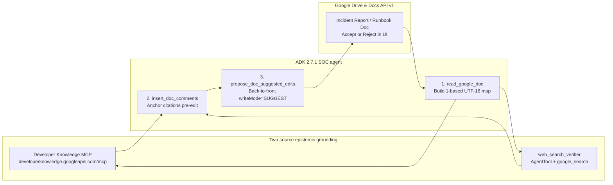

# Grounded suggested edits for SOC runbooks and incident reports in Google Docs

In the first two posts of this series, [Exploring Agent Graphs for SecOps AI Runbooks](https://security.googlecloudcommunity.com/community-blog-42/exploring-agent-graphs-for-secops-ai-runbooks-8113) and [Evaluating Agent Graphs for SecOps AI Runbooks](https://security.googlecloudcommunity.com/community-blog-42/evaluating-agent-graphs-for-secops-ai-runbooks-8232), we moved our SOC triage agents off brittle ReAct loops and onto explicit control-flow graphs with dynamic skill loading. That cut token burn and raised our automated report grades from a C average to an A-/A range across realistic incident scenarios.

Then we hit a human problem.

Our 63 operational runbooks lived as Markdown files inside a Git repository. Engineers love Git. Incident responders coming off a 2 a.m. ransomware bridge do not. When an analyst finishes an investigation and realizes step 3 of the `suspicious-login-triage` runbook points at a deprecated Gemini model or recommends an overly broad IAM role, they are not going to clone a repo, cut a branch, and wait for CI before going to sleep. The lesson stays in the incident Google Doc, and the runbook quietly rots.

On the `drive-mcp-runbooks` branch, we solved the storage half of that problem by wiring our agents to the [Google Drive remote MCP server](https://developers.google.com/workspace/drive/api/guides/configure-mcp-server) at `https://drivemcp.googleapis.com/mcp/v1`. Runbooks now live as Markdown files in a shared `SOC Runbooks` Drive folder, and `write_report` dual-writes incident reports into `SOC Reports`.

That unlocked a much harder question. Once runbooks and incident reports live in Google Workspace, how do we let an agent audit and improve them without breaking analyst trust?

Building on Romin Irani's recent two-part reference architecture, [Building an AI Document Reviewer with Google ADK, Gemini, and the New Google Docs Comments](https://medium.com/google-cloud/building-an-ai-document-reviewer-with-google-adk-gemini-and-the-new-google-docs-comments-1f79fb6cb86f) and [Grounding Google Docs Suggested Edits with Developer Knowledge MCP and Google Search](https://medium.com/google-cloud/grounding-google-docs-suggested-edits-with-developer-knowledge-mcp-and-google-search-9e2a3bf2800e), we extended `adk_runbooks` so our incident response and report writer agents can verify technical claims against official documentation and propose non-destructive edits directly inside Google Docs.

Here is why this pattern is novel, what makes the engineering underneath it interesting, and the sharp edges we found in `google-adk==2.7.1` while testing it against live Google Cloud APIs.

---

## Changing the trust contract between agents and authors

Most document-editing agents fail in one of two ways:

1. **Silent destructive overwrites.** The agent reads a document, rewrites the text, and saves the new version over the old one. In a security runbook or postmortem, a single hallucinated CLI flag or IAM role silently corrupts an operational procedure. Nobody wants an autonomous agent with unconditional write access to production runbooks.
2. **Detached chat critique.** To stay safe, teams restrict the agent to posting a bulleted review in a chat window. Now the human author has to hunt through a 15-page incident report, locate every quoted sentence, and copy-paste twenty separate fixes by hand.

Google Docs API v1 recently exposed two capabilities that let agents behave like a human peer reviewer instead of a wrecking ball:

- **Native anchored comments via `insertComment`.** Earlier workarounds had to call the Google Drive API v3 `comments.create` endpoint, which attaches comments at the file level without reliable character-range anchoring inside the document body. Docs API v1 `batchUpdate` now accepts an `insertComment` request with an explicit `startIndex` and `endIndex`, binding the comment highlight to the exact words under review.
- **Suggested edits via `writeControl.writeMode = "SUGGEST"`.** When a `batchUpdate` request includes `"writeControl": {"writeMode": "SUGGEST"}`, standard `deleteContentRange` and `insertText` operations do not overwrite the document. Instead, Google Docs records them as green insertion spans and pink strikethrough deletion spans with native Accept and Reject buttons in the margin.



This changes the division of labor. The agent does the tedious work of checking every IAM role, CLI flag, and model identifier against live documentation and staging the exact diff in place. The security engineer keeps 100% editorial control and approves or rejects each change with one click.

---

## Four engineering problems under the hood

Wiring an LLM to Google Docs and two grounding sources sounds straightforward until you hit the API boundaries. Four specific design problems make this architecture interesting to build.

### 1. Two-source epistemic grounding and the Gemini tool-mixing constraint

An agent that proposes edits to a cloud security runbook using only its training weights will "correct" valid new model names back to old ones it saw before its knowledge cutoff. Conversely, an agent that relies only on public web search will routinely pull outdated StackOverflow answers or third-party blog posts over official documentation.

We split verification across two distinct grounding tools based on domain:

- **Google Developer Knowledge Remote MCP Server.** Hosted at `https://developerknowledge.googleapis.com/mcp`, this managed Streamable HTTP MCP server exposes three tools, `search_documents`, `get_documents`, and `answer_query`, backed directly by Google's official documentation index across Google Cloud, Vertex AI, Gemini, ADK, Firebase, Android, and Go. For any claim touching Google Cloud IAM, `gcloud`, Vertex AI, or Chronicle, our agent queries Developer Knowledge MCP first.
- **Google Search Grounding for non-Google claims.** SOC runbooks also reference AWS S3 policies, Okta CLI flags, and CISA KEV publication dates. For those, the agent falls back to Google Search.

Here we hit a hard constraint in the Gemini API. Built-in `google_search` is a model-internal grounding tool that cannot be combined in the same `tools=[...]` list alongside custom `FunctionTool` declarations or `McpToolset` instances on a single `Agent`. If you pass both, the API rejects the request.

The workaround in ADK is sub-agent isolation via `AgentTool`. In `multi-agent/manager/tools/grounding_tools.py`, we define a small specialist `Agent` whose only tool is `google_search`, and wrap it in `AgentTool`:

```python
from google.adk.agents import Agent
from google.adk.tools import google_search
from google.adk.tools.agent_tool import AgentTool

web_search_verifier_agent = Agent(
    name="web_search_verifier",
    model="gemini-2.5-flash",
    instruction="Verify non-Google technical claims using Google Search and return URLs.",
    tools=[google_search],
)

web_search_tool = AgentTool(agent=web_search_verifier_agent)
```

To the parent SOC orchestrator, `web_search_verifier` looks like a normal function tool accepting `{"request": "..."}`. Under the hood, calling it spins up an isolated child model call where `google_search` runs legally on its own.

### 2. Translating LLM quotes into 1-based UTF-16 Google Docs indices

LLMs are terrible at counting characters, and asking a model to emit raw integer offsets into a 20,000-character document guarantees off-by-one corruption. Instead, the model emits exact substring quotes like `{"quote": "roles/owner", "replacement": "roles/aiplatform.user"}`, and deterministic Python code resolves those quotes into Google Docs API v1 coordinates.

Even in Python, mapping `str.find(quote)` directly to Google Docs indices breaks as soon as a document contains a table or a non-BMP Unicode character:

- **Google Docs indices are 1-based UTF-16 code units.** Python 3 strings index by Unicode code points. Any character outside the Basic Multilingual Plane takes 1 index in a Python `str`, but 2 UTF-16 code units in Google Docs.
- **Tables nest structural elements.** Text inside a Google Doc table does not live under top-level `paragraph` elements; it lives inside `table.tableRows[].tableCells[].content[].paragraph`.

In `multi-agent/manager/tools/docs_review_tools.py`, `_extract_text_and_index_map` walks `tabs[0].documentTab.body.content` recursively across paragraphs and table cells, stepping the Google Docs index by `len(ch.encode("utf-16-le")) // 2` for every character:

```python
def _utf16_code_units(ch: str) -> int:
    return len(ch.encode("utf-16-le")) // 2
```

When `read_google_doc` runs, it caches both the concatenated plain text and the `list[int]` mapping each Python character position to its 1-based UTF-16 Google Docs `startIndex`. When a quote spans characters `pos` through `last_pos = pos + len(quote) - 1`, its exact Docs range is:

```python
start_idx = index_map[pos]
end_idx = index_map[last_pos] + _utf16_code_units(plain_text[last_pos])
```

### 3. Comments before edits, and back-to-front batching

Once you have exact UTF-16 ranges from `read_google_doc`, two ordering bugs will still corrupt your `batchUpdate` calls if you are not careful.

**First, comments must be inserted before suggested edits.** It is tempting to think that because `propose_doc_suggested_edits` uses `"writeMode": "SUGGEST"`, the document's character indices do not change until a human clicks Accept. That is false. A suggested replacement inserts the new text into the document body immediately with `suggestedInsertionIds` alongside the old text marked with `suggestedDeletionIds`. The moment a suggested edit is applied, every character offset after that point shifts, invalidating the cached `doc_index_map`. By running `insert_doc_comments` first and `propose_doc_suggested_edits` second, both operations use the exact pre-edit index map from `read_google_doc`.

**Second, suggested replacements must be sorted back-to-front.** Suppose a single `propose_doc_suggested_edits` call replaces `"roles/owner"`, which is 11 characters at index 119, with the 21-character string `"roles/aiplatform.user"`, and also replaces `"gemini-1.5-pro"` at index 268 with `"gemini-2.5-pro"`. Because `batchUpdate` executes requests sequentially inside the array, executing the edit at index 119 first adds 10 UTF-16 code units to the document before the second edit runs. The second edit then deletes indices 268 to 282, slicing ten characters too early.

Sorting validated, non-overlapping edits in descending order by `startIndex` eliminates index drift completely:

```python
resolved_edits.sort(key=lambda item: item[0], reverse=True)

requests_list = []
for start_idx, end_idx, replacement in resolved_edits:
    requests_list.append(
        {"deleteContentRange": {"range": {"startIndex": start_idx, "endIndex": end_idx}}}
    )
    if replacement:
        requests_list.append(
            {"insertText": {"location": {"index": start_idx}, "text": replacement}}
        )
```

Because every edit in the batch mutates text strictly closer to the end of the document than the edits that follow it, earlier `startIndex` values remain invariant throughout the batch.

### 4. An ADK 2.7.1 `McpToolset` gotcha with `header_provider` and session pooling

Connecting ADK's `McpToolset` to authenticated remote MCP servers like `drivemcp.googleapis.com` and `developerknowledge.googleapis.com` surfaced a bug in `google-adk==2.7.1` that is worth documenting.

Many ADK examples pass `header_provider` to `McpToolset` to inject per-request headers. We found two problems with `header_provider` in ADK 2.7.1:

1. **Startup discovery ignores `header_provider`.** When a server boots or builds an A2A Agent Card, ADK calls `McpToolset.get_tools(readonly_context=None)`. When `readonly_context` is `None`, `McpToolset.get_tools` skips `header_provider` entirely, sending an unauthenticated `tools/list` call.
2. **Direct tool execution with `tool_context=None` crashes.** In `google/adk/tools/mcp_tool/mcp_tool.py` at line 434, `McpTool._run_async_impl` checks `if self._header_provider:` and unconditionally evaluates `ReadonlyContext(tool_context._invocation_context)` without checking whether `tool_context` is `None`. Calling `mcp_tool.run_async(args=..., tool_context=None)` in a test or CLI script immediately raises `AttributeError: 'NoneType' object has no attribute '_invocation_context'`.

On top of that, ADK's `MCPSessionManager` pools sessions keyed by a hash of the static `StreamableHTTPConnectionParams.headers` dictionary. If you put a rotating OAuth bearer token into static headers, every token refresh changes the hash and leaks a new session.

Our fix in `multi-agent/manager/tools/grounding_tools.py` and `drive_tools.py` avoids `header_provider` completely:

- When authenticating to Developer Knowledge MCP with a static `X-Goog-Api-Key`, we pass `headers={"X-Goog-Api-Key": key}` on `StreamableHTTPConnectionParams`.
- When authenticating with Application Default Credentials using an OAuth bearer token and `X-Goog-User-Project`, we leave `StreamableHTTPConnectionParams.headers` empty and pass a custom `httpx_client_factory` backed by the `_BearerAndProjectAuth` flow.

Because `httpx.Auth.auth_flow` signs each outgoing HTTP request at the transport layer, ADK sees stable connection parameters for session pooling, startup `get_tools(readonly_context=None)` is authenticated, and `run_async(args=..., tool_context=None)` never triggers the `NoneType` crash in `mcp_tool.py`.

---

## Live verification against Google Cloud and Workspace APIs

We tested the full stack in an isolated worktree against our `dandye-0324-chronicle` Argolis project using `scripts/grounded_docs_smoke_test.py`:

```bash
WORKTREE_DIR="/usr/local/google/home/dandye/Projects/adk_runbooks__worktrees/drive-mcp-runbooks__grounded-docs"
ACCOUNT="admin@dandye.altostrat.com"
PROJECT_ID="dandye-0324-chronicle"

direnv exec "$WORKTREE_DIR" gcloud auth login "$ACCOUNT" --enable-gdrive-access --update-adc
direnv exec "$WORKTREE_DIR" "$WORKTREE_DIR/.venv/bin/python" "$WORKTREE_DIR/scripts/grounded_docs_smoke_test.py" --create-review-doc
```

Four results from the live run stood out:

1. **Zero-API-key Developer Knowledge MCP auth works with ADC.** While public snippets for `https://developerknowledge.googleapis.com/mcp` usually use `X-Goog-Api-Key`, our `httpx.Auth` bearer flow sends `Authorization: Bearer <token>` and `X-Goog-User-Project: dandye-0324-chronicle`, which authenticated cleanly using standard Application Default Credentials once `developerknowledge.googleapis.com` was enabled on the project.
2. **Deterministic URL resolution from `search_documents`.** Querying `search_documents` for `"Vertex AI IAM predefined roles roles/aiplatform.user"` returned chunk `c1` with `"parent": "documents/docs.cloud.google.com/gemini-enterprise-agent-platform/models/access-control"`. Stripping the `documents/` prefix and prepending `https://` yields the live public documentation URL.
3. **Verified Kix-anchored comments on the wire.** After creating test Google Doc `1DV3E98OQSNuSuV_dClYJ21PF7xnSHLq6vioDthXEx3M` in the `SOC Reports` folder and running `insert_doc_comments`, inspecting `GET /drive/v3/files/1DV3E98OQSNuSuV_dClYJ21PF7xnSHLq6vioDthXEx3M/comments` confirmed that Google Docs bound the comment to the native Kix anchor `kix.wx96pu2w5q46` over the exact substring:
   ```json
   {
     "id": "AAACIbXnk5E",
     "anchor": "kix.wx96pu2w5q46",
     "quotedFileContent": {
       "mimeType": "text/html",
       "value": "roles/owner"
     },
     "content": "Avoid primitive roles/owner; grant least-privilege roles/aiplatform.user instead (https://docs.cloud.google.com/gemini-enterprise-agent-platform/models/access-control)."
   }
   ```
4. **Verified back-to-front `writeMode="SUGGEST"` spans.** Inspecting `GET /v1/documents/1DV3E98OQSNuSuV_dClYJ21PF7xnSHLq6vioDthXEx3M?includeTabsContent=true` after `propose_doc_suggested_edits` showed both replacements paired cleanly by suggestion ID without character drift:
   - Suggestion `suggest.q45iqyutndwg` pairs `"suggestedDeletionIds"` on `"roles/owner"` with `"suggestedInsertionIds"` on `"roles/aiplatform.user"`.
   - Suggestion `suggest.yc1sxqdzwek2` pairs `"suggestedDeletionIds"` on `"gemini-1.5-pro"` with `"suggestedInsertionIds"` on `"gemini-2.5-pro"`.

---

## Where this goes next

Right now, our SOC agents can read their 63 operational runbooks from Google Drive, write incident reports as Markdown or native Google Docs, verify cloud and third-party technical claims against Developer Knowledge MCP and Google Search, and stage anchored comments and suggested edits for human sign-off.

The natural next step is closing the loop from postmortem back to the runbook catalog. When an incident commander accepts a suggested edit on a postmortem report or flags a gap during an incident review, the agent can open the corresponding runbook in `SOC Runbooks`, verify the updated command or IAM role against `developerknowledge.googleapis.com/mcp`, and stage a suggested edit on the runbook itself. Analysts review and click Accept in Google Docs, and `DriveSkillRegistry` serves the updated runbook on the very next incident.
