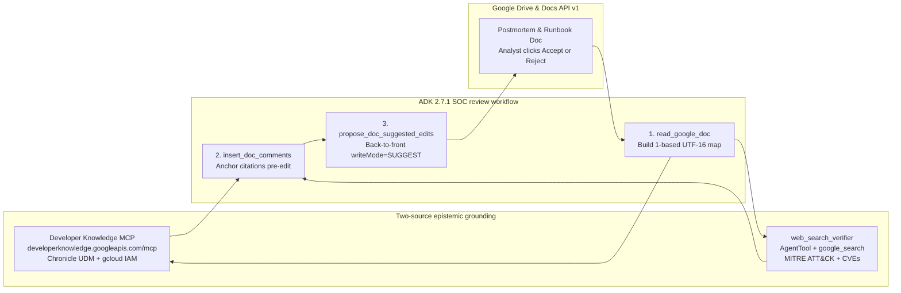

# Red-lining SOC runbooks and postmortems in Google Docs with grounded ADK agents

In the first two posts of this series, [Exploring Agent Graphs for SecOps AI Runbooks](https://security.googlecloudcommunity.com/community-blog-42/exploring-agent-graphs-for-secops-ai-runbooks-8113) and [Evaluating Agent Graphs for SecOps AI Runbooks](https://security.googlecloudcommunity.com/community-blog-42/evaluating-agent-graphs-for-secops-ai-runbooks-8232), we moved our SOC triage agents off open-ended ReAct loops and onto explicit control-flow graphs with dynamic skill loading. That cut token burn and raised automated report grades from a C average to an A-/A range across realistic incident scenarios.

Then we ran into the postmortem graveyard.

Every security operations center has one. At 3 a.m., after containing a compromised cloud service account or an encoded PowerShell intrusion, the incident commander writes up a postmortem in Google Docs. The postmortem lists three concrete gaps in the team's runbooks. Maybe a containment step broke production workload identity, or a Google SecOps UDM hunting query failed to match child processes. Everyone agrees on the bridge that the runbook needs to be updated.

It almost never is. Our 63 operational runbooks lived as Markdown files inside a Git repository, and tired incident responders do not open Git pull requests after an all-night bridge. On the `drive-mcp-runbooks` branch, we solved the storage half of that disconnect by wiring our agents to the [Google Drive remote MCP server](https://developers.google.com/workspace/drive/api/guides/configure-mcp-server) at `https://drivemcp.googleapis.com/mcp/v1`. Runbooks now live in a shared `SOC Runbooks` Drive folder where analysts actually work, and `write_report` publishes incident reports directly into `SOC Reports`.

That raised a harder security engineering problem. Once incident reports and runbooks live in Google Workspace, how do we let an AI agent audit a postmortem or propose updates to a production runbook without creating a new operational hazard?

Building on Romin Irani's recent two-part reference architecture, [Building an AI Document Reviewer with Google ADK, Gemini, and the New Google Docs Comments](https://medium.com/google-cloud/building-an-ai-document-reviewer-with-google-adk-gemini-and-the-new-google-docs-comments-1f79fb6cb86f) and [Grounding Google Docs Suggested Edits with Developer Knowledge MCP and Google Search](https://medium.com/google-cloud/grounding-google-docs-suggested-edits-with-developer-knowledge-mcp-and-google-search-9e2a3bf2800e), we extended `adk_runbooks` so our incident response and report writer agents can verify technical claims against official cloud documentation and stage non-destructive red-lines inside Google Docs.

---

## Four mistakes that happen in 3 a.m. incident docs

If you ask an ungrounded LLM to rewrite an incident postmortem or a SOC runbook in place, you trade human fatigue for machine hallucination. In security operations, four specific errors show up constantly in draft postmortems and AI-generated playbooks:

1. **Destructive containment commands.** Under pressure to cut off an attacker using a compromised GCP service account, a responder writes `gcloud iam service-accounts delete sa-prod-etl@...` into the containment section. Deleting a service account destroys its unique numeric resource ID. Even if you recreate a service account with the same email address 20 minutes later, its underlying unique ID changes, silently breaking IAM policy bindings and Workload Identity Federation pools across production. The reversible triage command is `gcloud iam service-accounts disable`.
2. **Hallucinated Chronicle UDM field paths.** Both tired analysts and ungrounded LLMs routinely write UDM queries like `process.command_line = /.*-enc.*/` without the required entity prefix. In Google SecOps, unprefixed `process.command_line` is not a valid UDM field; the query compiler requires `target.process.command_line` or `principal.process.command_line`. Putting an unverified query into a runbook guarantees the next responder gets zero hits during an active hunt.
3. **Live clickable C2 links in shared reports.** When analysts paste active phishing or stage-2 payload URLs like `https://login-micros0ft-update.com/stage2.ps1` into a Google Doc, Workspace automatically turns them into clickable hyperlinks. As soon as that postmortem is shared with executives, legal counsel, or IT administrators, a live C2 beacon sits one accidental click away. Indicators in shared docs must be defanged to `hxxps://` and `[.]`.
4. **Mislabeled MITRE ATT&CK sub-techniques.** Draft reports frequently tag an encoded `powershell.exe -enc` cradle as `T1059.003` for Windows Command Shell instead of `T1059.001` for PowerShell, skewing detection coverage heatmaps.

---

## Changing the trust contract between agents and responders

Most document-editing agents handle these mistakes in one of two broken ways. Either the agent overwrites the file in place, which no SOC lead will ever allow on a production runbook, or it dumps a wall of critique into a chat window, forcing the human to hunt through a 15-page report and copy-paste fixes by hand.

Google Docs API v1 recently added two features that let an agent act like a senior peer reviewer red-lining a draft:

- **Native anchored comments via `insertComment`.** Earlier workarounds had to call the Google Drive API v3 `comments.create` endpoint, which attaches comments at the file level without reliable character-range anchoring inside the document body. Docs API v1 `batchUpdate` now accepts an `insertComment` request with an explicit `startIndex` and `endIndex`, binding the comment highlight to the exact command or UDM field under review.
- **Suggested edits via `writeControl.writeMode = "SUGGEST"`.** When a `batchUpdate` request includes `"writeControl": {"writeMode": "SUGGEST"}`, standard `deleteContentRange` and `insertText` operations do not overwrite the document. Google Docs records them as green insertion spans and pink strikethrough deletion spans with native Accept and Reject buttons in the margin.



This also solves a governance problem we hit in our earlier evolutionary runbook optimization work. When an automated evaluator discovers that a runbook needs a pre-flight check for RFC-5737 documentation subnets or internal vulnerability scanners to prevent a $50,000 false-positive host isolation, you still need a human gate before mutating the production playbook. Staging that mutation as a Google Docs Suggested Edit with an anchored comment citing the incident postmortem gives the detection lead a one-click approval workflow.

---

## Five engineering problems under the hood

Wiring an ADK agent to Google Docs and two grounding sources surfaced five concrete engineering problems across security boundaries, Unicode indexing, and the ADK 2.7.1 runtime.

### 1. Dual-identity OAuth to prevent confused-deputy exfiltration of breach docs

In a security operations center, the `SOC Reports` folder holds some of the most sensitive documents in the company, including active breach timelines, unredacted command-line arguments, and legally privileged findings.

A naive architecture grants a single backend service account read and write access to every incident Google Doc. That creates a classic confused-deputy vulnerability. SOC agents routinely ingest untrusted attacker-controlled strings from SIEM telemetry, such as crafted `principal.process.command_line` values, HTTP user agents, and phishing email bodies. If an indirect prompt injection inside a log event tricks the agent into reading another incident document and copying its contents into the current case comment, a backend service account with broad Drive permissions gives the attacker access to every breach report in the organization.

To close that blast radius, `resolve_docs_token` in `multi-agent/manager/tools/docs_review_tools.py` implements a dual-identity model:

- **Backend service account ADC for model and public docs.** Vertex AI model calls using `roles/aiplatform.user` and queries to the public Developer Knowledge MCP server use the backend environment credentials, which hold zero permissions on confidential Google Docs when deployed in multi-user mode.
- **Per-user OAuth token for Google Docs operations.** When an analyst runs a review session, their short-lived OAuth 2.0 access token is placed in `tool_context.state["user_access_token"]`. Every `read_google_doc`, `insert_doc_comments`, and `propose_doc_suggested_edits` call authenticates with that user token first, falling back to local ADC only for single-operator CLI testing.

Because Google Docs enforces ACLs against the analyst's own identity, the agent cannot open a single postmortem the logged-in responder is not authorized to read. Every suggested edit and comment in the Google Docs audit trail is also attributed to the human session that triggered it.

### 2. Two-source epistemic grounding and the Gemini tool-mixing constraint

An agent that checks a `gcloud` command or a Chronicle UDM field using only its training weights will hallucinate flags or revert new syntax back to pre-cutoff patterns. Conversely, relying only on public web search often surfaces outdated blog posts or forum threads over canonical documentation.

We route verification across two grounding tools based on domain:

- **Google Developer Knowledge Remote MCP Server.** Hosted at `https://developerknowledge.googleapis.com/mcp`, this managed Streamable HTTP MCP server exposes `search_documents`, `get_documents`, and `answer_query` over Google's official documentation corpus. That corpus includes both the Google Cloud IAM documentation under `docs.cloud.google.com/iam/docs` and the Google SecOps Chronicle UDM reference at `docs.cloud.google.com/chronicle/docs/reference/udm-field-list`.
- **Google Search Grounding for external security standards.** For MITRE ATT&CK technique definitions, NVD CVE advisories, CISA KEV dates, and AWS or Okta CLI syntax, the agent routes queries to Google Search.

Here we hit a hard constraint in the Gemini API. Built-in `google_search` is a model-internal grounding tool that cannot be combined in the same `tools=[...]` list alongside custom `FunctionTool` declarations or `McpToolset` instances on a single `Agent`. Passing both causes the API to reject the request.

We bypass that constraint in `multi-agent/manager/tools/grounding_tools.py` by isolating `google_search` inside a child `Agent` wrapped in ADK's `AgentTool`:

```python
from google.adk.agents import Agent
from google.adk.tools import google_search
from google.adk.tools.agent_tool import AgentTool

web_search_verifier_agent = Agent(
    name="web_search_verifier",
    model="gemini-2.5-flash",
    instruction="Verify non-Google technical claims using Google Search and return URLs.",
    tools=[google_search],
)

web_search_tool = AgentTool(agent=web_search_verifier_agent)
```

To the parent SOC orchestrator, `web_search_verifier` looks like a standard function tool accepting `{"request": "..."}`. Calling it executes an isolated child model call where `google_search` runs on its own.

### 3. Translating LLM quotes into 1-based UTF-16 Google Docs indices

LLMs cannot reliably count character offsets across a long postmortem. Asking a model to output raw integer indices guarantees off-by-one corruption that slices words in half. Instead, our tools require the LLM to pass exact quoted substrings like `{"quote": "process.command_line", "replacement": "target.process.command_line"}`, while deterministic Python code resolves those quotes into Google Docs API v1 coordinates.

Even in Python, mapping `str.find(quote)` directly to Google Docs indices fails whenever a postmortem includes a MITRE ATT&CK table or a non-BMP Unicode character:

- **Google Docs indices are 1-based UTF-16 code units.** Python 3 strings index by Unicode code points. Any character outside the Basic Multilingual Plane takes 1 index in a Python `str`, but 2 UTF-16 code units in Google Docs.
- **Tables nest structural elements.** Text inside a Google Doc table does not sit under top-level `paragraph` elements; it sits inside `table.tableRows[].tableCells[].content[].paragraph`.

In `multi-agent/manager/tools/docs_review_tools.py`, `_extract_text_and_index_map` walks `tabs[0].documentTab.body.content` recursively across paragraphs and table cells, stepping the Google Docs index by `len(ch.encode("utf-16-le")) // 2` for every character:

```python
def _utf16_code_units(ch: str) -> int:
    return len(ch.encode("utf-16-le")) // 2
```

When `read_google_doc` runs, it caches both the plain text and the `list[int]` mapping each Python character position to its 1-based UTF-16 Google Docs `startIndex`. For a match spanning `pos` through `last_pos = pos + len(quote) - 1`, its exact Docs range is:

```python
start_idx = index_map[pos]
end_idx = index_map[last_pos] + _utf16_code_units(plain_text[last_pos])
```

### 4. Comments before edits, and back-to-front batching

Once you have exact UTF-16 ranges from `read_google_doc`, two ordering bugs will still corrupt your `batchUpdate` calls if you are not careful.

**First, comments must be inserted before suggested edits.** It is easy to assume that because `propose_doc_suggested_edits` uses `"writeMode": "SUGGEST"`, the document's character indices stay frozen until a human clicks Accept. That is false. A suggested replacement inserts the new text into the document body immediately with `suggestedInsertionIds` alongside the old text marked with `suggestedDeletionIds`. The moment a suggested edit is applied, every character offset after that point shifts, invalidating the cached `doc_index_map`. Running `insert_doc_comments` first and `propose_doc_suggested_edits` second ensures both operations use the pre-edit index map from `read_google_doc`.

**Second, suggested replacements must be sorted back-to-front.** In our `INC-2026-1011` smoke test, a single `propose_doc_suggested_edits` call applies four length-changing edits across the document:

1. Replacing the 33-character string `"T1059.003 (Windows Command Shell)"` with the 22-character string `"T1059.001 (PowerShell)"`, shrinking the text by 11 characters.
2. Replacing the 45-character URL `"https://login-micros0ft-update.com/stage2.ps1"` with the 47-character defanged URL `"hxxps://login-micros0ft-update[.]com/stage2.ps1"`, growing the text by 2 characters.
3. Replacing the 20-character field `"process.command_line"` with the 27-character field `"target.process.command_line"`, growing the text by 7 characters.
4. Replacing the 34-character command `"gcloud iam service-accounts delete"` with the 35-character command `"gcloud iam service-accounts disable"`, growing the text by 1 character.

Because `batchUpdate` executes requests sequentially inside the array, applying those edits from top to bottom would shift every subsequent target range off its intended words. Sorting validated, non-overlapping edits in descending order by `startIndex` eliminates index drift completely:

```python
resolved_edits.sort(key=lambda item: item[0], reverse=True)

requests_list = []
for start_idx, end_idx, replacement in resolved_edits:
    requests_list.append(
        {"deleteContentRange": {"range": {"startIndex": start_idx, "endIndex": end_idx}}}
    )
    if replacement:
        requests_list.append(
            {"insertText": {"location": {"index": start_idx}, "text": replacement}}
        )
```

Because every edit in the batch mutates text strictly closer to the end of the document than the edits that follow it, earlier `startIndex` values never move.

### 5. An ADK 2.7.1 `McpToolset` bug with `header_provider` and session pooling

Connecting ADK's `McpToolset` to authenticated remote MCP servers like `drivemcp.googleapis.com` and `developerknowledge.googleapis.com` surfaced a bug in `google-adk==2.7.1` worth noting for anyone building with remote MCP servers.

Many ADK examples pass `header_provider` to `McpToolset` to inject per-request headers. We hit two failures with `header_provider` in ADK 2.7.1:

1. **Startup discovery skips `header_provider`.** When a server boots or builds an A2A Agent Card, ADK calls `McpToolset.get_tools(readonly_context=None)`. When `readonly_context` is `None`, `McpToolset.get_tools` skips `header_provider` entirely, sending an unauthenticated `tools/list` request.
2. **Direct tool execution with `tool_context=None` crashes.** In `google/adk/tools/mcp_tool/mcp_tool.py` at line 434, `McpTool._run_async_impl` checks `if self._header_provider:` and unconditionally evaluates `ReadonlyContext(tool_context._invocation_context)` without checking whether `tool_context` is `None`. Calling `mcp_tool.run_async(args=..., tool_context=None)` in a test or CLI script immediately raises `AttributeError: 'NoneType' object has no attribute '_invocation_context'`.

In addition, ADK's `MCPSessionManager` pools sessions keyed by a hash of the static `StreamableHTTPConnectionParams.headers` dictionary. Putting a rotating OAuth bearer token into static headers changes the hash on every token refresh and leaks sessions.

Our implementation in `multi-agent/manager/tools/grounding_tools.py` and `drive_tools.py` avoids `header_provider` completely. When authenticating with Application Default Credentials using an OAuth bearer token and `X-Goog-User-Project`, we leave `StreamableHTTPConnectionParams.headers` empty and pass a custom `httpx_client_factory` backed by `_BearerAndProjectAuth`. Because `httpx.Auth.auth_flow` signs each outgoing HTTP request at the transport layer, ADK sees stable connection parameters for session pooling, startup `get_tools(readonly_context=None)` is authenticated, and `run_async(args=..., tool_context=None)` never triggers the `NoneType` crash in `mcp_tool.py`.

---

## Live verification on an `INC-2026-1011` postmortem and runbook

We ran `scripts/grounded_docs_smoke_test.py` against our `dandye-0324-chronicle` Argolis environment to test the full SecOps red-lining workflow end to end:

```bash
WORKTREE_DIR="/usr/local/google/home/dandye/Projects/adk_runbooks__worktrees/drive-mcp-runbooks__grounded-docs"
ACCOUNT="admin@dandye.altostrat.com"
PROJECT_ID="dandye-0324-chronicle"

direnv exec "$WORKTREE_DIR" gcloud auth login "$ACCOUNT" --enable-gdrive-access --update-adc
direnv exec "$WORKTREE_DIR" "$WORKTREE_DIR/.venv/bin/python" "$WORKTREE_DIR/scripts/grounded_docs_smoke_test.py" --create-review-doc
```

Here is what happened on the wire during the live run:

1. **Developer Knowledge MCP resolved canonical IAM and Chronicle UDM docs via ADC.** Using standard Application Default Credentials without an API key, `search_documents` resolved `https://docs.cloud.google.com/iam/docs/service-accounts-disable-enable` for the service account containment check and `https://docs.cloud.google.com/chronicle/docs/reference/udm-field-list` for the UDM field check.
2. **Created and indexed the postmortem Google Doc.** `create_google_doc` created [`INC_2026_1011_Postmortem_and_Runbook_Redline`](https://docs.google.com/document/d/18lUrLtd42tlxAh3SDuHBZHDdYi0JEORGjiaIfAYTlZI/edit) with document ID `18lUrLtd42tlxAh3SDuHBZHDdYi0JEORGjiaIfAYTlZI` in `SOC Reports`, and `read_google_doc` mapped all 813 UTF-16 character positions.
3. **Anchored four grounded SOC comments to exact Kix spans.** Inspecting `GET /drive/v3/files/18lUrLtd42tlxAh3SDuHBZHDdYi0JEORGjiaIfAYTlZI/comments` confirmed that all four review comments bound to native Kix anchors over the exact offending phrases:
   ```json
   [
     {
       "id": "AAACIbZVxNU",
       "anchor": "kix.jsub1u90xbjs",
       "quotedFileContent": { "value": "gcloud iam service-accounts delete" },
       "content": "High blast-radius containment warning: deleting a production service account destroys its unique resource ID and breaks Workload Identity bindings. Use reversible 'gcloud iam service-accounts disable' during triage (https://docs.cloud.google.com/iam/docs/service-accounts-disable-enable)."
     },
     {
       "id": "AAACIbZVxNQ",
       "anchor": "kix.plvnk95sibns",
       "quotedFileContent": { "value": "process.command_line" },
       "content": "Invalid Chronicle UDM field path: UDM requires an entity prefix such as target.process.command_line or principal.process.command_line (https://docs.cloud.google.com/chronicle/docs/reference/udm-field-list)."
     },
     {
       "id": "AAACIbZVxNM",
       "anchor": "kix.4yir6x8defx",
       "quotedFileContent": { "value": "https://login-micros0ft-update.com/stage2.ps1" },
       "content": "Live C2 URL auto-linkifies in Google Docs and creates a click hazard for bridge reviewers. Defang indicator to hxxps:// and [.] before sharing."
     },
     {
       "id": "AAACIbZVxNI",
       "anchor": "kix.9t5839q3lmou",
       "quotedFileContent": { "value": "T1059.003 (Windows Command Shell)" },
       "content": "MITRE ATT&CK mismatch: powershell.exe -enc payloads map to T1059.001 (PowerShell), not T1059.003 (cmd.exe) (https://attack.mitre.org/techniques/T1059/001/)."
     }
   ]
   ```
4. **Applied all four back-to-front `writeMode="SUGGEST"` edits without character drift.** Inspecting `GET /v1/documents/18lUrLtd42tlxAh3SDuHBZHDdYi0JEORGjiaIfAYTlZI?includeTabsContent=true` confirmed that each deletion span paired cleanly with its insertion span across all four locations:
   - `suggest.5zryddz0zyff` replaces `"T1059.003 (Windows Command Shell)"` with `"T1059.001 (PowerShell)"`.
   - `suggest.pvuzeec7wbe` defangs `"https://login-micros0ft-update.com/stage2.ps1"` to `"hxxps://login-micros0ft-update[.]com/stage2.ps1"`.
   - `suggest.du136hpq9scc` corrects `"process.command_line"` to `"target.process.command_line"`.
   - `suggest.m31glb161cw6` changes `"gcloud iam service-accounts delete"` to `"gcloud iam service-accounts disable"`.

---

## Working real SOAR cases from our Argolis tenant

Synthetic postmortems are a clean starting point, but real SOAR queues are messier. When we pointed the workflow at live cases in our Argolis Chronicle SOAR instance `ltstrtn.siemplify-soar.com` backed by Chronicle SIEM project `dandye-0324-chronicle` via `scripts/experiment_argolis_soar_cases.py`, two real-world engineering challenges surfaced immediately.

### Fixing `direnv` credential stripping across stdio MCP servers

When an ADK runner spawns `secops-mcp` or `secops-soar` via `StdioConnectionParams` without an explicit `env` dictionary, the Python MCP SDK calls `get_default_environment()`, which copies only a handful of system variables such as `HOME`, `PATH`, and `USER` while stripping `GOOGLE_APPLICATION_CREDENTIALS` and `CLOUDSDK_CONFIG`. On a `direnv`-isolated multi-tenant workstation where each worktree holds its own `.gcloud/` config and ADC JSON, child `uv run` servers fell back to `~/.config/gcloud` and failed with 401 and 403 errors against `us-chronicle.googleapis.com`. Passing `env=dict(os.environ)` in `StdioServerParameters` inside `multi-agent/manager/tools/tools.py` preserved the per-worktree credential isolation across all child MCP processes.

### Working around LLM safety filter blocks on known-malicious telemetry

When we pulled raw endpoint process telemetry from Chronicle SOAR Cases `33269` and `33288`, the `principal.process.command_line` fields contained a 1.4 KB raw Base64 PowerShell Empire stager alongside a `rundll32.exe comsvcs.dll, MiniDump` command targeting `lsass.dmp`. Asking an LLM to quote or rewrite lines containing verbatim offensive stagers triggers model output safety filters and blocks the response mid-turn.

We solved this in [`docs_review_tools.py`](file:///usr/local/google/home/dandye/Projects/adk_runbooks__worktrees/drive-mcp-runbooks__grounded-docs/multi-agent/manager/tools/docs_review_tools.py) with a two-part architecture that separates deterministic payload handling from semantic grounding:

1. **Tool-boundary telemetry sanitization via `sanitize_telemetry_text`.** Before raw SIEM or SOAR process strings enter the LLM context or get written to a Google Doc, `sanitize_telemetry_text()` replaces raw `-EncodedCommand` and `-Enc` Base64 blobs and `comsvcs.dll, MiniDump` arguments with deterministic forensic tokens that preserve payload length and a 12-character SHA-256 fingerprint:
   ```text
   powershell.exe -nop -w hidden -enc <REDACTED_B64:len=56,sha256=e035de8b80be>
   rundll32.exe C:\Windows\System32\comsvcs.dll, <REDACTED_DUMP_ARGS:sha256=1e6f45e16c7f>
   ```
   The analyst still gets a deterministic hash to pivot on in Chronicle SIEM, and the model never ingests or echoes raw exploit payloads. One subtle edge case surfaced when we ran the standalone Base64 regex `[A-Za-z0-9+/]{64,}={0,2}` against Windows process telemetry in Cases `33280` and `33285`. Because a 64-character hexadecimal SHA-256 hash `[0-9a-f]{64}` is a valid subset of the Base64 alphabet, a naive standalone Base64 matcher will redact `target.process.file.sha256` values. Adding `if re.fullmatch(r"[0-9a-fA-F]+", blob): return blob` preserved all four 64-character SHA-256 process hashes intact while redacting genuine Base64 payloads.
2. **Span-based addressing via `start_index` and `end_index` with `find_deterministic_indicator_spans`.** We extended `insert_doc_comments` and `propose_doc_suggested_edits` to accept explicit 1-based UTF-16 `start_index` and `end_index` spans in addition to `quote`, and wrapped the full pipeline in `review_google_doc_with_stage_a()`. Stage A runs `find_deterministic_indicator_spans(plain_text, index_map)` in pure Python to locate live untrusted URLs while skipping trusted documentation domains like `docs.cloud.google.com` and `attack.mitre.org`, staging their defanging to `hxxps://` and `[.]` by numeric index without asking the LLM to repeat the malicious URL. Stage B uses the LLM and Developer Knowledge MCP strictly for safe technical claims such as MITRE ATT&CK technique IDs, Chronicle UDM schema fields, and `gcloud` containment syntax.

### Six live Argolis SOAR case studies and three staged Drive runbook red-lines

Running `scripts/experiment_argolis_soar_cases.py` and `scripts/overnight_argolis_soar_suite.py` executed the full pipeline across nine real cases grouped into six incident reports and three direct Drive runbook red-line drafts from `ltstrtn.siemplify-soar.com`:

| Argolis SOAR Case | Correlated SIEM Telemetry | Drive Runbook Loaded | Generated Google Doc | Grounded Red-Lines Applied |
| :--- | :--- | :--- | :--- | :--- |
| **Case `33278`** (`gcp_admin_privileged_roles_added_to_service_accounts`, alerts `488690` and `488689`, SOAR comment `52`) | 5 `GCP_CLOUDAUDIT` UDM events from `104.198.226.161` showing `SetIamPolicy` granting `roles/editor` on `serviceAccount:hello@base-production.iam.gserviceaccount.com`, `cloudsql.instances.delete` on `projects/base-analytics/instances/prod-customers`, and 3 rogue VMs `production-do-not-delete1..3` | `compromised-user-account-response`, 15,481 chars | [`SOAR_Case_33278_GCP_Service_Account_Privilege_Escalation`](https://docs.google.com/document/d/1wH5XBHqH1g_nqAIZ04ebKqiBu0CU_umuSXpl7kIBwQA/edit), ID `1wH5XBHqH1g_nqAIZ04ebKqiBu0CU_umuSXpl7kIBwQA`, 2,260 UTF-16 chars | 1. `T1078.004 (Cloud Accounts)` to `T1098.003 (Account Manipulation: Additional Cloud Roles)`<br>2. `resource.name` to `target.resource.name` via Developer Knowledge MCP<br>3. `gcloud iam service-accounts delete` to `gcloud iam service-accounts disable` via Developer Knowledge MCP |
| **Cases `33287` & `33281`** (`google_workspace_ownership_transferred_on_google_drive` and `new_trusted_domain_added`, SOAR comment `53`) | Overturned 4 prior SOAR analyst comments concluding "legitimate automated process" by correlating 15 `WORKSPACE_ACTIVITY` UDM events from `79.154.246.114` showing SAML2 IdP deletion, rogue OAuth client `955611971872-...` granted `https://mail.google.com/`, and `CHANGE_TWO_STEP_VERIFICATION_ENROLLMENT` setting `ENFORCE_STRONG_AUTHENTICATION=false` on the `Finance` OU 65 seconds before the Drive transfer | `suspicious-login-triage`, 13,508 chars | [`SOAR_Case_33287_33281_Workspace_Admin_Takeover_Review`](https://docs.google.com/document/d/1tDrz_tM2qwlP2weizVGRSEvikDPaLxp-MIylOL49kns/edit), ID `1tDrz_tM2qwlP2weizVGRSEvikDPaLxp-MIylOL49kns`, 2,171 UTF-16 chars | 1. Corrected Case `33287` disposition from `"Benign Automated Process"` to `"Confirmed True Positive"`<br>2. `user.email_addresses` to `security_result.about.email`<br>3. `gam user admin@mydomain.com delete` to `gam user admin@mydomain.com suspend` |
| **Case `33288`** (`Argolis Admin Live Manual Case`, 3 alerts across Phishing, LSASS, and PowerShell, SOAR comment `54`) | Sanitized 3-stage intrusion chain with `<REDACTED_DUMP_ARGS:sha256=1e6f45e16c7f>` and `<REDACTED_B64:len=56,sha256=e035de8b80be>` | `phishing-response`, 20,517 chars | [`SOAR_Case_33288_Sanitized_3Stage_Intrusion_Review`](https://docs.google.com/document/d/14kr7gtw5AJd4a53vCrQ4bIQdyW-t_v48LTtzWMhSg58/edit), ID `14kr7gtw5AJd4a53vCrQ4bIQdyW-t_v48LTtzWMhSg58`, 1,370 UTF-16 chars | 1. Stage A span-based URL defanging at `start_index=526, end_index=570` without echoing the URL through the LLM<br>2. `T1059.003 (Windows Command Shell)` to `T1059.001 (PowerShell)`<br>3. `process.command_line` to `target.process.command_line` |
| **Case `33269`** (`Powershell Empire Launch Parameters`, alert `488681`, SOAR comment `55`) | Sanitized the 1.4 KB raw Base64 PowerShell Empire stager at the tool boundary to `<REDACTED_B64:len=1436,sha256=...>` so the LLM never ingests or echoes weaponized stager bytes | `malware-incident-response`, 20,500 chars | [`SOAR_Case_33269_Sanitized_PowerShell_Empire_Review`](https://docs.google.com/document/d/1GqWNhFtidZ8zU9_YduUApvUw2ecTP4Wb-3rS0Gfe8eo/edit), ID `1GqWNhFtidZ8zU9_YduUApvUw2ecTP4Wb-3rS0Gfe8eo`, 1,883 UTF-16 chars | 1. Stage A span-based C2 URL defanging<br>2. `T1059.003` to `T1059.001`<br>3. `process.command_line` to `target.process.command_line`<br>4. `Remove-ADComputer` to `Disable-ADAccount` |
| **Cases `33280` & `33285`** (`wins-d19` LOLBin and Gamarue campaign, 40 total alerts, SOAR comment `56`) | Correlated 6-second execution burst on `wins-d19` for user `lisawalker` across `cmd.exe`, `powershell.exe`, `rundll32.exe`, and `cmstp.exe` while preserving 4 intact 64-character SHA-256 hashes | `malware-incident-response`, 20,500 chars | [`SOAR_Cases_33280_33285_LOLBin_Gamarue_Campaign_Review`](https://docs.google.com/document/d/1iwHmCCXu1QUNTCEnPbpVbBDxvfY7lYvROCQJEDrSECs/edit), ID `1iwHmCCXu1QUNTCEnPbpVbBDxvfY7lYvROCQJEDrSECs`, 2,236 UTF-16 chars | 1. Stage A span-based dropper URL defanging<br>2. `T1218.011 (Rundll32)` to `T1218.003 (CMSTP)`<br>3. `file.sha256` to `target.process.file.sha256` |
| **Cases `33283`, `33284` & `33282`** (Workspace Drive Exfiltration, Okta Spray, and SSH Brute Force, SOAR comment `57`) | Linked Case `33283` external Drive sharing to `alina.levine@gmail.com` and anonymous encryption key access 5 seconds after Case `33287` | `suspicious-login-triage`, 13,508 chars | [`SOAR_Cases_33283_33284_33282_Identity_and_Exfiltration_Review`](https://docs.google.com/document/d/1aNUuk3Q8gyOOK9ezw1eX57mq4ibHZb4CuWSlMsgbJJY/edit), ID `1aNUuk3Q8gyOOK9ezw1eX57mq4ibHZb4CuWSlMsgbJJY`, 1,922 UTF-16 chars | 1. Stage A span-based drop URL defanging<br>2. `T1048.003` to `T1567.002 (Exfiltration to Cloud Storage)`<br>3. `T1110.001` to `T1110.003 (Password Spraying)`<br>4. `ip` to `principal.ip` |

To close the loop directly on the playbooks in `SOC Runbooks`, `stage_runbook_update_as_google_doc()` loaded each Markdown runbook from Google Drive, appended the sanitized post-incident lessons learned, and staged non-destructive `writeMode="SUGGEST"` edits directly onto three collaborative runbook drafts before `post_reviewed_doc_to_soar_case()` posted both links back to the originating SOAR case timelines:

1. [`Runbook_Redline_compromised-user-account-response_Case_33278`](https://docs.google.com/document/d/1Pl_YLBmtyfFkT_R3xvQVugEb32KNyPfmbUQ-uiSex8o/edit), ID `1Pl_YLBmtyfFkT_R3xvQVugEb32KNyPfmbUQ-uiSex8o`, 14,360 UTF-16 chars, 3 anchored comments, 3 Suggested Edits, linked in SOAR Case `33278` comment `52`.
2. [`Runbook_Redline_suspicious-login-triage_Case_33287_33281_33283`](https://docs.google.com/document/d/1zY3mV2wHOUzIigZffYenXR7EexWvZCf1kgZlKbfWx6w/edit), ID `1zY3mV2wHOUzIigZffYenXR7EexWvZCf1kgZlKbfWx6w`, 13,135 UTF-16 chars, 3 anchored comments, 2 Suggested Edits, linked in SOAR Cases `33287` and `33283` comments `53` and `57`.
3. [`Runbook_Redline_malware-incident-response_Case_33269_33280_33285`](https://docs.google.com/document/d/1gUovdKOjdmsdPiomvBd-iuRM6Bz8cM_M5RtToubtjKw/edit), ID `1gUovdKOjdmsdPiomvBd-iuRM6Bz8cM_M5RtToubtjKw`, 20,812 UTF-16 chars, 2 anchored comments, 2 Suggested Edits, linked in SOAR Cases `33269` and `33280` comments `55` and `56`.

### Live Chronicle UDM query verification inside Google Docs (`verify_and_redline_udm_queries_in_doc`)

Notice that across all six SOAR case studies above, every single draft report or runbook contained at least one unprefixed or hallucinated Chronicle UDM field (`resource.name`, `user.email_addresses`, `process.command_line`, `file.sha256`, or `ip`). Relying on a human or an LLM to spot every broken UDM field in Stage B leaves room for omissions, and even a syntactically valid UDM field path does not guarantee that the hunting query will actually match telemetry in Chronicle SIEM.

In Cycle 1 (`H1`), we elevated Chronicle UDM query verification into Stage A (`find_udm_field_spans`) and paired it with live Chronicle SIEM dry-run execution (`verify_udm_query_with_siem` and `verify_and_redline_udm_queries_in_doc`):

1. **Deterministic UTF-16 UDM field span extraction.** `find_udm_field_spans(plain_text, index_map)` scans UDM comparison clauses (`<field_token> (=|!=) ("..."|/regex/)`) in pure Python, maps 19 common unprefixed or hallucinated field tokens (`process.command_line`, `principal.process.cmd_line`, `resource.name`, `file.sha256`, `ip`, `hostname`, `user.email_addresses`, etc.) to their canonical Chronicle UDM paths, and computes exact 1-based UTF-16 `(start_index, end_index)` coordinates while deduplicating against any overlapping Stage B edits in `review_google_doc_with_stage_a()`.
2. **Closed-loop SIEM dry-run verification.** When `run_live_siem_check=True`, `verify_and_redline_udm_queries_in_doc()` rewrites each defective query to its canonical UDM syntax, executes a live dry-run search against `us-chronicle.googleapis.com` (`secops-mcp_search_udm`), and stamps the anchored Google Docs comment with `[SIEM Dry-Run Verified: query='...', events_matched=N]`.
3. **Catching semantic zero-hit traps.** Running `scripts/verify_cycle1_udm_doc_verifier.py` against [`Cycle1_H1_Live_UDM_Query_Verifier_Validation`](https://docs.google.com/document/d/16VJd9N-1c7ZP49xgI0hsVYyOwGpoJtoHPT8sYR-vg80/edit) (`16VJd9N-1c7ZP49xgI0hsVYyOwGpoJtoHPT8sYR-vg80`) detected 4 broken UDM field spans, staged 4 descending-index `writeMode="SUGGEST"` fixes, and verified 3 queries live against Argolis Chronicle SIEM:
   - `metadata.log_type = "GCP_CLOUDAUDIT" AND ip = "104.198.226.161"` -> repaired to `principal.ip = "104.198.226.161"` (`events_matched=9`).
   - `hostname = "wins-d19" AND process.command_line = /.*cmd.*/ nocase` -> repaired to `principal.hostname = "wins-d19" AND target.process.command_line = /.*cmd.*/ nocase` (`events_matched=12`).
   - `metadata.log_type = "GCP_CLOUDAUDIT" AND resource.name = "projects/base-analytics/instances/prod-customers"` -> repaired to `target.resource.name = ...` (`siem_verified=True`, `events_matched=0`), immediately surfacing to the reviewer that while the repaired field name compiles cleanly, the literal Cloud SQL resource string requires value-level adjustment to match raw GCP Cloud Audit telemetry.

---

## Closing the postmortem-to-runbook loop

With runbooks stored in Google Drive, incident reports published to Google Docs, and verification grounded against Developer Knowledge MCP and Google Search, the postmortem graveyard disappears.

When an incident commander finishes a postmortem, the review agent can audit the report for live C2 links, broken UDM syntax, and dangerous containment commands before the document leaves the SOC. Better yet, the agent can open the matching playbook in `SOC Runbooks` and stage the lessons learned from the incident as non-destructive Suggested Edits. The detection lead reviews the red-lined Google Doc over morning coffee, clicks Accept on the changes that hold up, and `DriveSkillRegistry` serves the hardened runbook on the next alert.

