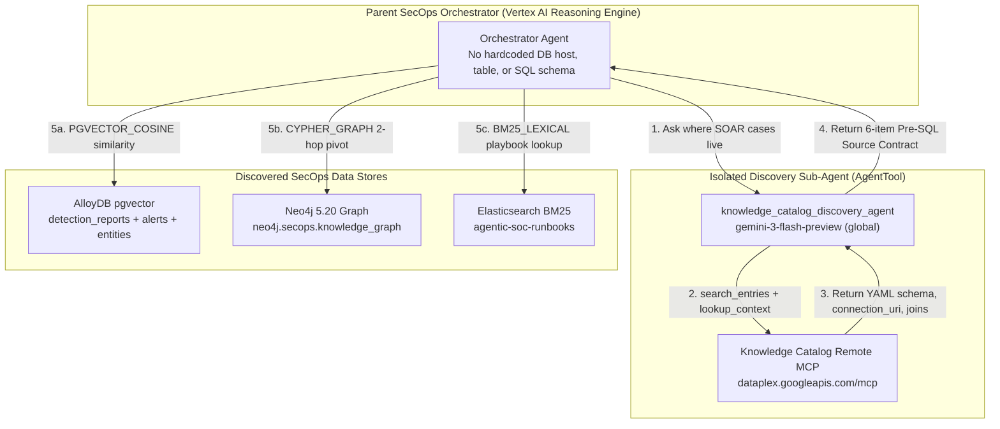

# Decoupling SecOps agents from hardcoded databases with Google Cloud Knowledge Catalog

**Author:** Dan Dye  
**Repository:** [`dandye/adk_runbooks`](https://github.com/dandye/adk_runbooks)

When I first heard the name Google Cloud Knowledge Catalog, I assumed it was a document repository where you upload Markdown files, PDFs, and incident postmortems for retrieval-augmented generation.

Then I pointed the Knowledge Catalog Remote MCP server at `https://dataplex.googleapis.com/mcp` against our `dandye-0324-chronicle` project and listed everything inside it. It returned 20 entries. Eleven were BigQuery `INFORMATION_SCHEMA` views, six were Vertex AI datasets, two were Cloud Pub/Sub topics, and one was our `chatops_warehouse.channel_events` BigQuery table. There was not a single Markdown investigation report in the results. Even more puzzling, the databases where I actually store our harvested security investigation reports, including AlloyDB with `pgvector`, Neo4j, and Elasticsearch, were completely missing.

That moment cleared up a common misconception about what a data catalog does. Knowledge Catalog, formerly known as Dataplex Universal Catalog, does not store your documents or rows. It stores the map of your data estate: where each table, graph, or search index lives, what columns or node labels it exposes, which fields join across systems, and whether the asset is certified for production use.

Once you treat the catalog as a runtime service and schema registry rather than a document bucket, a major deployment headache disappears. In most agent codebases, database hostnames, table names, and SQL schemas are hardcoded directly inside Python tools or system prompts. If you migrate your historical SOAR case reports from a Cloud SQL PostgreSQL table to AlloyDB with `pgvector`, you have to rewrite the agent's tool code, update the prompt, run CI, and redeploy the Vertex AI Reasoning Engine.

With Knowledge Catalog in the loop, the agent has no hardcoded database. At turn time, it queries the catalog to find the active `GOLD_CRITICAL` store for SOAR cases, reads the store's connection URI, schema, and join keys from the catalog's context payload, and runs the query. When the database moves from Postgres to AlloyDB, you update the catalog entry and leave the deployed agent untouched.

This post walks through how we registered our AlloyDB, Neo4j, and Elasticsearch investigation stores in Knowledge Catalog, the four Dataplex API traps we hit along the way, how an ADK agent discovers and queries related SOAR cases across all three engines at runtime, and how a database cutover works with zero agent redeployment.

---

## Why AlloyDB, Neo4j, and Elasticsearch did not show up automatically

When you enable Dataplex in a Google Cloud project, Knowledge Catalog automatically discovers native GCP analytics services that push metadata into Dataplex out of the box. In `dandye-0324-chronicle`, auto-discovery picked up our BigQuery datasets (`chatops_warehouse`), Pub/Sub topics (`chatops-inbound-events` and `chatops-normalized-events`), and Vertex AI datasets.

It did not discover our three SecOps investigation stores for two reasons:

1. **Databases inside a database cluster require table-level registration.** Even if an AlloyDB or Cloud SQL instance runs in the same project, Dataplex does not log into your PostgreSQL database over port `5432` to inspect schemas, `JSONB` columns, or `vector(768)` embeddings unless you run a metadata discovery job or register custom entries.
2. **Self-managed engines on Compute Engine VMs or GKE are opaque to GCP control planes.** Our Neo4j 5.20 property graph (`bolt://34.85.131.164:7687`) and our Elasticsearch BM25 runbook index (`http://34.145.140.152:9200/agentic-soc-runbooks`) run inside containers. To Google Cloud IAM and Asset Inventory, they look like network ports on a VM.

In our SecOps environment, a single investigation is split across all three engines so each engine handles the query shape it does best:

| Store entry in Knowledge Catalog | Engine | What it stores | Primary query pattern |
| :--- | :--- | :--- | :--- |
| `alloydb.secops.detection_reports` | AlloyDB (`pgvector`) | Full Markdown investigation reports (`markdown_report`), 768-dim Vertex AI embeddings (`embedding`), verdicts, and `JSONB` triage steps | HNSW cosine similarity (`embedding <=> $1::vector`) + GIN full-text search |
| `alloydb.secops.detection_alerts` | AlloyDB (`pgvector`) | Relational child table linking Chronicle SIEM and SOAR `alert_id` rows and MITRE ATT&CK arrays to `detection_reports.id` | Relational join on `investigation_id = detection_reports.id` and `mitre_techniques` overlap |
| `alloydb.secops.detection_entities` | AlloyDB (`pgvector`) | Relational child table indexing extracted `HOST`, `USER`, `IP`, `FILE`, and `DOMAIN` indicators per investigation | Compromise-pivot lookup on `(entity_type, entity_value)` |
| `neo4j.secops.knowledge_graph` | Neo4j 5.20 | Cypher property graph connecting `:Investigation`, `:Alert`, and `:Case` nodes to `:Host`, `:User`, `:File`, `:Domain`, and `:NetworkAddress` via `[:INVOLVES]` | Multi-hop lateral movement and shared-entity blast radius traversal |
| `elasticsearch.secops.agentic_soc_runbooks` | Elasticsearch | Section-chunked Markdown investigation reports and 63 operational SOC runbooks (`max_chunk_size=3000`, `overlap=300`) | BM25 lexical `multi_match` on `["title^2", "content"]` ordered by `chunk_index` |

To make all five stores visible to our ADK agents through `https://dataplex.googleapis.com/mcp`, we created a custom entry group (`projects/dandye-0324-chronicle/locations/us-central1/entryGroups/secops-investigation-stores`), three custom entry types (`alloydb-pgvector-table`, `neo4j-knowledge-graph`, and `elasticsearch-bm25-index`), and a custom governance aspect type (`secops-store-governance`).

---

## Four Dataplex REST and MCP traps we hit in production

Registering custom entries for non-BigQuery stores and querying them through the hosted Dataplex MCP server exposed four concrete API constraints that are easy to miss in the documentation.

### 1. Custom `EntryType.typeAliases` must match Dataplex's internal allowlist

When we first created the `alloydb-pgvector-table`, `neo4j-knowledge-graph`, and `elasticsearch-bm25-index` entry types via `POST https://dataplex.googleapis.com/v1/projects/dandye-0324-chronicle/locations/us-central1/entryTypes`, we passed descriptive aliases like `"GRAPH"` and `"SEARCH_INDEX"`. Dataplex rejected the request with `400 INVALID_ARGUMENT`.

Dataplex validates `typeAliases` against a fixed allowlist (`TABLE`, `DATASET`, `FILESET`, `CLUSTER`, `DATABASE`, `SERVICE`, `TOPIC`, `MODEL`, `VIEW`, `ROUTINE`, `ZONE`, `LAKE`). Mapping `alloydb-pgvector-table` to `["TABLE"]` and both `neo4j-knowledge-graph` and `elasticsearch-bm25-index` to `["DATASET"]` satisfied the validator while preserving the engine-specific `entryType` resource name.

### 2. Global schema aspects separate `metadataType` from `dataType`

To make `lookup_context` include column definitions, node labels, and vector dimensions in its synthesized YAML output, each custom entry must attach the system schema aspect `projects/655216118709/locations/global/aspectTypes/schema` under the aspect key `655216118709.global.schema`.

If you populate `fields[].dataType` with `"VECTOR(768)"` or `"JSONB"` and omit `metadataType`, Dataplex rejects the aspect payload. Every field in `655216118709.global.schema` requires two type fields:
- `dataType` holds the literal engine type string that the agent needs to write valid queries, such as `"VECTOR(768)"`, `"JSONB"`, `"TEXT[]"`, `"NODE_LABEL"`, or `"KEYWORD"`.
- `metadataType` must be one of Dataplex's five canonical primitive enums: `"STRING"`, `"NUMBER"`, `"BOOLEAN"`, `"BYTES"`, or `"DATETIME"`.

### 3. Omit `fullyQualifiedName` on custom entries for non-GCP systems

For native Google Cloud services, `fullyQualifiedName` follows a strict parser format such as `bigquery:dandye-0324-chronicle.chatops_warehouse.channel_events`. When we initially set `fullyQualifiedName` to `neo4j:secops.knowledge_graph` and `elasticsearch:secops.agentic_soc_runbooks`, Dataplex returned `400 INVALID_ARGUMENT: Invalid fully qualified name`.

For custom entries representing external or self-managed engines (`system="ALLOYDB_POSTGRESQL"`, `system="NEO4J"`, or `system="ELASTICSEARCH"`), leave `fullyQualifiedName` unset and populate `entrySource.resource`, `entrySource.system`, and `entrySource.displayName` instead.

### 4. The hosted Dataplex MCP server expects camelCase tool arguments

The REST documentation for `CatalogService.SearchEntries` and `CatalogService.LookupContext` uses snake_case field names (`page_size`, `semantic_search`, `entry_group`). However, when you inspect the live tool declarations returned by `https://dataplex.googleapis.com/mcp` during `McpToolset.get_tools()`, the MCP server exposes camelCase JSON schema properties:

- `search_entries` takes `projectId`, `query`, `pageSize`, `semanticSearch`, and `orderBy`.
- `lookup_context` takes `projectId`, `location`, and `resources` (up to 10 entry resource names).
- `lookup_entry` takes `projectId`, `location`, `entry`, and `view` in `{"BASIC", "SCHEMA", "CUSTOM", "ALL"}`.

---

## Walkthrough: Finding related SOAR cases without a hardcoded database

Once our five stores were registered in `secops-investigation-stores` (defined in `MULTI_ENGINE_SECOPS_INVESTIGATION_STORE_ENTRIES` inside `multi-agent/manager/tools/catalog_enrichment_tools.py`), we wired our ADK agents to discover and query them at runtime.



To see how this works end to end, take a real investigation from our corpus: **`0a9a67ec-e42d-42e5-9c84-02305a04230a`** (*Volume Shadow Copy Creation*).

In this case, user `frank.kolzig` executed `cmd /c vssadmin create shadow /for=C:` via `WmiPrvSE.exe` on the Active Directory domain controller `activedir.stackedpads.local` (`10.1.0.4`), mapped to MITRE ATT&CK `TA0006` and `T1003.003` (*OS Credential Dumping: NTDS.DIT*). Prior to the shadow copy command, `frank.kolzig` had multiple failed logon attempts from workstation `wrk-shasek.stackedpads.local` (`10.1.0.50`), followed by explicit credential logons initiated by `tim.smith`.

The analyst asks the agent to find related historical SOAR cases and determine whether this activity is a routine administrative backup or an active domain compromise.

### Step 1: Isolate catalog search inside an `AgentTool` sub-agent

A wide-net semantic search (`pageSize=50`) plus a multi-entry `lookup_context` call returns several thousand tokens of raw JSON and YAML metadata. If the root orchestrator runs those calls directly in its main context window, every catalog search bloats the parent conversation history.

In `multi-agent/manager/tools/grounding_tools.py`, we wrap a dedicated `knowledge_catalog_discovery_agent` inside an ADK `AgentTool` using `gemini-3-flash-preview` on the `global` Vertex AI endpoint:

```python
from google.adk.agents import Agent
from google.adk.tools.agent_tool import AgentTool

DEFAULT_KNOWLEDGE_CATALOG_DISCOVERY_MODEL = "gemini-3-flash-preview"


def knowledge_catalog_discovery_agent(
    model: str | None = None,
    toolset: Any = None,
) -> Agent:
    resolved_model = model or DEFAULT_KNOWLEDGE_CATALOG_DISCOVERY_MODEL
    tools_list = [toolset] if toolset is not None else []
    return Agent(
        name="knowledge_catalog_discovery_agent",
        model=resolved_model,
        description=(
            "Discovers enterprise BigQuery, AlloyDB (pgvector), Neo4j (property graph), "
            "Elasticsearch (BM25), and Chronicle datalake assets in Google Cloud "
            "Knowledge Catalog and returns a verified 6-item Pre-SQL Source Contract."
        ),
        instruction=(
            "Execute the Two-Pass Discovery Protocol before any SQL, Cypher, or "
            "Elasticsearch DSL query is written..."
        ),
        tools=tools_list,
    )
```

Upgrading this sub-agent from `gemini-2.5-flash` to `gemini-3-flash-preview` (`GOOGLE_CLOUD_LOCATION="global"`) cut live multi-turn MCP discovery latency in half, dropping from `77.79s` to `38.92s`, while shrinking the synthesized contract returned to the parent agent from `16,250` characters to `3,423` characters.

### Step 2: Discover the stores with `search_entries` and `lookup_context`

When the parent agent invokes `knowledge_catalog_discovery_agent`, the sub-agent first calls `kcatalog_search_entries`:

```json
{
  "tool": "kcatalog_search_entries",
  "arguments": {
    "projectId": "dandye-0324-chronicle",
    "query": "entrygroup=secops-investigation-stores",
    "pageSize": 20,
    "semanticSearch": true
  }
}
```

That single call returns the five registered entries in `secops-investigation-stores`. Next, the sub-agent passes those entry resource names to `kcatalog_lookup_context`:

```json
{
  "tool": "kcatalog_lookup_context",
  "arguments": {
    "projectId": "dandye-0324-chronicle",
    "location": "us-central1",
    "resources": [
      "projects/dandye-0324-chronicle/locations/us-central1/entryGroups/secops-investigation-stores/entries/alloydb_secops_detection_reports",
      "projects/dandye-0324-chronicle/locations/us-central1/entryGroups/secops-investigation-stores/entries/alloydb_secops_detection_alerts",
      "projects/dandye-0324-chronicle/locations/us-central1/entryGroups/secops-investigation-stores/entries/alloydb_secops_detection_entities",
      "projects/dandye-0324-chronicle/locations/us-central1/entryGroups/secops-investigation-stores/entries/neo4j_secops_knowledge_graph",
      "projects/dandye-0324-chronicle/locations/us-central1/entryGroups/secops-investigation-stores/entries/elasticsearch_agentic_soc_runbooks"
    ]
  }
}
```

Knowledge Catalog returns a unified `10,165`-byte YAML context payload containing the exact table schemas, the 5 multi-modal similarity profiles (`balanced`, `threat-hunt`, `compromise-pivot`, `false-positive`, `semantic`), and the cross-engine join keys. The sub-agent also inspects the `1002894625780.us-central1.secops-store-governance` aspect via `kcatalog_lookup_entry(view="ALL")`, which supplies:
- `engine_family`: `"ALLOYDB_POSTGRESQL"`, `"NEO4J"`, or `"ELASTICSEARCH"`
- `connection_uri`: `"projects/secops-demo-env/locations/us-central1/clusters/secops-alloydb-cluster/instances/secops-alloydb-primary (host=34.70.211.60:5432, db=postgres)"`
- `governance_tier`: `"GOLD_CRITICAL"`
- `is_certified`: `true`
- `retrieval_modality`: `"PGVECTOR_COSINE"`, `"CYPHER_GRAPH"`, or `"BM25_LEXICAL"`
- `cross_engine_join_key`: `"id, alert_ids"`

### Step 3: Search the discovered stores for related SOAR cases

Armed with the 6-item Pre-SQL Source Contract from the catalog, the agent runs three targeted queries across the discovered stores without a single hardcoded database table or IP in its code:

#### 1. Multi-dimension case similarity in AlloyDB (`PGVECTOR_COSINE`)

Using the schema and `frequent_joins` from the catalog's `alloydb.secops.detection_reports` entry, the agent joins `detection_reports`, `detection_alerts`, and `detection_entities` on `detection_reports.id = investigation_id` and scores candidates under the `threat-hunt` profile (`ttp=0.45, semantic=0.35, flow=0.10, time=0.05, entity=0.05`):

```sql
WITH vector_candidates AS (
    SELECT id
    FROM detection_reports
    WHERE id != $1 AND embedding IS NOT NULL
    ORDER BY embedding <=> $2::vector ASC
    LIMIT 25
),
entity_candidates AS (
    SELECT DISTINCT investigation_id AS id
    FROM detection_entities
    WHERE entity_value = ANY($3) AND investigation_id != $1
    LIMIT 25
),
union_candidates AS (
    SELECT id FROM vector_candidates
    UNION
    SELECT id FROM entity_candidates
)
SELECT
    r.id,
    r.display_name,
    r.verdict,
    r.confidence,
    r.summary,
    1 - (r.embedding <=> $2::vector) AS semantic_score
FROM detection_reports r
JOIN union_candidates c ON r.id = c.id;
```

For investigation `0a9a67ec-e42d-42e5-9c84-02305a04230a`, AlloyDB returns five historical matches with composite similarity scores above `0.95`:

| Rank | Historical investigation ID | Verdict | Composite score | Semantic / Entity / TTP / Flow / Time | Key finding surfaced by correlation |
| :---: | :--- | :--- | :---: | :---: | :--- |
| 1 | `b170c702-b405-4a5f-8f21-232d2af504da` | `FALSE_POSITIVE` | `0.9945` | `1.00 / 1.00 / 1.00 / 1.00 / 0.92` | Identical `vssadmin` command on `activedir.stackedpads.local` by `frank.kolzig` |
| 2 | `19231038-c0c7-4dad-a9b7-4a5cb5c14684` | **`TRUE_POSITIVE`** | **`0.9798`** | `0.98 / 1.00 / 1.00 / 1.00 / 0.75` | **Confirmed domain controller compromise** preceded by failed logons and PowerShell explicit credentials from `wrk-shasek.stackedpads.local` |
| 3 | `a240eec6-cab1-4cef-ab2c-b3989abff745` | `FALSE_POSITIVE` | `0.9726` | `0.99 / 1.00 / 1.00 / 1.00 / 0.53` | Same host, user, and hash `bc866cfc...` |
| 4 | `5f80038b-b849-4e9c-a369-2f6f756d247a` | `FALSE_POSITIVE` | `0.9704` | `0.99 / 1.00 / 1.00 / 0.80 / 0.88` | Explicit credential logons initiated by `tim.smith` from `10.1.0.50` |
| 5 | `4a166db4-fd04-4eb5-968d-d9e72cb357fe` | `FALSE_POSITIVE` | `0.9576` | `0.99 / 1.00 / 1.00 / 0.67 / 0.92` | BAM registry modifications for `cmd.exe` and `WmiPrvSE.exe` |

Look at Rank 2 (`19231038-c0c7-4dad-a9b7-4a5cb5c14684`). Four of the five historical cases were closed as `FALSE_POSITIVE`, which would tempt a naive frequency voter to auto-close the new alert as benign admin noise. However, Rank 2 (`0.9798` similarity) was adjudicated `TRUE_POSITIVE` with `HIGH_CONFIDENCE` specifically because the shadow copy command was preceded by brute-force failed logons and explicit credential logons from `wrk-shasek.stackedpads.local`. Because the current investigation has that exact same lateral-movement precursor from `wrk-shasek.stackedpads.local`, the agent flags the verdict discrepancy and recommends overturning the `FALSE_POSITIVE` disposition.

#### 2. Two-hop entity blast radius in Neo4j (`CYPHER_GRAPH`)

Next, using the node labels and `[:INVOLVES]` relationship schema from the catalog's `neo4j.secops.knowledge_graph` entry (`bolt://34.85.131.164:7687`), the agent checks whether `wrk-shasek.stackedpads.local`, `activedir.stackedpads.local`, or `frank.kolzig` are linked to any other open `:Case` or `:Alert` nodes across the enterprise:

```cypher
MATCH (i:Investigation {id: $investigation_id})-[:INVOLVES]->(e:Host|User|NetworkAddress)<-[:INVOLVES]-(related:Case|Investigation)
WHERE related.id <> $investigation_id
RETURN related.id AS related_id,
       labels(related) AS node_labels,
       collect(DISTINCT e.name) AS shared_entities
```

#### 3. Containment playbook retrieval in Elasticsearch (`BM25_LEXICAL`)

Finally, using the `elasticsearch.secops.agentic_soc_runbooks` catalog entry (`http://34.145.140.152:9200/agentic-soc-runbooks`), the agent runs a BM25 `multi_match` query on `["title^2", "content"]` for `"T1003.003 vssadmin NTDS.DIT"` and groups chunks by `doc_path` ordered by `chunk_index` to retrieve the response steps for Active Directory credential dumping.

---

## Moving from Cloud SQL Postgres to AlloyDB with zero agent redeployment

Now consider what happens when your infrastructure team migrates SOAR case reports from a legacy Cloud SQL PostgreSQL instance (`postgres.secops.soar_case_reports`) to AlloyDB with `pgvector` (`alloydb.secops.detection_reports`).

In `multi-agent/manager/tools/catalog_enrichment_tools.py`, `select_active_case_store()` resolves the active database connection, retrieval method, and column names directly from the Knowledge Catalog entries returned at turn time:

```python
def select_active_case_store(
    catalog_entries: list[dict[str, Any]],
    *,
    allowed_engine_families: tuple[str, ...] = (
        "CLOUD_SQL_POSTGRESQL",
        "ALLOYDB_POSTGRESQL",
    ),
) -> dict[str, Any]:
    for entry in catalog_entries:
        aspects = entry.get("aspects") or {}
        gov: dict[str, Any] = {}
        for k, v in aspects.items():
            if k.endswith(".secops-store-governance") or k == "governance_aspect":
                gov = (v.get("data") if isinstance(v, dict) and "data" in v else v) or {}
                break

        engine_family = str(
            gov.get("engine_family")
            or entry.get("system")
            or entry.get("entrySource", {}).get("system")
            or ""
        )
        if (
            gov.get("governance_tier") == "GOLD_CRITICAL"
            and gov.get("is_certified") is True
            and (not allowed_engine_families or engine_family in allowed_engine_families)
        ):
            schema_aspect = (
                aspects.get("655216118709.global.schema")
                or aspects.get("dataplex-types.global.schema")
                or {}
            )
            raw_fields = schema_aspect.get("data", {}).get("fields") or []
            return {
                "entry_name": entry.get("name", ""),
                "display_name": entry.get("entrySource", {}).get("displayName"),
                "engine_family": engine_family,
                "connection_uri": gov.get("connection_uri", ""),
                "retrieval_modality": gov.get("retrieval_modality", "SQL_EXACT"),
                "markdown_column": gov.get(
                    "markdown_column_or_property", "markdown_report"
                ),
                "join_keys": gov.get("cross_engine_join_key", "id"),
                "schema_fields": [f["name"] for f in raw_fields if "name" in f],
            }
    raise LookupError(
        "No certified GOLD_CRITICAL SOAR case store found in Knowledge Catalog entries."
    )
```

During the database migration, the deployed Vertex AI Reasoning Engine (`projects/1002894625780/locations/us-central1/reasoningEngines/7232703485987258368`) does not change at all. Only the Knowledge Catalog governance aspects change:

| Catalog attribute | Day 1: Cloud SQL PostgreSQL | Day 2: AlloyDB `pgvector` cutover |
| :--- | :--- | :--- |
| `postgres_secops_soar_cases` tier | `GOLD_CRITICAL` (`is_certified: true`) | `DEPRECATED` (`is_certified: false`) |
| `alloydb_secops_detection_reports` tier | `BRONZE_ADHOC` (`is_certified: false`) | `GOLD_CRITICAL` (`is_certified: true`) |
| Resolved `engine_family` | `CLOUD_SQL_POSTGRESQL` | `ALLOYDB_POSTGRESQL` |
| Resolved `connection_uri` | `host=10.128.0.15:5432, db=soar_cases` | `host=34.70.211.60:5432, db=postgres` |
| Resolved `retrieval_modality` | `SQL_FTS_TSVECTOR` | `PGVECTOR_COSINE` |
| Resolved `markdown_column` | `case_body_md` | `markdown_report` |
| Deployed ADK agent code | Unchanged | **Unchanged (0 redeployments)** |

When the data engineering pipeline finishes backfilling the 768-dimensional embeddings into AlloyDB, it patches the two catalog entries via `PATCH https://dataplex.googleapis.com/v1/{entry_name}?updateMask=aspects`.

In Stage 3 of our live verification suite (`scripts/verify_live_knowledge_catalog_gauntlet.py`), we measured the propagation delay between patching an entry aspect on `dataplex.googleapis.com/v1` and reading it back through `https://dataplex.googleapis.com/mcp` `lookup_context`. The update appeared immediately with zero caching lag. On the very next incident turn, the agent sees that `postgres.secops.soar_case_reports` is `DEPRECATED`, selects `alloydb.secops.detection_reports` as the active `GOLD_CRITICAL` store, and switches from `to_tsvector` lexical search to `pgvector` cosine similarity automatically.

---

## Closing the loop safely: Enriching catalog metadata without leaking IoCs

Agents do not only read from Knowledge Catalog. When an analyst or an agent discovers a verified cross-engine join path during an investigation, such as joining `alloydb.secops.detection_reports.alert_id` to `neo4j.secops.knowledge_graph` `:Alert` nodes, we want to save that join pattern back into the catalog's `655216118709.global.overview` aspect so future sessions do not have to rediscover it.

However, letting a security agent write directly into organization-wide catalog metadata introduces a data-leakage risk. If an agent copies a snippet from an active investigation into a catalog overview, it can easily paste a live SOAR case number (`Case 33269`), a victim workstation's private RFC 1918 IP address (`10.42.88.19`), an employee's email (`bruce.wayne@the.org`), or an OAuth bearer token (`ya29...`) into a catalog entry visible to every analyst and agent in the GCP project.

To prevent that, `multi-agent/manager/tools/catalog_enrichment_tools.py` implements a 4-stage closed-loop enrichment pipeline with a deterministic **Pre-Promotion Semantic Leakage Critic**:

1. **`download_catalog_entry_to_markdown()`** pulls the live entry from `dataplex.googleapis.com/v1` into a local Markdown baseline file.
2. **`enrich_catalog_entry_markdown()`** appends parameterized join rules (`<TARGET_HOST>`, `<PRINCIPAL_EMAIL>`, `<ALERT_ID>`), partition pruning rules, and cosine similarity thresholds.
3. **`diff_and_audit_catalog_enrichment()`** generates a `git diff --no-index` unified diff and scans the draft for four forbidden token classes: literal SOAR case or incident IDs (`Case 33269`, `INC-2026-0412`), private RFC 1918 IPv4 addresses (`10.x`, `172.16-31.x`, `192.168.x`), user email addresses, and raw bearer tokens (`ya29.`, `eyJ`, `AKIA`).
4. **`publish_enriched_markdown_to_catalog()`** blocks publication unless `leakage_violations == []` and `human_approved=True`, then patches `655216118709.global.overview` with `updateMask=aspects`.

---

## Putting the full stack through its paces in Argolis

We verified all five stages against our live Argolis project (`dandye-0324-chronicle`) using `scripts/verify_live_knowledge_catalog_gauntlet.py`:

```bash
WORKTREE_DIR="/usr/local/google/home/dandye/Projects/adk_runbooks__worktrees/drive-mcp-runbooks__grounded-docs"
cd "$WORKTREE_DIR"
direnv exec "$WORKTREE_DIR" "$WORKTREE_DIR/.venv/bin/python" scripts/verify_live_knowledge_catalog_gauntlet.py
```

| Gauntlet stage | What it exercises | Live result on `gemini-3-flash-preview` |
| :--- | :--- | :--- |
| **Stage 1: MCP startup & multi-engine search** | `init_knowledge_catalog_toolset()` with `readonly_context=None` + 5 live `search_entries` queries across AlloyDB, Neo4j, Elasticsearch, and BigQuery | `PASS` (`4.29s`, all 5 custom stores + BigQuery `channel_events` discovered) |
| **Stage 2: Multi-engine `lookup_context` & `lookup_entry`** | Synthesizes YAML context across all 6 multi-engine resources (`10,165` bytes) + inspects `655216118709.global.schema`, `overview`, and `secops-store-governance` | `PASS` (`1.63s`, 6 resources synthesized) |
| **Stage 3: Closed-loop enrichment & leakage critic** | Downloads live AlloyDB entry, blocks an injected leak (`Case 33269`, `10.42.88.19`, `bruce.wayne@the.org`) with `3` violations, publishes clean parameterized joins via `PATCH`, and verifies via live MCP `lookup_context` | `PASS` (`2.13s`, 0s propagation delay to live MCP) |
| **Stage 4: Live `AgentTool(knowledge_catalog_discovery_agent)`** | Full multi-turn ADK `InMemoryRunner` session on `gemini-3-flash-preview` (`global`) calling `kcatalog_search_entries` and `kcatalog_lookup_context` to emit the 6-item Pre-SQL Source Contract | `PASS` (`38.92s`, `2.0x` faster and `4.75x` tighter than `gemini-2.5-flash`) |
| **Stage 5: Stage A/B governance red-lining** | Audits an ungrounded SQL draft (`KC-01`..`KC-05`) and stages 5 anchored comments + 5 descending-index `writeMode="SUGGEST"` edits (`F1=1.0000`, Pass 2 idempotency `skipped=5`) | `PASS` (`0.01s`, `5/5` defects repaired, `0` residual defects) |

---

## Takeaways

1. **Use Knowledge Catalog as your agent's service registry, not a document folder.** Auto-discovery only sees native GCP analytics resources like BigQuery and Pub/Sub. Registering your operational databases, such as AlloyDB `pgvector` tables, Neo4j graphs, and Elasticsearch indices, as custom entries with a governance aspect gives your agents a single API to discover every store in your architecture.
2. **Query the catalog for the active `GOLD_CRITICAL` store at runtime.** When agents resolve `connection_uri`, `retrieval_modality`, `schema`, and `cross_engine_join_key` from Knowledge Catalog at turn time, database migrations from PostgreSQL to AlloyDB become metadata updates rather than agent redeployments.
3. **Isolate catalog discovery in a sub-agent on `gemini-3-flash-preview`.** Wrapping `kcatalog_search_entries` and `kcatalog_lookup_context` inside an `AgentTool` sub-agent keeps 50-entry search payloads out of the parent orchestrator's context window and returns a compact 6-item source contract in under 40 seconds.
4. **Gate catalog write-backs with a deterministic IoC and PII critic.** Enriching catalog `overview` aspects with learned join paths makes every future session smarter, provided a pre-promotion regex critic blocks case IDs, private IPs, user emails, and tokens before `PATCH` executes.
