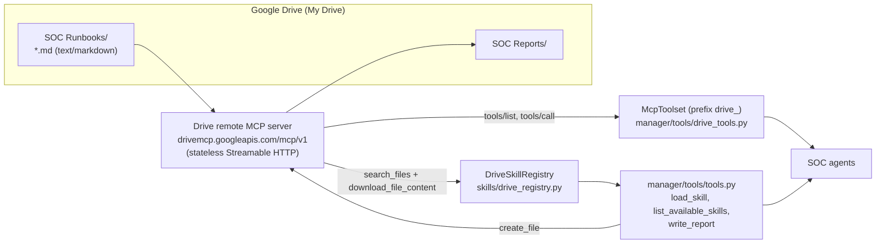

# Google Drive Runbooks via the Drive Remote MCP Server

**Source Branch:** `drive-mcp-runbooks`
**Target Branch:** `main`
**Reference:** [Configure the Drive MCP server](https://developers.google.com/workspace/drive/api/guides/configure-mcp-server)

---

## Executive Summary

The SOC runbooks are Markdown files. Until now the only place agents could
read them from was the checked-in `skills/` tree, which means every edit by an
analyst is a pull request. Google's Drive remote MCP server
(`https://drivemcp.googleapis.com/mcp/v1`) exposes Drive files as MCP tools, so
this branch makes Google Drive the source of truth for runbooks and a
destination for reports:

1. **Drive-backed skill registry** (`skills/drive_registry.py`). A
   `DriveSkillRegistry` lists one Drive folder for `text/markdown` files,
   downloads their exact bytes, parses the same YAML frontmatter the local
   registry uses and serves them to the existing `load_skill` and
   `list_available_skills` tools. Edits made in Drive are picked up on the next
   call after a short TTL without redeploying anything.
2. **Drive as an agent toolset** (`multi-agent/manager/tools/drive_tools.py`).
   An ADK `McpToolset` exposes `drive_search_files`, `drive_read_file_content`,
   `drive_download_file_content`, `drive_get_file_metadata` and
   `drive_create_file` to the agents.
3. **Report publishing**. `write_report` keeps writing to
   `multi-agent/reports/` and, when `DRIVE_REPORTS_FOLDER_ID` is set, also
   creates the report in Drive as a native Markdown file and returns its
   `viewUrl`.

Nothing changes for environments without Drive configured: the registry falls
back to the local `skills/` tree with a warning and the Drive toolset is simply
not added.

---

## 1. Architecture



Key design decisions:

| Decision | Why |
| --- | --- |
| Direct JSON-RPC `POST` per call, no `initialize` | The server is stateless (`StatelessServer ESF`), and ADK function tools such as `load_skill` are synchronous. A tiny synchronous `DriveMcpClient` (httpx) is simpler and faster than running an async MCP session per call. |
| `download_file_content` for runbooks, not `read_file_content` | `read_file_content` returns a verbalized rendering of the file; `download_file_content` returns the exact bytes (base64 in `content`), so frontmatter and fenced code survive. |
| `parentId = '<id>' and mimeType = 'text/markdown'` | The Drive MCP query grammar differs from Drive API v3 (`'<id>' in parents`). The fake server used in tests rejects the v3 form so a regression is caught. |
| `create_file` with `disableConversionToGoogleType: true` | Without it, text uploads are converted into Google Docs. |
| Bearer token injected through `httpx.Auth`, not static headers | ADK pools MCP sessions keyed by a hash of the connection headers. Putting a rotating ADC access token there would open a new session on every token refresh. |
| Cache invalidated by `modifiedTime` | The folder listing is cheap; re-downloading is done only for files whose `modifiedTime` changed, so a 60-second TTL costs one `search_files` call per minute at most. |
| Fail soft | A Drive refresh failure serves the last good catalog; a Drive publish failure keeps the local report and reports the error in the tool result. |

---

## 2. Configuration

All variables are read from the environment (the worktree's `direnv` setup
loads a git-ignored `.env`):

| Variable | Default | Purpose |
| --- | --- | --- |
| `RUNBOOK_SOURCE` | `drive` | `drive` serves runbooks from Drive; `local` uses the checked-in `skills/` tree. |
| `DRIVE_RUNBOOKS_FOLDER_ID` | unset | Drive folder that holds the `*.md` runbooks. Required for `RUNBOOK_SOURCE=drive`. |
| `DRIVE_REPORTS_FOLDER_ID` | unset | Drive folder that receives published reports. Enables dual-write in `write_report`. |
| `DRIVE_MCP_URL` | `https://drivemcp.googleapis.com/mcp/v1` | Endpoint; tests point it at an in-process fake. |
| `DRIVE_MCP_QUOTA_PROJECT` | `$GCP_PROJECT_ID` | Sent as `X-Goog-User-Project`; must have `drive.googleapis.com` and `drivemcp.googleapis.com` enabled. |
| `DRIVE_RUNBOOKS_CACHE_TTL_SECONDS` | `60` | How long the folder listing is trusted before re-listing. |
| `DRIVE_MCP_TOOLSET` | `1` | Set to `0` to keep the Drive tools away from agents (for example in evals). |
| `REPORTS_DIR` | `multi-agent/reports/` | Local report directory override. |

Authentication is gcloud Application Default Credentials with a Drive scope.
Inside the worktree:

```bash
ACCOUNT="admin@dandye.altostrat.com"
gcloud auth login "$ACCOUNT" --enable-gdrive-access --update-adc
```

### Access prerequisite

`tools/list` on the Drive MCP server is open, but `tools/call` is gated: the
calling GCP project must be enrolled in the Google Workspace Developer Preview
Program (or otherwise allowlisted). Until then every call returns
`The caller does not have permission`, the registry falls back to the local
`skills/` tree, and `write_report` reports a `drive_error`. Seeding Drive with
the REST API (below) is not gated.

---

## 3. Seeding Drive

`scripts/seed_drive_runbooks.py` uses the Drive REST API v3 (not the MCP
server) to create `SOC Runbooks` and `SOC Reports` in My Drive and upload every
local `skills/**/SKILL.md` as `<skill-name>.md` with the `text/markdown` MIME
type. The layout is flat because the registry lists direct children only; the
category lives in each file's frontmatter. The script seeds the 62 local
`skills/**/SKILL.md` packages into `SOC Runbooks`, which holds 63 `.md` runbooks
in the live Argolis tenant (the 62 seeded skills plus 1 staged runbook artifact).

```bash
python scripts/seed_drive_runbooks.py --dry-run      # show what would change
python scripts/seed_drive_runbooks.py --write-env    # create, upload, record ids in .env
python scripts/seed_drive_runbooks.py --update       # push local edits over drifted files
```

Unchanged files are detected by `md5Checksum`; drifted files are skipped unless
`--update` is passed.

---

## 4. Verification

`scripts/drive_mcp_smoke_test.py` exercises the live server with the official
`mcp` client: token scopes, `tools/list`, `search_files`, both read tools, and
an optional `create_file` probe.

The unit tests do not need network access or credentials. `tests/fake_drive_mcp.py`
runs the real `mcp` FastMCP server in stateless Streamable HTTP mode behind
uvicorn with the exact Drive tool contracts, so the production client path
(JSON and SSE responses, pagination, base64 decoding, `isError` handling) and
the ADK `McpToolset` (bearer injection visible server-side, `tools/list`,
`tools/call`) are tested end to end:

```bash
python -m pytest tests/test_drive_registry.py tests/test_drive_publish.py tests/test_seed_drive_runbooks.py
```

| Test file | Covers |
| --- | --- |
| `tests/test_drive_registry.py` | JSON-RPC parsing (JSON, batch, SSE), header injection, exact Markdown round-trip, grammar guard, permission-denied surfacing, pagination, TTL refresh that re-downloads only changed files, cached catalog on refresh failure. |
| `tests/test_drive_publish.py` | `RUNBOOK_SOURCE` selection and fallbacks, `httpx.Auth` token rotation, ADK `McpToolset` listing and calling tools through the fake, `write_report` dual-write and failure semantics. |
| `tests/test_seed_drive_runbooks.py` | Multipart `text/markdown` upload shape, idempotent folder creation, md5-based create/skip/update, `.env` writing. |

---

## 5. Grounded Google Docs review and Markdown sync

The stacked branch `drive-mcp-runbooks__grounded-docs` extends Drive runbooks with collaborative review in Google Docs. It introduces Google Docs API v1 non-destructive review via `multi-agent/manager/tools/docs_review_tools.py`, dual-source external grounding via `multi-agent/manager/tools/grounding_tools.py`, and the automated graph workflow in `multi-agent/manager/workflows/grounded_soar_review_workflow.py`.

The system reads Google Docs AST nodes, anchors non-destructive comments, and stages suggested edits back-to-front by UTF-16 start offset under `writeMode="SUGGEST"`. Lossless AST-to-Markdown export via `export_accepted_doc_to_markdown` reconstructs headings, tables, frontmatter, and code blocks. Before changes sync back to Markdown runbooks or close active SOAR cases, `verify_post_accept_secops_doc_readiness` gates promotion.

Run the full 275-test test suite across all subsystems:

```bash
direnv exec . env RUNBOOK_SOURCE=local .venv/bin/python -m pytest tests/ -q
```

