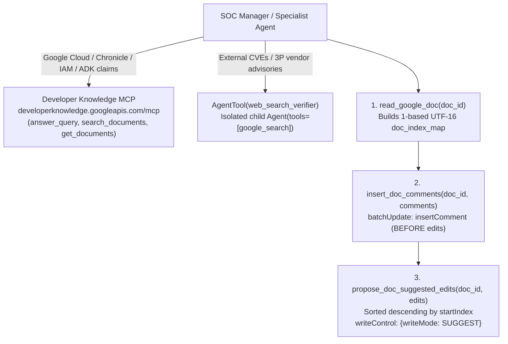

# Grounded Google Docs Runbook & Report Review

**Source Branch:** `drive-mcp-runbooks__grounded-docs` (stacked on `drive-mcp-runbooks`)
**References:**
- Romin Irani, *Building an AI Document Reviewer with Google ADK, Gemini and the New Google Docs Comments & Suggested Edits API* (Oct 2026)
- Romin Irani, *Grounding Google Docs Suggested Edits with Developer Knowledge MCP and Google Search* (Oct 2026)

---

## Executive Summary

On the `drive-mcp-runbooks` branch, SOC runbooks and incident reports live in Google Drive as `text/markdown` files served via `https://drivemcp.googleapis.com/mcp/v1`. Because in-place blob revision uploads (`upload_file_revision`) are gated behind `WORKSPACE_MCP_INTERNAL`, modifying existing runbooks or collaboratively reviewing incident reports requires a human-in-the-loop review surface.

This branch adds two complementary capabilities from Irani (2026):

1. **Two-Source External Grounding (`multi-agent/manager/tools/grounding_tools.py`)**:
   - **Google Developer Knowledge Remote MCP Server** (`https://developerknowledge.googleapis.com/mcp`, tools prefixed `devknowledge_`): Exposes `answer_query`, `search_documents`, and `get_documents` across official Google documentation (Google Cloud, Chronicle SIEM/SOAR, IAM, Vertex AI, Gemini, ADK).
   - **Isolated Web Search Sub-Agent (`AgentTool(web_search_verifier)`)**: Wraps a dedicated child `Agent(name="web_search_verifier", tools=[google_search])` inside `AgentTool` so the root `manager` and specialist sub-agents can invoke Google Search Grounding alongside custom `FunctionTool`s and `McpToolset`s without triggering Gemini's single-tool constraint.

2. **Google Docs API v1 Non-Destructive Review Tools (`multi-agent/manager/tools/docs_review_tools.py`)**:
   - `create_google_doc`: Creates a native collaborative Google Doc (`application/vnd.google-apps.document`) in `DRIVE_REPORTS_FOLDER_ID` or `DRIVE_RUNBOOKS_FOLDER_ID`.
   - `read_google_doc`: Reads a Google Doc via `GET https://docs.googleapis.com/v1/documents/{id}?includeTabsContent=true` and maps every character across paragraphs and table cells to its 1-based UTF-16 index.
   - `insert_doc_comments`: Anchors native Google Docs comments (`insertComment`) with rationale and canonical citation URLs to the pre-edit index spans.
   - `propose_doc_suggested_edits`: Validates non-overlapping spans, sorts replacements **descending by `startIndex`** (back-to-front) so earlier edits never shift subsequent UTF-16 character offsets, and submits `deleteContentRange` + `insertText` under `"writeControl": {"writeMode": "SUGGEST"}`.

---

## 1. Architecture & Ordering Invariants



### Key Implementation Nuances

| Mechanism | Why It Matters |
| --- | --- |
| **Static headers + `httpx.Auth` on `StreamableHTTPConnectionParams`** | During A2A Agent Card startup, ADK calls `McpToolset.get_tools(readonly_context=None)`. `header_provider` is skipped when `readonly_context` is `None`, and in ADK 2.7.1 `mcp_tool.py:L434` dereferences `tool_context._invocation_context` whenever `header_provider` is non-null. Putting `X-Goog-User-Project` / `X-Goog-Api-Key` in static headers and injecting rotating OAuth tokens via `BearerTokenAuth` works across both startup (`readonly_context=None`) and direct `run_async(tool_context=None)` calls. |
| **`AgentTool(web_search_verifier)`** | Gemini's built-in `google_search` tool cannot sit in the same `tools=[...]` array as custom `FunctionTool`s or `McpToolset`s. Wrapping a single-tool child agent in `AgentTool` exposes web search as a standard function call. |
| **Dual-Identity Token Resolution (`resolve_docs_token`)** | Prefers `tool_context.state["user_access_token"]` (end-user OAuth 2.0 token) so comments and suggested edits carry the human analyst's identity, falling back to the worktree's `AdcTokenSource` for CLI/headless execution. |
| **Comments Before Edits + Back-to-Front Sorting** | `insert_doc_comments` and `propose_doc_suggested_edits` both resolve quotes against the pre-edit `doc_index_map` from `read_google_doc`. Inserting comments first and sorting `deleteContentRange` + `insertText` descending by `startIndex` (`reverse=True`) guarantees UTF-16 offsets never drift mid-batch. |

---

## 2. Configuration

| Variable | Default | Purpose |
| --- | --- | --- |
| `DEVELOPERKNOWLEDGE_MCP_URL` | `https://developerknowledge.googleapis.com/mcp` | Developer Knowledge Remote MCP endpoint. |
| `DEVELOPERKNOWLEDGE_API_KEY` | unset | Optional API key sent as `X-Goog-Api-Key` (falls back to ADC bearer token when unset). |
| `DEVELOPERKNOWLEDGE_QUOTA_PROJECT` | `$GCP_PROJECT_ID` | Sent as `X-Goog-User-Project`; requires `developerknowledge.googleapis.com` enabled. |
| `DEVELOPERKNOWLEDGE_MCP_TOOLSET` | `1` | Set to `0` to disable the Developer Knowledge toolset. |
| `WEB_SEARCH_VERIFIER_MODEL` | `gemini-3-flash-preview` | Model used by the isolated `web_search_verifier` child agent. |

---

## 3. Master 6-pillar cross-horizon architecture (`H1` through `H30`, Cycles 1 to 29)

Across 29 autonomous evolution cycles (`H1` through `H30`), the Grounded Google Docs SecOps reviewer unifies 35+ specialized verification, attribution, readiness, routing, and remediation tools. The `H28_CAPABILITY_PILLAR_CATALOG` defines the 5 weighted readiness scoring pillars (`pillar_count = 5`, weights summing to 100.0). The `H30_CAPSTONE_PRODUCTION_GOVERNANCE_AND_KEV_EXPOSURE_CATALOG` defines the 6th capstone production governance pillar (`CAPSTONE_PRODUCTION_GOVERNANCE_AND_EXPOSURE`), whose 5 defect classes map into those 5 scored pillars during `synthesize_master_secops_doc_readiness` and `verify_post_accept_secops_doc_readiness`. Orchestration runs through `synthesize_master_secops_doc_readiness`, `audit_master_secops_doc_readiness_in_doc`, `audit_capstone_production_governance_and_kev_exposure_in_doc`, and `verify_post_accept_secops_doc_readiness`:

| Pillar ID | Capability Pillar | Horizons Covered | Primary Verifiers & Guardrails |
| :--- | :--- | :--- | :--- |
| `UDM_YL2_AND_ENTITY_GRAPH` | Chronicle SIEM UDM, YARA-L 2.0 (`YL2`), Entity Graph `$g.graph.*` Joins & Data Table Exports (`%<table>.write_row`) | `H1`, `H2`, `H13`, `H14` to `H19`, `H22`, `H26`, `H27`, `H29` | UDM field/enum/operator syntax, zero-hit single-clause ablation, YARA-L 2.0 (`YL2`, strictly separated from standard file and payload YARA `strings:` rules) compiler and `outcome:` max-1-agg gates, sliding windows (`over <W> after/before $<ev>`), Entity Graph `$g.graph.entity.*` and `$g.graph.metadata.entity_type` joins and criticality `$risk_score` scaling, and Data Table `export: %ioc_threat_actor_attributions.write_row(...)` scalar `match:` binding, `keyColumn: true` verification, and `VerdictInfo` (`confidence_score`, `malicious_count`) validation. |
| `TELEMETRY_CREDENTIAL_AND_SOAR_SAFETY` | Telemetry Hygiene, Leaked Credentials, Alert Streaming & SOAR/Siemplify Actuation Safety | `H3`, `H6`, `H10`, `H13`, `H26`, `H27`, `H29`, `H30` | Untrusted URL defanging (`hxxps://`), Base64 and MiniDump payload sanitization, safe JWT claim decoding and live SIEM credential blast-radius triage, shell `export VAR="..."` enforcement, SOAR containment pre-flight blast-radius and rollback gates, Siemplify SOAR `/api/1p/external/v1/cases` vs. unmigrated native Chronicle `v1alpha/.../cases` endpoint routing (`secops-demo-env`), instance-root `:verifyRuleText` vs. invalid `/rules:verifyRuleText`, `legacy:legacyFetchAlertsView` final-chunk (`progress == 1`, `complete == True`) alert deduplication, and Spanner `/span/global/` vs. invalid `/span/prod/` path verification. |
| `MITRE_CVE_WAVED_AND_GTI_ATTRIBUTION` | MITRE ATT&CK v16.1, CVE/KEV, 4-Layer WAVED Ontology, GTI Attribution & STIX 2.1 Sightings | `H4`, `H11`, `H21`, `H23`, `H29`, `H30` | MITRE ATT&CK technique and sub-technique grounding, CISA KEV CVE verification, 4-layer WAVED (`Weakness CWE -> Vulnerability CVE -> Exploit ATT&CK -> Defense D3FEND`) ontology chain verification, live GTI (`gti-mcp`) IoC reputation and threat-actor/malware attribution (`RFC-5737`, `8.8.8.8`, and 0-byte SHA-256 false-positive block prevention), and STIX 2.1 (`spec_version="2.1"`) Sightings bundle validation (`sighting_of_ref`, `where_sighted_refs` from `detection.collection_elements.references.entity.metadata.threat.associations`). |
| `CAMPAIGN_TIMELINE_AND_TDO_COVERAGE` | Cross-Case Campaign Correlation & Threat Detection Opportunity (TDO) Synthesis | `H5`, `H8`, `H20` | Multi-case campaign graph correlation (`CAMP-GCP-CONTROL-PLANE-33278`, `CAMP-WORKSPACE-SUPERADMIN-TAKEOVER`, `CAMP-WINS-D19-ENDPOINT`), claim-to-evidence grounding, and TDO coverage gap matrix with compiler-verified YARA-L 2.0 (`YL2`) rule synthesis. |
| `WIKISKILL_RRSI_ORCHESTRA_AND_SKILLRL` | WikiSkill/RRSI Promotion Gate, SkillOrchestra Routing, SkillRL Guardrails & Counterfactual Post-Accept Sign-Off | `H7`, `H20`, `H24`, `H25`, `H28`, `H29`, `H30` | `WikiSkill` and `RRSI` IoC parameterization and $L_1$ churn / noise-floor promotion gate (`skill-impact.md`), `SkillOrchestra` Stage A/B competence-cost routing and `SkillToolset` MCP schema filtering (`-68.94%`), `LocalGoogleDocsSimulator` Kix AST parity, 10-rule `SkillRL` failure-trajectory distillation (`SKILLRL-01` through `SKILLRL-10`), and counterfactual post-accept 6-pillar readiness sign-off (`verify_post_accept_secops_doc_readiness`: `BLOCKED_CRITICAL_DEFECTS` to `APPROVED_FOR_SOC_EXECUTION`). |
| `CAPSTONE_PRODUCTION_GOVERNANCE_AND_EXPOSURE` | CISA KEV Inventory-First Exposure Gate, Native Dashboards Threat Paths, SOAR Content Hub Packaging, Hillclimber Governance & OpenTelemetry/mTLS Resilience | `H29`, `H30` | Epistemic inventory-first CISA KEV exposure verification (`check_scc_findings` + `search_cloud_asset_inventory` before `search_chronicle_udm`), Chronicle Native Dashboards `RULE_DETECTIONS` `detection.collection_elements.references.entity.metadata.threat.associations` path verification, SOAR Content Hub Python 3.11 `Dependencies/` packaging, `< 10 MiB` Envoy limit, and `*` (`All Environments`) teardown checks, `validate_compiled_prompt()` hillclimber anti-memorization and `2-sigma` noise-floor gates, and OpenTelemetry `32768` attribute truncation + Cloudtop mTLS `GOOGLE_API_USE_CLIENT_CERTIFICATE=false` crash prevention. |

### Master 16-scenario verification benchmark suite (`evaluate_verification_benchmark_suite`)

Running `evaluate_verification_benchmark_suite(include_extended_night2=True)` (or `generate_master_evolution_synthesis_report()`) evaluates all 16 scenarios (`BENCH-01` through `BENCH-16`) hermetically against `LocalGoogleDocsSimulator` (`0` Google Drive write calls):

- **Scenarios Evaluated:** `16` (`BENCH-01`..`BENCH-06` Night 1 Core + `BENCH-07` WAVED + `BENCH-08` YL2 Sliding Window + `BENCH-09` GTI IoC Attribution + `BENCH-10` SkillOrchestra + `BENCH-11` SkillRL + `BENCH-12` YL2 Entity Graph + `BENCH-13` SOAR Actuation Safety + `BENCH-14` Master Composite Synthesis + `BENCH-15` YL2 Data Table Export, `:verifyRuleText`/`legacy:legacyFetchAlertsView` & STIX 2.1 Sightings + `BENCH-16` Capstone CISA KEV Inventory-First Gate, Native Dashboards `RULE_DETECTIONS` Threat Path, SOAR Content Hub Packaging, Hillclimber Anti-Memorization & OpenTelemetry/mTLS Resilience)
- **Seeded Defects Detected (TP):** `83 / 83` (`FP = 0`, `FN = 0`)
- **Negative Controls Preserved (TN):** `33 / 33` (including standard file and payload YARA `strings:` rules, valid Siemplify `/api/1p/external/v1/cases` endpoints, `/span/global/` Spanner paths, valid `$g.graph.entity.*` joins, valid `%ioc_threat_actor_attributions.write_row` + STIX 2.1 Sightings blocks, and valid inventory-first CISA KEV + Native Dashboards + SOAR Content Hub + OpenTelemetry/mTLS blocks)
- **Micro Precision / Recall / F1:** `1.0000 / 1.0000 / 1.0000`
- **Pass-2 Idempotency Rate:** `1.0000` (`0` duplicate edits on second pass)
- **SkillRL Failure-Distillation Rules (`SKILLRL-01`..`SKILLRL-10`):** `10` rules across `H25`, `H26`, `H27`, `H28`, `H29` (`SKILLRL-09-YARAL2-DATA-TABLE-EXPORT-AND-ALERT-STREAM-SAFETY`), and `H30` (`SKILLRL-10-CAPSTONE-PRODUCTION-GOVERNANCE-GATE`).

---

## 4. Verification

Run the hermetic unit test suite (275 passed tests across `tests/`, including 174 in `tests/test_docs_review_tools.py`, 8 in `tests/test_grounding_tools.py`, 26 in `tests/test_drive_registry.py`, 17 in `tests/test_drive_publish.py`, and 6 in `tests/test_seed_drive_runbooks.py`):

```bash
direnv exec . env RUNBOOK_SOURCE=local .venv/bin/python -m pytest tests/ -q
```

The following reports record the detailed verification outputs and machine-readable execution metrics:
- [Cycle 28 YARA-L 2.0 Export and Post-Accept Verification Report](./cycle28_yaral2_export_and_post_accept_verification_report.json)
- [Cycle 29 H30 Capstone Governance Verification Report](./cycle29_h30_capstone_governance_verification_report.json)

