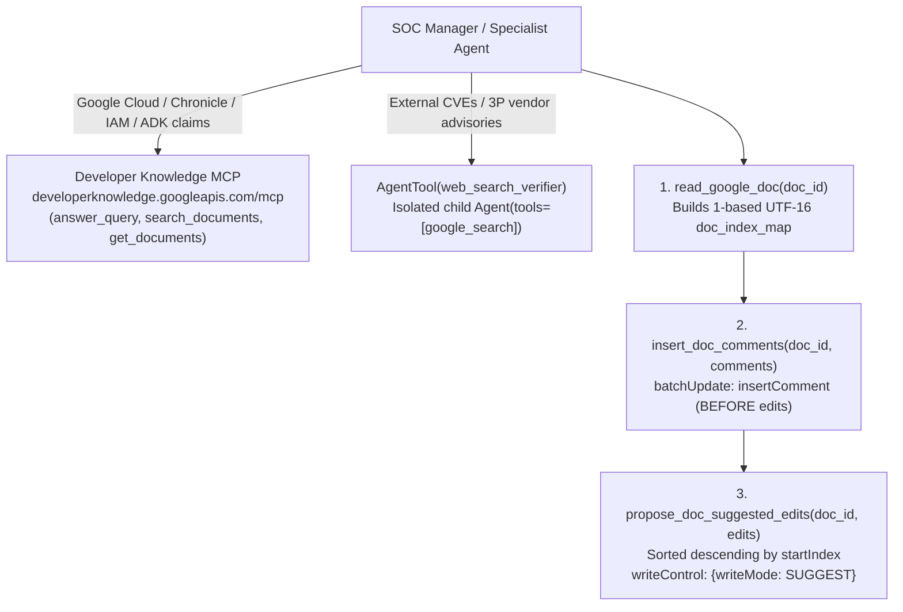

# Grounded Google Docs Runbook & Report Review

**Source Branch:** `drive-mcp-runbooks__grounded-docs` (stacked on `drive-mcp-runbooks`)
**References:**
- Romin Irani, *Building an AI Document Reviewer with Google ADK, Gemini and the New Google Docs Comments & Suggested Edits API* (Oct 2026)
- Romin Irani, *Grounding Google Docs Suggested Edits with Developer Knowledge MCP and Google Search* (Oct 2026)

---

## Executive Summary

On the `drive-mcp-runbooks` branch, SOC runbooks and incident reports live in Google Drive as `text/markdown` files served via `https://drivemcp.googleapis.com/mcp/v1`. Because in-place blob revision uploads (`upload_file_revision`) are gated behind `WORKSPACE_MCP_INTERNAL`, modifying existing runbooks or collaboratively reviewing incident reports requires a human-in-the-loop review surface.

This branch adds two complementary capabilities from Irani (2026):

1. **Two-Source External Grounding (`multi-agent/manager/tools/grounding_tools.py`)**:
   - **Google Developer Knowledge Remote MCP Server** (`https://developerknowledge.googleapis.com/mcp`, tools prefixed `devknowledge_`): Exposes `answer_query`, `search_documents`, and `get_documents` across official Google documentation (Google Cloud, Chronicle SIEM/SOAR, IAM, Vertex AI, Gemini, ADK).
   - **Isolated Web Search Sub-Agent (`AgentTool(web_search_verifier)`)**: Wraps a dedicated child `Agent(name="web_search_verifier", tools=[google_search])` inside `AgentTool` so the root `manager` and specialist sub-agents can invoke Google Search Grounding alongside custom `FunctionTool`s and `McpToolset`s without triggering Gemini's single-tool constraint.

2. **Google Docs API v1 Non-Destructive Review Tools (`multi-agent/manager/tools/docs_review_tools.py`)**:
   - `create_google_doc`: Creates a native collaborative Google Doc (`application/vnd.google-apps.document`) in `DRIVE_REPORTS_FOLDER_ID` or `DRIVE_RUNBOOKS_FOLDER_ID`.
   - `read_google_doc`: Reads a Google Doc via `GET https://docs.googleapis.com/v1/documents/{id}?includeTabsContent=true` and maps every character across paragraphs and table cells to its 1-based UTF-16 index.
   - `insert_doc_comments`: Anchors native Google Docs comments (`insertComment`) with rationale and canonical citation URLs to the pre-edit index spans.
   - `propose_doc_suggested_edits`: Validates non-overlapping spans, sorts replacements **descending by `startIndex`** (back-to-front) so earlier edits never shift subsequent UTF-16 character offsets, and submits `deleteContentRange` + `insertText` under `"writeControl": {"writeMode": "SUGGEST"}`.

---

## 1. Architecture & Ordering Invariants



### Key Implementation Nuances

| Mechanism | Why It Matters |
| --- | --- |
| **Static headers + `httpx.Auth` on `StreamableHTTPConnectionParams`** | During A2A Agent Card startup, ADK calls `McpToolset.get_tools(readonly_context=None)`. `header_provider` is skipped when `readonly_context` is `None`, and in ADK 2.7.1 `mcp_tool.py:L434` dereferences `tool_context._invocation_context` whenever `header_provider` is non-null. Putting `X-Goog-User-Project` / `X-Goog-Api-Key` in static headers and injecting rotating OAuth tokens via `BearerTokenAuth` works across both startup (`readonly_context=None`) and direct `run_async(tool_context=None)` calls. |
| **`AgentTool(web_search_verifier)`** | Gemini's built-in `google_search` tool cannot sit in the same `tools=[...]` array as custom `FunctionTool`s or `McpToolset`s. Wrapping a single-tool child agent in `AgentTool` exposes web search as a standard function call. |
| **Dual-Identity Token Resolution (`resolve_docs_token`)** | Prefers `tool_context.state["user_access_token"]` (end-user OAuth 2.0 token) so comments and suggested edits carry the human analyst's identity, falling back to the worktree's `AdcTokenSource` for CLI/headless execution. |
| **Comments Before Edits + Back-to-Front Sorting** | `insert_doc_comments` and `propose_doc_suggested_edits` both resolve quotes against the pre-edit `doc_index_map` from `read_google_doc`. Inserting comments first and sorting `deleteContentRange` + `insertText` descending by `startIndex` (`reverse=True`) guarantees UTF-16 offsets never drift mid-batch. |

---

## 2. Configuration

| Variable | Default | Purpose |
| --- | --- | --- |
| `DEVELOPERKNOWLEDGE_MCP_URL` | `https://developerknowledge.googleapis.com/mcp` | Developer Knowledge Remote MCP endpoint. |
| `DEVELOPERKNOWLEDGE_API_KEY` | unset | Optional API key sent as `X-Goog-Api-Key` (falls back to ADC bearer token when unset). |
| `DEVELOPERKNOWLEDGE_QUOTA_PROJECT` | `$GCP_PROJECT_ID` | Sent as `X-Goog-User-Project`; requires `developerknowledge.googleapis.com` enabled. |
| `DEVELOPERKNOWLEDGE_MCP_TOOLSET` | `1` | Set to `0` to disable the Developer Knowledge toolset. |
| `WEB_SEARCH_VERIFIER_MODEL` | `gemini-2.5-flash` | Model used by the isolated `web_search_verifier` child agent. |

---

## 3. Verification

Run the hermetic unit test suite (110 tests across Drive MCP, Developer Knowledge MCP, `AgentTool(web_search_verifier)`, and Google Docs API v1 review tools):

```bash
direnv exec . .venv/bin/python -m pytest tests/
```
