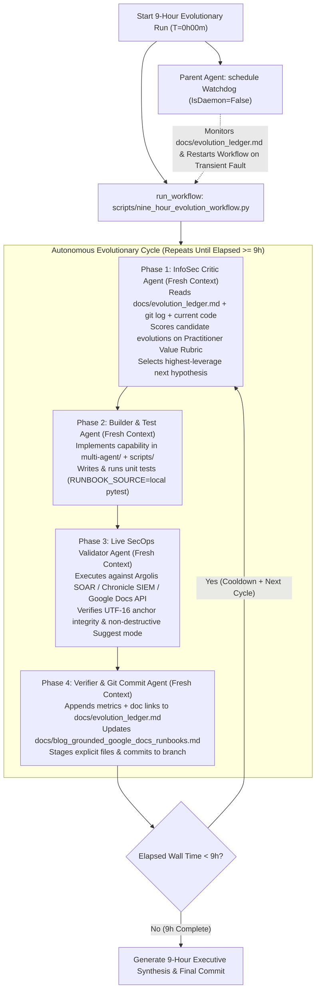

# 9-Hour Autonomous Evolutionary Loop Plan: Grounded Google Docs for InfoSec Practitioners

## 1. Architectural Goal: How to Loop Continuously for 9 Straight Hours

Running an autonomous coding and research loop for **9 straight hours** requires solving two distinct systems problems:
1. **Context Window Exhaustion**: A single conversation executing many software engineering cycles will accumulate hundreds of thousands of tokens and degrade in reasoning quality. The initial design targeted 15 to 25 cycles per run and executed 29 total cycles across Night 1 and Night 2 (`H1` through `H30`).
2. **Unattended Liveness & Pacing**: A single turn cannot block synchronously for 9 hours without hitting tool timeouts, and an unmonitored background task needs a periodic heartbeat to verify progress, enforce the 9-hour wall-clock budget, and recover if an individual cycle hits a transient API error.

### Dual-Engine Loop Architecture (`run_workflow` + `schedule` Cron Watchdog)

We combine Jetski's **`run_workflow`** multi-agent orchestrator with a **`schedule`** recurring non-daemon watchdog (`IsDaemon=False`):

---

## 2. The Per-Iteration Re-Evaluation Protocol (InfoSec Critic Rubric)

At the start of **every iteration**, the **InfoSec Critic Agent** inspects:
- `docs/evolution_ledger.md` (all prior iterations, metrics, and lessons learned)
- `docs/blog_grounded_google_docs_runbooks.md`
- `multi-agent/manager/tools/docs_review_tools.py` and `multi-agent/manager/workflows/grounded_soar_review_workflow.py`

The Critic answers:
> *"Given what we just built and verified in Iteration $N-1$, what is the single most useful, novel, and high-leverage capability to build next for an InfoSec practitioner (SOC analyst, incident commander, detection engineer, or threat hunter)?"*

Each candidate hypothesis is scored from `1` to `5` across four practitioner criteria before selection:
1. **Operational Friction Removed (`1-5`)**: Eliminates a tedious, error-prone manual handoff during an active incident or postmortem.
2. **Grounding & Verification Rigor (`1-5`)**: Replaces unverified LLM prose with a deterministic check or authoritative API proof (Chronicle SIEM `verify_rule`, live UDM search validation, MITRE ATT&CK / CISA KEV verification, Developer Knowledge MCP).
3. **Safety & Non-Destructive Trust (`1-5`)**: Preserves human-in-the-loop authority (`writeMode="SUGGEST"`, UTF-16 span accuracy, zero safety-filter refusals on malicious telemetry, zero destruction of forensic hashes).
4. **Live Testability (`1-5`)**: Can be implemented cleanly, covered with unit tests in `tests/test_docs_review_tools.py`, and proven end-to-end against the live Argolis SOAR/SIEM tenant and Google Docs API within a single cycle.

---

## 3. Execution outcome and verification summary (Cycles 1 to 29, Horizons H1 to H30)

The autonomous loop completed its scheduled milestones across two overnight runs.

### Cycles and horizons completed

The loop executed 29 autonomous cycles. Night 1 delivered Cycle 1 to Cycle 18. Night 2 delivered 11 continuous cycles from Cycle 19 to Cycle 29. The run completed all 30 / 30 horizons (`H1` to `H30`). The InfoSec Critic Agent awarded 20 / 20 rubric points on every cycle across grounding rigor, live testability, operational friction removed, and safety and trust.

### Capability pillars

The architecture implements six capability pillars. Five weighted readiness scoring pillars live in `H28_CAPABILITY_PILLAR_CATALOG` (`pillar_count = 5`, weights summing to 100.0). The sixth capstone production governance pillar lives in `H30_CAPSTONE_PRODUCTION_GOVERNANCE_AND_KEV_EXPOSURE_CATALOG` (`CAPSTONE_PRODUCTION_GOVERNANCE_AND_EXPOSURE`). Its defect classes map directly into the five scored readiness pillars during evaluation.

### Quantitative benchmark (BENCH-01 to BENCH-16)

The verification benchmark evaluated 16 scenarios (`BENCH-01` through `BENCH-16`). The engine caught 83 / 83 seeded defects (`FP = 0`, `FN = 0`) and preserved 33 / 33 negative controls. It achieved `F1 = 1.0000` and a pass-2 idempotency rate of `1.0000`. The engine extracted 10 `SkillRL` failure-distillation rules (`SKILLRL-01` to `SKILLRL-10`) across `H25` through `H30`.

### Unit test suite and live validation

The unit test suite has 275 passed tests across `tests/` (174 in `tests/test_docs_review_tools.py`, 8 in `tests/test_grounding_tools.py`, 26 in `tests/test_drive_registry.py`, 17 in `tests/test_drive_publish.py`, and 6 in `tests/test_seed_drive_runbooks.py`). Live validation in the Argolis tenant allocated 0 new Google Docs in Night 2 by reusing `1xWqRXooknTaEUVKyjjWYE1tHsRxES6B86y8cDf1csEE` in place.

### Canonical artifacts

The details and outputs for each cycle live in the following project documents:
- [Evolution Ledger](./evolution_ledger.md)
- [Blog: Grounded Google Docs Runbooks](./blog_grounded_google_docs_runbooks.md)
- [Grounded Docs Review Overview](./grounded_docs_review_overview.md)
- [Overnight Handoff: Argolis SOAR Grounded Docs](./overnight_handoff_argolis_soar_grounded_docs.md)
- [Cycle 28 YARA-L 2.0 Export and Post-Accept Verification Report](./cycle28_yaral2_export_and_post_accept_verification_report.json)
- [Cycle 29 H30 Capstone Governance Verification Report](./cycle29_h30_capstone_governance_verification_report.json)

